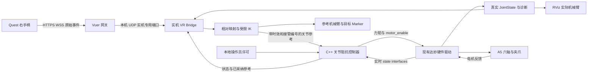

# A5 机械臂 VR 实机接入方案

> 2026-10-08 用户调整：使用电机原生 `pos_vel` 位置控制，不使用重力补偿或阻抗力矩。已实现独立位置插件与启动入口；用户随后明确选择末端平移、旋转和夹爪完整控制，对应 `motion_range:=full`。原受限六轴实机保持 15 秒通过；完整七电机保持的静止速度指标尚未通过，真实 Quest 已接入并进入过 TELEOP，动态连续性仍在调试。当前命令与实测证据见 [实机使用说明](VR_REAL_ROBOT_USAGE.md)。以下原方案作为力控路线历史保留。

> 最新简化：用户要求参考 Piper 后，full 原生位控关闭 CAD 网格碰撞硬检查，移除其折叠 ±2° 活动范围门槛；IK 数值失败保持当前参考并在下一帧重试。仍保留行程、速度、通信和电机故障停止，不提供自动自碰/环境避障。trial/阻抗保留原几何检查，不能把下文的几何要求当作当前 full 已启用或已实测的能力。详见 [Piper 对比](../参考方案/VR_PIPER_CONTROL_COMPARISON.md)。


日期：2026-10-08。状态：按方案实施中。消息、外部参考控制器、VR Bridge、只读/mock/commission/execute 入口已经实现；支撑下 15 秒保持与软件失能复测通过，见 [使用说明](VR_REAL_ROBOT_USAGE.md)。常规 execute 仍需完整验收；用户明确要求先实机跟随后排查问题后，新增显式 operator_trial 受限跟随入口，保留运行时保护并如实记录未完成项。

建议采用 **Quest 右手柄 → 相对末端目标 → A5 IK → 受限关节参考 → 现有关节阻抗控制器 → 达妙力矩命令**。优先让六轴在小范围、低速度下跟随，夹爪开合单独进入后续验收。实机启动和每次重抓均以真实反馈为参考，不要求机械臂走到虚拟演示的初始姿态。

与虚拟方案相比，核心改动是为 C++ 控制器增加可撤销的外部参考输入，并让它在 VR 或 Python 进程停止后仍能独立停止跟随、保持机械臂。实机 VR 使用独立参数文件，原固定目标模式仍为默认行为。

## 1 当前基础和需要补齐的能力

| 当前实现 | 对实机接入的含义 |
| --- | --- |
| [VR 输入与状态机](../../../src/a6_y_vr_teleop/a6_y_vr_teleop/virtual_arm.py)已有会话、握把计数、时效检查和相对位姿映射 | 可复用输入语义与几何计算；其中的虚拟 q 更新和冻结不能充当真实机械臂反馈或停止策略 |
| [A5 运动学](../../../src/a6_y_vr_teleop/a6_y_vr_teleop/a5_kinematics.py)使用原生 URDF、mimic 和七个独立坐标 | 可复用 FK、雅可比及六轴差分 IK；实机还需限制目标领先实际位置的距离 |
| [关节阻抗控制器](../../../src/a6_y_controllers/src/A6_y_joint_impedance_controller.cpp)在首次有效 update 中捕获固定 `target_` | 需要新增外部参考模式、许可与超时状态机；目前没有可以直接发布的运行中目标话题 |
| [硬件配置](../../../src/a6_y_controllers/config/a5.urdf.xacro)使用 MIT，电机侧 `Kp=Kd=0` | 当前运动主要由 effort 决定；只把 IK 结果写入 position 字段不会建立位置跟踪 |
| 控制器向 position 写真实 q、velocity 写 0，并给七个关节写 motor_enable | 六轴目标应进入阻抗计算，驱动仍完成原有坐标转换与力矩发送；第一阶段夹爪沿用零力行为 |
| 三份控制器 YAML 当前均为 125 Hz | 新实机入口先沿用 125 Hz；旧 README、部分控制说明中的 50 Hz 不能作为当前配置依据 |
| [60 秒真机被动测量](../../../validation/live_frequency_20261008/033513_utc/report.json)约 125 Hz；[虚拟集成测试](../../../validation/vr_rviz/integration_check.json)约 124.998 Hz | 前者没有移动目标和完整执行耗时测量，后者没有真实电机；都不证明 VR 实机闭环已通过验证 |

以下问题在实机执行前需要落实到记录和配置，而不是在新代码中自动忽略：

1. **基座/关节方向采用用户确认，零点/比例测试按要求跳过。** 用户于 2026-10-08 确认基座 Z 轴竖直向上、关节对应及正负方向正确，并要求不进行零点和角度比例测试。[a5_calibration.yaml](../../../src/a6_y_controllers/config/a5_calibration.yaml) 分别记录 `operator_confirmed` 与 `skipped_by_user`，这部分不再阻塞预检。TCP 和夹爪行程检查仍为 pending。
2. **J3 总力矩限值已确认。** 用户于 2026-10-08 明确核定为 20 N·m，运动限制、重力配置与新 VR profile 已统一；此确认不代替其余标定和保持/停止试验。
3. **历史测量与当前参数并非同一快照。** 被动测量时 J6 刚度是 5.2 N·m/rad，当前 YAML 是 15.2 N·m/rad；旧测试结论不能直接覆盖当前组合。
4. **历史零位反馈已纳入用户指定容差。** 上述被动记录中 J2 约 −0.00477 rad，第一手指约 +0.00039 m；两者已处于用户要求的 ±2° 零位容差内（夹爪按电机端角度换算）。原始反馈保留，零点和比例采样按用户要求跳过。夹爪张开侧 −40.77 mm 与 −30 mm 运行下限的差异仍需单独处理。
5. **实机输入链路尚未验收。** 已有报告标记 `actual_quest_tested=false`。包括佩戴检测、静止握持、挂脖使用等实际姿态下的追踪连续性，都需要在只读阶段记录确认。

## 2 路线选择

| 路线 | 变化与适用性 | 本阶段决定 |
| --- | --- | --- |
| IK 输出关节参考，现有关节阻抗跟踪 | 延续用户已调试的关节控制与有界力矩求解，容易逐关节验收 | **首选** |
| 末端目标直接进入笛卡尔阻抗 | 也需新增动态目标、许可、失联处理；末端刚度、奇异性与实际跟踪需单独调试 | 后续可用相同 VR 输入替换控制路线 |
| 改为电机位置模式或给电机 MIT Kp/Kd 非零值 | 改变当前力矩控制行为、调参依据和失效方式 | 本阶段不采用 |

保留 `A6YJointImpedanceController`，增加 `reference_mode: captured | external_vr`，默认 `captured` 保持原行为。实机 VR 使用独立 YAML 和 launch 选择 `external_vr`。不复制整份阻抗控制器，也不在接管时临时改变电机控制模式。

外部参考模式仍是移动平衡点的关节阻抗：概念上为 `G(q) + K(q_ref-q) - D*dq`，实际沿用已有惯量相关的有界隐式求解。首版不增加期望加速度前馈，也不直接将阻尼项改成速度跟踪项；允许存在可测的跟踪误差，并用误差上限停止参考推进。

## 3 数据流和显示



Bridge 负责输入校验、坐标映射、IK 和可视化，使用现有 Python/Pinocchio 环境。C++ 控制器负责最终接管、参考约束、实际状态监测、保持策略及 effort 输出。网关和 Bridge 都不打开串口。

虚拟入口继续使用 domain 84、`/arm6_vr` 和 UDP 15150。实机入口使用与硬件一致的显式 ROS domain（本机现有流程通常是 0，启动时核对），命名空间仍为 `/arm6`；拟使用本机 UDP 15153 接收实机输入，不建立 domain 84 到实机的命令桥。ROS 通信限定本机，只有 HTTPS/WSS 服务面向局域网。

`/arm6/joint_states` 始终只表达真实反馈，由现有 broadcaster 发布。参考显示使用 `/arm6/vr/reference_joint_states` 和独立 TF 前缀 `vr_ref/`；通过固定变换将参考模型基座与真实 `base_link` 对齐。RViz 的 TF Prefix 写 `vr_ref`，robot_state_publisher 的 frame_prefix 写 `vr_ref/`。真实模型、参考模型和 TCP 目标使用不同颜色，显示跟踪误差，而不是让参考模型代替实机反馈。

## 4 从真实姿态建立参考

### 接管和握把重抓

新增 `JointReferenceGate` Module，其 Interface 统一处理启动许可、会话绑定、握把边沿、命令期限和状态转换。它是 Bridge 与控制器之间的 Seam；正常输入和故障注入使用同一接口验证。

每次从保持进入跟随时执行一次握手：

1. Bridge 收到绑定会话中的有效握把上升沿，提交新的接管请求；不立即推进关节参考。
2. 控制器在 update 内检查七关节有效反馈、误差、速度和许可，捕获同一周期的 `q_actual`，生成新的 `takeover_id`，返回带单调时间的锚点快照。
3. Bridge 将该快照与对应手柄位姿配对，得到 `T_tcp0 = FK(q_actual)`，初始化参考；握手期间超时、松手或会话改变就取消请求。
4. 首个参考位置等于捕获的实际六轴 q，参考速度为零。后续位移只计算握手完成后的手柄增量；握手期间积累的移动不补发。

采用[虚拟方案](../虚拟机械臂/VR_RVIZ_PLAN.md)相同的坐标约定：

```text
p_target = p_tcp0 + scale * B * (p_v - p_v0)
R_target = B * (R_v * R_v0^T) * B^T * R_tcp0
```

首轮仅允许平移并固定末端方向；三个平移方向确认后再开放旋转。B 与 TCP 坐标由实机轴向检查确定。虚拟 YAML 中的 `home` 不作为实机命令，不执行自动回零。

### 参考不能持续跑在真实机械臂前面

IK 由上一次控制器**已采纳**的关节参考热启动，接管时由真实 q 初始化。候选同时受三类约束：关节位置范围、相邻参考的速度/加速度范围、相对真实 q 的最大领先误差。夹爪测量值参与完整模型，六轴 IK 不优化夹爪。

Bridge 订阅真实状态时按关节名配对，并同时检查 position_valid、position_age 和 feedback_age；仅收到新的 JointState 消息不足以证明电机采样新鲜。控制器仍以自己的实时 state interfaces 为最终依据。

当实际跟不上参考、持续饱和、IK 停滞或接近奇异姿态时，停止继续推进目标；超出阈值则暂停并清空未达到的目标。控制器独立复核候选范围、每周期参考变化和实际跟踪误差，即使 Bridge 出错也不能无限积累目标。不能把每周期 IK 迭代次数当成额外速度预算。

首轮实机增加经过核对的局部工作空间、连杆对基座/桌面的间距及自碰撞检查。候选路径需覆盖相邻状态之间的运动，不能只检查 TCP 或轨迹端点。建议先用保守连杆包络和固定环境几何，在小范围内验收；模型间距、实际误差及停止距离共同决定余量。仅关节未越限不代表连杆不碰撞。

## 5 控制器接口和时序约定

以下接口已经实现。默认只读入口不发布控制请求，且控制器拒绝 prepare；操作命令见使用说明。

| 接口 | 方向与内容 |
| --- | --- |
| `/arm6/a6_y_joint_impedance_controller/vr_reference` | Bridge → 控制器；新消息 `VrJointReference`，包含六轴参考和可核验的输入来源、时效、接管状态 |
| `/arm6/a6_y_joint_impedance_controller/vr_control` | 本地操作工具 → 控制器；请求 prepare、arm、pause、disarm；请求是否采纳由 update 决定 |
| `/arm6/a6_y_joint_impedance_controller/vr_state` | 控制器 → Bridge/操作工具；权威状态、请求确认、锚点、实际状态时间、已采纳参考、故障原因 |
| `/arm6/vr/target_pose`、`/arm6/vr/markers` | Bridge → RViz；原始目标、受限目标、实际 TCP 与误差 |
| `/arm6/vr/reference_joint_states` | Bridge → 参考模型显示；不能替代真实反馈 |

`VrJointReference` 的数据契约：

- 固定六轴顺序 joint1～joint6，`float64[6] positions`，单位 rad；首版不从外部接收 effort、增益或 motor_enable，也不把 dq_reference 用作电机命令。参考速度由控制器内部限速器维护。
- `controller_epoch`、`takeover_id`、`session_id`、`sequence`、`pose_sequence`、`clutch_epoch`、`squeeze`：绑定本次控制器实例、许可、浏览器会话与握把周期。重启、重新许可或重抓后，旧编号全部失效。
- `generated_monotonic_ns`、原始 pose/buttons 接收单调时间、Bridge 使用的实际反馈快照编号、有效性与连接状态：控制器检查参考生成时间和原始输入时间；Bridge 的心跳不能给旧手柄姿态续期。
- 所有进程限定同一 Linux 主机和同一次启动，显式约定 `CLOCK_MONOTONIC`；用启动标识校验时间域。ROS header 时间只用于显示与录制，不用于续期。拒绝未来时间、倒序、重复、非有限数和未知枚举。

订阅回调完成解析和固定大小数据拷贝，通过 `realtime_tools::RealtimeBuffer` 交给 update；update 不做 JSON、UDP、文件读写或等待 ROS service。项目已在重力控制器中使用 realtime_tools，沿用 Humble 的非实时接收、实时计算方式。[Humble 官方控制器示例](https://control.ros.org/humble/doc/ros2_control_demos/example_7/doc/userdoc.html)

参考流拟用 `keep_last(1)`、`volatile`、`best_effort`，降低旧参考排队；握把累计计数用于检测丢失的边沿。prepare/arm 等离散请求需要 request_id 和显式确认，不能把 service 回调返回“收到”当成电机已使能。QoS 只辅助传输，输入是否过期和应该如何停车由控制器状态机执行。[ROS 2 QoS 设计](https://design.ros2.org/articles/qos_deadline_liveliness_lifespan.html)

实机只绑定由操作员选定的实时网关会话。默认回放工具保持虚拟用途，增加对实机保留端口的拒绝；若扩展输入协议标记 live/demo/replay，实机入口拒绝后两类。来源标签、端口和会话编号是防误操作措施，不是对恶意本地进程的认证机制。录制文件重新映射时间后也不能自动获得控制器新生成的许可与接管编号。

## 6 操作状态和退出行为

| 状态 | 真实机械臂行为 | 进入或退出条件 |
| --- | --- | --- |
| DISABLED | 不输出承重力矩，motor_enable=0 | 默认启动；操作员在机械臂已支撑、反馈与配置合格后请求 prepare |
| HOLD | 电机已使能，保持一次捕获的真实姿态；拒绝 VR 移动参考 | prepare 成功并完成本地渐增；尚未授予 VR 许可 |
| ARMED_HOLD | 同样保持姿态，已绑定 VR 会话，等待完整松开/握住事件 | 明确 arm 请求成功；需输入新鲜、握把已释放、速度足够低 |
| TELEOP | 对新参考做约束后计算力矩 | 握把上升沿及锚点握手成功 |
| STOPPING | 本地停止跟随，撤销尚未到达的 VR 目标，限制停止期间的力矩变化 | 松开握把、输入超时、Bridge 消失、跟踪/工作空间检查失败 |
| PAUSED | 在真实反馈有效的前提下保持本地停止目标；VR 许可撤销 | 异常 STOPPING 完成；恢复后需新的 arm 和松开/握住，不能自动续接 |
| FAULT | 进入现有零力/失能故障路径，禁止自动重启 | 无效/过期真实反馈、电机故障、控制计算失败或无法完成受控停止 |

正常松开握把后的 STOPPING 完成，回到 ARMED_HOLD，允许再次握住重新锚定；异常进入 PAUSED。在 STOPPING 期间的重新握住不排队、不立即执行。

**松手保持的具体实现：**收到释放或检测到超时时，在控制器当次有效反馈处捕获一次 `q_stop`，撤销外部目标并将参考速度归零；本地阻抗逐步转向该停止目标，附加力矩变化受专用变化率限制。保持目标不能每周期改成当前 q，否则会退化成随动而非保持。转换时保留连续的重力项，不反复触发整个电机使能流程；真实惯性和重力误差可能使机械臂继续移动，因此不能使用虚拟实现中的“冻结 q”描述实机停止效果。

力矩变化率限制与原有隐式阻抗求解共同作用，必须补做动力学和实机停止试验，不能直接继承原求解器的耗能结论。最终命令优先满足当前总力矩/附加力矩硬边界；反馈失效和失能处理优先于平滑过渡。变化率、停稳阈值、停止超时和允许停止距离由试验确定，未填写时实机 profile 拒绝 arm。

prepare 是使能承重控制，arm 是允许 VR 改变目标，两者不能混用。`auto_enable=true` 只是允许硬件进入原有使能握手，不应绕过新增 prepare 条件。只读阶段使用 `auto_enable=false`；外部参考模式在 prepare 前始终输出 motor_enable=0。

只读预览与允许输出是两次明确选择的启动模式。从只读进入输出模式需要停止并重新启动入口，不依赖运行中修改 `auto_enable` 或 `enable_output` 参数。新的 prepare/arm 控制请求在完成实现后通过状态机生效，不等同于修改现有控制器的缓存参数。

pause 是保持承重下的撤销遥操作许可；disarm 在本方案中明确表示**已托住机械臂后的电机失能**。Ctrl+C 会触发现有停用失能，不能作为日常松手暂停。首次实施不做运行中控制器热切换：托住机械臂，停旧 launch，再启动新的独立入口，避免切换期间补偿中断的行为不明确。

### 驱动看门狗的能力边界

[SteadyCommandWatchdog](../../../src/a6_y_ros2_control/include/a6_y_ros2_control/steady_command_watchdog.hpp)由驱动下一次 `write()` 调用时检查写间隔。若整个控制进程卡死或主机断电，它不能自行运行并发送失能；USB/CAN 已断开时，发送停机命令也不保证到达。当前 xacro 的 command_timeout=0.2 s、feedback_timeout=0.5 s 不是电机侧硬件看门狗的证明。

因此，实机阶段必须核实电机固件在丢失命令后的行为、可配置的通信超时与独立停止手段，并在有机械支撑时验证。普通 VR 断流采用本地保持；真实反馈失效则无法保证保持，沿用故障失能并依赖支撑/独立停止措施。两种情形不能合并成“断连就发零力矩”。

## 7 初始参数建议

下表用于设计首轮低速试验，不是硬件额定值或已经通过实测的参数；新建实机专用 profile，不覆盖已有三份控制 YAML。

| 项目 | 拟定首轮值或策略 | 说明 |
| --- | --- | --- |
| 控制器周期 | 125 Hz，8 ms | 记录实际 read/update/write 和完整周期耗时 |
| Bridge 映射/IK | 125 Hz 目标频率 | 允许原始 VR 输入频率更低，不伪造新事件 |
| 平移比例 | 0.2 | 手柄移动 10 cm，对应 2 cm 目标位移 |
| TCP 平移参考速度 | 0.02 m/s | 首轮仅平移；实物速度另行测量 |
| TCP 旋转参考速度 | 首轮关闭；后续 0.15 rad/s | 轴向与平移验收完成后启用 |
| 六轴参考速度/加速度 | 0.1 rad/s、0.3 rad/s² | 与统一运行限制取交集；停止/故障处理有单独规则 |
| 参考与实际 q 的领先范围 | 初始试验目标每轴 ≤0.03 rad | 建立约束，不允许 IK 任意积累；具体阈值根据低速跟踪与量化确定 |
| VR 原始 pose/buttons 超时 | 0.15 s | 超时进入本地停止；不是“150 ms 内实物必停” |
| Bridge 参考生成超时 | 0.05 s | Bridge 卡住时不继续沿旧目标追赶 |
| 真实反馈最大年龄 | 拟从 0.05 s 验证起 | 当前控制器是 0.1 s；先测反馈，再固定新 profile，不静默改旧值 |
| update 超长周期 | 拟用 0.04 s 故障门槛 | 8 ms 是调度目标；另统计超过 8/16 ms 的次数，不能等到 40 ms 才算超期 |
| 刚度、阻尼、总力矩和停止力矩变化率 | 基于当前参数重新验收，保存完整快照 | 当前值包含试调参数，不以“125 Hz 已运行”代替验证 |
| 位置积分 | 首版外部参考模式 Ki=0 | 避免目标移动/重抓后保留旧积分；低速保持不过关时先处理原因，再另行设计积分管理 |
| 沿速度方向摩擦助力 | VR 阻抗模式不启用 | 现有关节阻抗本来未叠加重力模式中的该功能 |
| 夹爪命令 | 第一阶段零力，扳机不驱动真实夹爪 | 七关节反馈仍参与模型与状态检查 |

关节参考限速不能限制外力推动、重力下坠或残余力矩产生的实际速度。控制器必须另设真实速度、跟踪误差、力矩饱和持续时间和关节端点接近监测，超限转 STOPPING/FAULT。各阈值要高于实测噪声并低于本次工况的可接受上限，作为上机前必填值。

`spring_error_limits` 只限制弹簧输入，不等于关节位置保护；[当前驱动](../../../src/a6_y_ros2_control/src/A6_y_damiao_system.cpp)在零刚度 MIT 模式下还特意跳过 position 字段的软限位拒绝。因此新增实际状态保护应放在控制器，不能认为 motor YAML 的 min/max 已经实现了力矩模式下的实体限位制动。

## 8 夹爪分阶段接入

首轮六轴跟随沿用七关节命令批次和夹爪零力，不把“零力”描述成“保持开度”。当前驱动的 motor_enable 握手面向完整命令批次，不能随意将第七项设为 0 就声称已实现夹爪独立失能。

六轴稳定后，在同一控制器中增加默认关闭的夹爪位置/阻尼控制，避免额外控制器竞争第七关节接口。仍沿用当前 effort 路径，先标定开度、方向与力矩映射，再增加独立的速度、力、堵转时间和失联行为。

虚拟扳机映射 `q_finger1=-0.03*(1-trigger)` 可作为目标定义，但初次接管扳机不能让夹爪突跳到绝对开度：先对齐实际开度与扳机，或独立确认夹爪接管，再限速推进。握把松开和 VR 失联时是否维持夹持，需要结合掉落风险单独验收；首轮空载夹爪不进行承载物品试验。30 N 配置值不是已经标定的指尖夹持力。

## 9 拟修改的文件

| 文件或目录 | 计划改动 |
| --- | --- |
| `src/a6_y_teleop_msgs/` | 新建消息包，定义参考、控制请求、控制器状态与锚点快照 |
| `src/a6_y_vr_teleop/a6_y_vr_teleop/real_bridge.py` | 新建实机 Bridge，接收真实状态、执行接管握手和受限 IK |
| `src/a6_y_vr_teleop/a6_y_vr_teleop/virtual_arm.py` | 提取可复用的相对映射纯计算；虚拟输出行为仍保留在虚拟 Adapter |
| `src/a6_y_vr_teleop/a6_y_vr_teleop/a5_kinematics.py` | 支持相邻参考约束、参考与实际 q 的领先约束及候选路径检查 |
| `src/a6_y_controllers/include/a6_y_controllers/joint_reference_gate.hpp` | 新增可离线测试的接管、时效、限速、暂停状态机 |
| `A6_y_joint_impedance_controller.hpp/.cpp` | 新增 `external_vr` 模式、非实时输入缓冲、实时参考选择和诊断；复用有界阻抗求解 |
| `src/a6_y_controllers/config/a5_vr_joint_impedance_controllers.yaml` | 新建 VR 实机参数快照，集中设置许可、停止、参考约束及控制增益 |
| `src/a6_y_vr_teleop/config/a5_vr_real.yaml`、`a5_vr_real.rviz` | 实机映射/工作空间配置，实际与参考对照显示 |
| `src/a6_y_vr_teleop/launch/a5_vr_real.launch.py` | 独立实机入口，默认只读；显式检查域、模式、配置与实例互斥 |
| `vr_gateway/quest_gateway.py`、`tools/vr_replay.py` | 增加实机 profile/输入来源识别与防误回放检查；不让虚拟默认入口获得实机许可 |
| `tools/verify_vr_real_*.py`、C++ tests | 接口、故障注入、动力学与只读验收；测试命令默认不操作真实电机 |
| `docs/VR遥操作/实机控制/VR_REAL_ROBOT_USAGE.md` | 已补充启动、prepare/arm、暂停、失能命令及本次验证边界 |

launch 中的 `command_timeout`、`feedback_timeout` 当前只在 xacro 有参数，现有总 launch 没有向外声明和透传；新 VR 入口直接向 xacro 固定传入 command_timeout=0.05 s、feedback_timeout=0.5 s，并在只读启动日志核对；控制器使能后的采样年龄限制另为 0.05 s。`a5_gravity_comp.launch.py` 还会从重力文件覆盖总力矩等四项参数；新 VR profile 应生成单一合并快照并检查一致性，避免人工修改被静默覆盖。

## 10 实施顺序和验收

| 阶段 | 工作与场景 | 通过条件 |
| --- | --- | --- |
| R0 现状核对 | 标定/限值、输入连续性、保持能力、独立停止手段；保存当前硬件与模型快照 | 消除已知配置冲突，记录当前实机反馈容差；输入静止与移动均有新鲜事件 |
| R1 无硬件开发 | 消息、接管状态机、控制器外部参考模式和 Bridge；使用模拟 state interfaces | 默认不使能，首参考等于实际快照；旧模式回归通过，所有过期/乱序/丢边沿测试通过 |
| R2 动力学与停止验证 | 使用真实 C++ 控制逻辑，输入模拟惯量、摩擦、重力残差和通信延迟 | 实际速度、力矩和停止位移受验收阈值约束；验证新增参考/力矩变化率限制，记录失败工况 |
| R3 实机只读预览 | 打开原驱动读取七关节，`auto_enable=false`；VR 只生成参考模型与 Marker | 实际模型与实物一致；六个控制方向、小范围工作空间正确；没有任何使能或运动命令 |
| R4 低速六轴跟随 | 先本地 HOLD，后单个小参考，再真实握把；先平移，再旋转 | 保持和停止试验先通过；每次重抓不跳变，实物跟踪/速度/停距满足记录阈值 |
| R5 夹爪与联合回归 | 空载夹爪开合、暂停/失联，再验证与六轴同时运行 | 开度/方向/力限制正确，首接管无突跳，组合运行无新的周期与失联问题 |

R1 的 dry-run 仅检查启动、接口和使能门控；现有驱动把 command_position 回填为状态，而阻抗控制器又写当前 q，因此它不会模拟 effort 驱动的运动。R2 必须使用动力学测试或明确的模拟硬件，不能把 RViz 动起来当成闭环稳定证据。

关键验收用例：

1. **初始化与参考**：实机位于不同合法姿态，首参考均来自测量；从虚拟演示切换过来不能发送旧 home、旧目标或旧会话。
2. **握把**：连续 20 次释放/重抓；参考首帧变化目标小于 1 mm、0.5°，同时记录实际运动及力矩突变。重抓测试不以参考指标替代实物指标。
3. **小范围运动**：关节参考先做 ±0.02 rad 测试；VR 再做单轴约 1 cm TCP 平移，之后约 2° 旋转。操作范围仅在检查过的自由空间内，不自动移动到测试姿态。
4. **停止**：分别在静止、匀速、小误差、饱和与近限位处释放握把；测量停止时间、位移和最终保持误差。未达到具体停止指标前不扩大工作空间或速度。
5. **输入故障**：停止浏览器、摘下头显、遮挡追踪、停止网关、杀掉或挂起 Bridge、重复旧 pose 但持续发心跳、漏掉一次释放、会话重连；都必须由控制器独立终止旧目标且不自动恢复。
6. **控制故障**：反馈缺失/非法值、虚假未来时间、ROS 时间跳变、update 延迟与求解失败；先用测试接口注入。整机卡死和总线断开只在有支撑且已确认电机侧保护时做实机故障测试。
7. **积分与饱和**：首轮 Ki=0；未来启用积分时单独验证移动目标、反向、握把释放/重抓、暂停恢复与持续外力，不能保留不相容的旧负载偏置。
8. **关节、速度与碰撞**：参考受限但外力推动实际关节超速、近端点或进入几何禁区时，保护仍生效；IK 不可达时不积累将来突然执行的路径。
9. **权限和回放**：未 prepare/arm、旧 controller_epoch、旧 takeover_id、额外发布者和 demo/replay 输入都不能推进真实参考。旧模式默认不订阅或不采纳外部参考。
10. **频率和压力**：首先 60 秒、然后 10 分钟的连续低速工况，统计完整控制周期与各段时间；CPU/网络负载下的超期必须有明确记录和处理，不宣称普通 Linux/Python 输入链路已是硬实时。

记录内容包括：URDF/标定/限值/控制参数哈希、依赖与固件版本、原始输入时间和序号、锚点、实际/候选/已采纳 q、参考与实际速度、TCP 误差、重力/阻抗/积分/最终力矩、饱和标志、模式转换原因及各段耗时。按主机单调时间关联事件；现有 feedback_age 是主机处理侧年龄，不是电机采集时刻。停止距离和头显到实物响应延迟需要额外的同步测量。

## 11 评审建议

建议按“**关节阻抗外部参考模式 + 控制器本地许可/保持 + 实机反馈重锚定**”实施，先完成 R0～R3，得到可以对着真实机械臂检查的只读预览；随后进入 R4 的小范围跟随，最后加入夹爪。

首次实机跟随的前置条件是：限值与标定记录及用户决定一致、本地 HOLD 和停止策略通过验证、真实 Quest 输入持续有效、独立停止手段已核实。J3 力矩配置和零位容差已经统一；基座/关节方向已由用户确认，零点/比例采样已按要求跳过。首次现场验收入口已增加 `mode:=commission stage:=hold|follow`：保持阶段由 C++ 禁止 ARM；跟随阶段采用固定起点的累计位移限制，允许在完成其余前置检查后收集停止证据。`execute` 保留完整验收要求。操作与试验记录见 [使用说明](VR_REAL_ROBOT_USAGE.md)。
