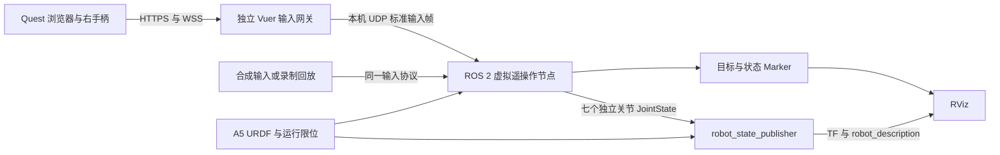

# A5 机械臂 VR 到 RViz 移植方案

日期：2026-10-08。状态：首版软件已实施并通过合成输入、网关协议、ROS 集成和回放验证，实际 Quest 联调待完成。运行方法及实测结果见 [VR 使用说明](VR_RVIZ_USAGE.md)。下文保留设计决策与验收目标；其中拟新增接口和入口现已实现，不把设计阈值当成全部实测结果。本阶段采用运动学状态更新，不模拟重力、接触或电机响应。

建议保留参考项目的浏览器 VR 接入和握把相对控制方式，以本项目的 A5 URDF、Pinocchio 运动学及 ROS 2 状态发布替换 Piper 模型、IK 和电机发送链路。新增独立虚拟启动入口，不修改现有重力、关节阻抗及末端阻抗控制模式。

## 1 阶段目标与操作方式

默认沿用参考项目的 Quest 3 与右手柄，控制单台 A5。实际头显型号不同，但仍能提供相同浏览器事件时，只调整输入 Adapter。第一阶段不加入左手双臂、裸手追踪、相机传流或学习模型。

| 操作 | 虚拟机械臂行为 |
| --- | --- |
| 启动 | 显示配置中的有效初始关节姿态，等待输入 |
| 按住右手握把 | 记录当前手柄位姿与虚拟 TCP 位姿，开始相对跟随 |
| 移动或旋转右手柄 | TCP 跟随相对平移和旋转，受 IK 与速度限制 |
| 松开握把 | 六轴和夹爪立即保持当前虚拟状态 |
| 再次按住握把 | 从当前虚拟姿态重新建立参考，不跳回上次目标 |
| 跟随期间扣动扳机 | 扳机值越大，虚拟夹爪越闭合 |
| HOLD 状态按 A | 清除旧参考，等待下一次握把；第一阶段不绑定自动回零 |
| 断连、输入过期或追踪异常 | 进入 PAUSED，保持姿态；恢复后须先松开再按握把 |

首版默认只在 TELEOP 状态允许夹爪更新。暂停或松开握把时夹爪一并冻结，避免在姿态已停止后仍响应旧扳机值。回初始姿态若后续确有需要，增加单独的虚拟重置入口，不沿用 Piper 启动或退出时自动回零的行为。

完成标准是能够连接头显、连续控制六维 TCP 和夹爪、松手保持、重抓无突跳，并可通过录制回放复现相同虚拟轨迹。RViz 展示的是计算出来的关节状态，不代表实机已执行。

## 2 参考项目与 A5 的差异

参考路径下有两套实现，详细源码证据见 [VR 参考项目分析](../参考方案/VR_REFERENCE_ANALYSIS.md)。

| 内容 | 参考项目现状 | A5 移植决定 |
| --- | --- | --- |
| VR 接入 | `piper-quest3-teleop/teleop/TeleVision.py` 使用 Vuer 的 `CONTROLLER_MOVE`，通过 HTTPS/WSS 与浏览器通信 | 抽取位姿、按键和连接状态，移除图像与 Piper 骨架依赖 |
| 主实现 | `piper-quest3-teleop` 当前代码包含双臂，使用 MuJoCo、mink、DAQP | 借鉴输入与交互；不复制整套运行时 |
| 另一实现 | `Meta_to_Arm_staging` 已改用 Pinocchio、CasADi、ProxQP，但仍使用 Piper 的硬编码模型 | 借鉴差分 IK 约束思想，模型必须从 A5 URDF 加载 |
| 坐标处理 | Preprocessor 先做基变换，mapper 的平移和旋转又有不同处理 | 统一定义原始输入坐标与单个基变换，避免重复映射 |
| 夹爪 | 有 Piper SDK 单位转换和发送层逻辑 | 使用 A5 的米制独立手指坐标 |
| 输出 | Piper SDK、电机发送进程、SocketCAN | 改为独立虚拟 `JointState` 发布 |
| 环境 | 原 requirements 包含视觉、学习、仿真和 Piper 依赖 | VR 网关与 ROS 环境分开，保留最小依赖 |
| 输入时效 | 共享状态可能持续保留旧位姿和按键 | 增加原始事件时间、序号、会话与超时状态机 |

本项目可直接复用的资源包括：

- [A5.urdf](../../../src/A5/urdf/A5.urdf)：六个转动关节、两个联动手指及固定 `tool_tcp`。
- [模型约定](../../../src/A5/config/a5_model_conventions.yaml)：七个独立坐标，第二手指为 `-1` 倍 mimic；臂关节单位 rad，夹爪单位 m。
- [运行位置与速度限制](../../../src/a6_y_controllers/config/a5_motion_limits.yaml)：作为虚拟运动的初始限制来源，仍标记为 `uncommissioned`。
- [现有模型校验](../../../tools/verify_s0.py)：Pinocchio mimic 模型和独立 URDF 连乘的 FK 交叉检查方法。
- 现有网格和 RViz 显示样式；新建配置以适配虚拟命名空间。

有两处不能直接复用：现有 dry-run 驱动只将 `command_position` 回填成状态，而阻抗控制器向这个接口写的仍是当前测量位置，不能由此产生手柄驱动的虚拟运动；两种阻抗控制器都在激活后捕获固定目标，没有运行时 VR 目标输入。参见 [dry-run 状态回填](../../../src/a6_y_ros2_control/src/A6_y_damiao_system.cpp)、[固定关节目标](../../../src/a6_y_controllers/src/A6_y_joint_impedance_controller.cpp)及[固定 TCP 目标](../../../src/a6_y_controllers/src/A6_y_cartesian_impedance_controller.cpp)。

## 3 推荐架构



ROS 节点内保留三个可独立验证的 Module：输入状态机与相对映射、A5 IK、虚拟状态输出。首版放在一个节点内，避免位姿、按键、IK 与状态在多个 ROS 队列中失去对应关系。输入协议是实际的 Seam：Vuer 网关和离线回放是两个 Adapter，使用相同校验与状态机。IK 返回候选关节状态及诊断，由输出 Module 决定提交或保持。

独立 Vuer 网关只负责读取浏览器事件并生成标准帧。首版使用本机 UDP，绑定 `127.0.0.1`，默认端口例如 `15150`，允许配置且启动时检查占用。一次报文包含一次完整快照，建议上限 2 KiB；同一时刻仅接受一个会话。接收层按序处理已收到的有效按键与会话事件，仅位姿合并为最新值；按键边沿另用累计计数检测遗漏。该端口不开放到局域网；局域网接入发生在有 TLS 的 Vuer 服务上。

### 虚拟启动的隔离

- 默认 ROS domain 为 `84`，实施时确认未被其他本机 ROS 应用使用；由新启动脚本在启动 ROS 进程前设置，并设置 `ROS_LOCALHOST_ONLY=1`。选低域 ID，避免沿用历史验证中的高域 ID 而与 Linux 临时端口范围重叠。Vuer 局域网服务不依赖 DDS，因此不受此设置限制。端口关系见 [ROS 2 Humble domain 说明](https://github.com/ros2/ros2_documentation/blob/humble/source/Concepts/Intermediate/About-Domain-ID.rst)。
- ROS 命名空间使用 `/arm6_vr`；TF frame prefix 使用 `vr_a5/`。JointState 中的关节名仍是 URDF 原名，不能加 TF 前缀。
- 启动文件直接加载纯 `A5.urdf`，仅启动遥操作节点、`robot_state_publisher` 和 RViz；不包含现有三个硬件 launch，不加载 ros2_control 硬件插件或 controller_manager。
- 新包不依赖 Piper SDK、CAN/串口库，也不调用真实 `/arm6` 控制器的服务。即使同一电脑上真机仍在运行，也使用独立数据流。
- 在启动时检查 domain 和命名空间；虚拟入口没有 `auto_enable` 或 `can_channel` 参数。用进程、节点和文件描述符检查验证上述隔离，而不只依赖参数名。

RViz 的 Fixed Frame 为 `vr_a5/base_link`，RobotModel 使用 `/arm6_vr/robot_description`，RViz TF Prefix 为 `vr_a5`（不带末尾斜杠，RViz 自行补 `/`）。`robot_state_publisher` 的 `frame_prefix` 配置为 `vr_a5/`，描述消息使用 transient-local QoS。该节点根据 JointState 计算 TF，支持 mimic，并可配置 TF 最大发布频率。[Humble 官方实现说明](https://github.com/ros/robot_state_publisher/tree/humble)、[RViz 前缀拼接实现](https://github.com/ros2/rviz/blob/humble/rviz_default_plugins/src/rviz_default_plugins/robot/tf_link_updater.cpp)

## 4 VR 输入协议与连接

新网关按一次原始浏览器事件生成一帧，包含以下字段：

| 字段 | 约定 |
| --- | --- |
| `schema_version` | 首版为 1，拒绝未知版本 |
| `session_id`、`sequence` | 新浏览器连接生成新会话；序号只在收到新的右手原始输入事件时增加 |
| `event_received_monotonic_ns` | 网关收到本次原始事件的主机单调时钟时间，两个进程必须在同一台主机 |
| `pose_sequence`、`pose_received_monotonic_ns` | 只在本次事件包含新的有效右手位姿时更新，按钮事件与左手事件不能刷新缓存右手位姿的时效 |
| `source_frame` | 明确为原始 WebXR world，不经过参考项目 Preprocessor 的坐标转换 |
| `hand` | 首版只接受 `right` |
| `position_m` | 长度 3，单位 m |
| `quaternion_xyzw` | 长度 4，归一化；ROS 与网关均使用 xyzw |
| `squeeze`、`trigger`、`button_a` | 握把布尔值、扳机 0～1、A 按键布尔值；与位姿属于同一输入快照 |
| `clutch_epoch` | 网关每观察到一次右握把变化就递增，后续每个快照都携带；即使某个释放报文丢失，也可识别参考已变化 |
| `pose_valid` | 姿态结构、数值及可用性检查结果；有追踪有效性字段时同时使用 |

矩阵的行列顺序以参考事件解析源码和真实抓取样本共同确认，不用数组外形猜测；将其规范化为位置和四元数后才进入映射。有限数检查、四元数范数检查、会话匹配、序号去重和报文长度检查都在接收端执行。

关键时效规则：重复转发旧快照不得更新序号或原始事件时间；ROS 节点不能用“本地收到 UDP 的时间”替代原始事件时间。首版 `input_timeout=0.15 s` 为待测初值，以右手 `pose_received_monotonic_ns` 判定。只有左手输入、按钮输入或无效右手矩阵时，不得给缓存右手位姿换新时间；有效的握把释放事件仍可独立触发 HOLD。若参考版本仅在手柄运动时发送事件，先验证或增加逐 XR 帧采样，静止握持也必须产生新采样序号；网关不能自造新序号掩盖输入停更。主机接收时间不能证明浏览器到主机的上游排队延迟；该延迟单独记录和评估。

会话重连、WebXR 重定位、位姿突跳或连续无效帧进入 PAUSED。重连时即使握把仍按住，也必须收到新会话中的一次有效松开再按下，避免自动续接旧目标。握把释放和掉线均有明确状态，不允许因保存了最后一帧而继续跟随。

连接先沿用参考项目锁定的 `vuer==0.0.70` 作为兼容验证起点，记录实际 Python、Vuer 前后端版本及事件样本，不把旧示例和当前新版 API 混用。参考项目对 WebSocket 端口有显式修正，应保留该行为的连接测试。

Quest 通过实际局域网地址访问 `https://<主机地址>:8012`，WebSocket 对应 `wss://<主机地址>:8012`。证书按本机地址重新准备，不复制参考目录的私钥和历史 IP；进入 immersive XR 前完成浏览器对证书的信任配置。WebXR 的 TLS 要求与显式 `ws` 地址见 [Vuer 官方 TLS 说明](https://docs.vuer.ai/tutorials/basics/ssl_proxy_webxr/)。首版无需相机，网页显示连接状态、坐标轴和手柄即可；机械臂的完整显示交给 RViz。

## 5 相对映射与状态机

设 `B` 为从原始 VR world 轴向到 A5 `base_link` 轴向的旋转矩阵，要求 `BᵀB=I` 且 `det(B)=+1`。握把按下时记录手柄 `(p_v0, R_v0)` 和当前已发布虚拟关节状态的 FK `(p_tcp0, R_tcp0)`。后续目标为：

```text
p_target = p_tcp0 + position_scale * B * (p_v - p_v0)
R_delta  = B * (R_v * R_v0ᵀ) * Bᵀ
R_target = R_delta * R_tcp0
```

这里使用世界轴表达的相对旋转并左乘 TCP 初始朝向；不直接相减欧拉角。位移和旋转采用同一个基变换。`B` 包含 VR 上方向转换及操作方向对齐，不能再叠加参考项目的 Preprocessor 和 `P`。初始朝向锚定在实际虚拟 TCP 上，因此不用让手柄绝对朝向等于机械臂绝对朝向。

首版先使用固定房间参考，不跟随头部朝向旋转控制轴。实现时必须做六项轴向检查：三个方向平移、三个方向正旋转，并检查仅移动头部不引起目标移动。输入约定中的合法零位置不能仅因范数接近零而被丢弃；是否有效由事件和数值检查确定。

`position_scale=0.5` 为初始建议值，旋转比例为 1。目标限速在映射后执行；旋转限速通过最短旋转或 quaternion slerp，保证四元数符号连续。握把重抓时重置滤波记忆，并以当前已发布 `q_virtual` 的 FK 为锚点，不用尚未达到的旧目标。

```text
WAITING --新鲜有效输入且握把已释放--> HOLD
HOLD --握把上升沿，捕获两个锚点--> TELEOP
TELEOP --松开握把--> HOLD
任意状态 --超时/会话改变/追踪异常--> PAUSED
PAUSED --新鲜有效输入且确认握把释放--> HOLD
```

每周期先处理释放、过期和会话变更，再决定是否运行 IK；松开当帧不能再执行一次旧目标步进。输入接收时保留按键边沿与会话变化，不能因位姿只取最新帧而丢掉“松开后再次按下”的重抓事件。若 `clutch_epoch` 跳变说明中间边沿遗漏，则进入 PAUSED，要求重新观察到完整释放/按下，不沿用旧锚点。HOLD、PAUSED 直接冻结 q，不继续运行带姿态偏置的 IK；继续发布固定关节位置和零虚拟速度，没有“积攒后补发”的轨迹。求解时间超预算时保持上一状态，不按超长 `dt` 产生大步进。位姿连续但暂时不可达时，保留可行进展并显示 LIMITED；持续误差或突跳超过阈值时转 HOLD/PAUSED，重新握把后再锚定。

## 6 A5 逆运动学与夹爪

### 模型与求解变量

加载完整 A5 URDF，保留原生 mimic，启动时断言 `nq=nv=7`。按关节名查询 Pinocchio 的 q/v 索引，不假定 URDF 遍历顺序。IK 只求解 `joint1`～`joint6` 的六个变量，夹爪坐标由扳机单独提供；不要让求解器用手指移动去补偿 TCP 误差。终端 frame 为 `tool_tcp`，其在 `link6` 下的固定偏置为 `[0.135300001892, 0.00000415, 0] m`，不用 Piper 的 attachment site 或夹爪长度。

建议首版用 Pinocchio FK/Jacobian 加阻尼最小二乘差分 IK，Python/NumPy 即可，不引入 MuJoCo、mink 或 CasADi。每周期从上一已发布状态热启动，计算：

```text
e = [p_target - p(q); log(R_target * R(q)ᵀ)]
J = tool_tcp 的 LOCAL_WORLD_ALIGNED 雅可比，只取六个臂关节列
Δq = argmin ||W½ (J Δq - e)||² + λ² ||Δq||²
```

`W` 用显式长度/角度尺度归一化任务误差；`λ` 随奇异性增加。用受限步长、回溯和 FK 复核，将候选状态限制在位置及每周期速度允许范围内。若一个周期内迭代多步，速度预算必须针对周期起点计算，不能每次迭代重新获得 `v_max*dt`。保留最优可行候选，非有限数或数值失败则不提交。

第一阶段允许因限位产生跟踪误差，必须显示原始目标、限速后的目标与实际 FK，避免“画目标就算到达”。不能通过直接写目标 TF 伪装 IK 成功。若简单有界步进在限位附近停滞，再将内部求解器替换为六变量带边界 QP；这不改变网关或 ROS 输出 Interface。

限制取 URDF 与运行位置限制的交集。URDF 中多个 `velocity=0` 是 CAD 导出占位，本项目已有运行速度配置，不能把 0 直接当有效速度上限或无限制。虚拟初始速度上限采用六轴 `0.5 rad/s`、夹爪 `0.1 m/s`；允许在 VR 配置中进一步降低。初始姿态 `q_home` 在模型里选取、检查限位和局部雅可比后保存，不能照搬 Piper 全零回零策略。动力学 effort 参数不参与这个运动学求解。

本阶段不实现避障或接触仿真，限位满足不等于无自碰撞；验收中的运动限定在预先检查的自由空间。后续真机接入前须增加适用的碰撞/工作空间检查。

### 夹爪映射

设扳机输入 `t∈[0,1]`，默认扣满闭合：

```text
q_finger1 = -0.03 * (1 - t)  # m
q_finger2 = -q_finger1       # 由 URDF mimic 生成
```

JointState 只发布第一手指这一独立坐标，第二手指由 robot_state_publisher 推导。0、0.5、1 三个扳机值分别对应第一手指 `-0.03`、`-0.015`、`0 m`；两个手指的相对间距变化分别为 60、30、0 mm，这不是未经实测的绝对闭合间距。按上述速度限制平滑到达目标，暂停时冻结；虚拟链路不使用电机 sign、offset 或 `position_scale` 再做转换。

## 7 ROS 接口与频率

以下均为拟新增接口：

| 接口 | 类型与用途 |
| --- | --- |
| `/arm6_vr/joint_states` | `sensor_msgs/msg/JointState`；六轴加第一手指，共七项；位置为已提交虚拟状态，速度由状态差分得到，effort 留空 |
| `/arm6_vr/target_pose` | `geometry_msgs/msg/PoseStamped`；送入 IK 的受限目标，frame 为 `vr_a5/base_link` |
| `/arm6_vr/tcp_pose` | `geometry_msgs/msg/PoseStamped`；由已发布关节状态计算的 TCP 位姿 |
| `/arm6_vr/markers` | `visualization_msgs/msg/MarkerArray`；原始目标、受限目标、实际 TCP 和 LIMITED 状态 |
| `/arm6_vr/status` | `diagnostic_msgs/msg/DiagnosticArray`；状态机、事件年龄、输入频率、IK 时间、误差、奇异性指标、丢弃原因 |
| `/arm6_vr/robot_description` | 由 robot_state_publisher 发布 A5 模型 |

同一虚拟 JointState 只允许一个发布者，不同时启动 joint_state_publisher GUI。TF 保留标准 `/tf`、`/tf_static`，由独立 domain 和 frame 前缀隔离。

| 链路 | 初始设计 |
| --- | --- |
| VR 原始事件 | 跟随头显实际事件率，记录实测值，不假定等于显示刷新率 |
| ROS 映射、IK 与虚拟状态 | 可配置，初始目标 125 Hz，即 8 ms；每周期消费最新有效输入 |
| 动态 TF | 显式设置 `publish_frequency=125.0`，实际频率另测 |
| RViz 绘制 | 初始 30 FPS，需要时再提高 |
| 状态诊断 | 5～10 Hz 汇总，避免逐周期打印 |

VR 输入低于 125 Hz 时，不为同一帧生成新输入时间；IK 可以继续靠近当前目标，但超时后冻结。125 Hz 是本阶段调度目标，不能由此前真机状态发布测试推导为 VR 完整链路已满足。此前 [125 Hz 被动测量](../../../validation/live_frequency_20261008/033513_utc/report.json)只覆盖已有控制器和状态发布。

建议记录每周期输入年龄、映射/IK/发布耗时和超期数，初始性能目标为节点处理耗时 P99 小于 4 ms、连续 60 秒无未处理的周期超期；超期必须显式记账并保持状态。网关收到原始事件到发布虚拟状态的延迟目标为 P99 小于 30 ms，另用画面或外部时间基准测量包含头显网络和 RViz 绘制的端到端延迟，不能混称同一个指标。

## 8 拟新增目录与环境

```text
src/a6_y_vr_teleop/                   # 新增 ament_python 包
  package.xml / setup.py
  a6_y_vr_teleop/
    node.py                          # 节拍、ROS 输出与诊断
    input_protocol.py                # 校验、会话、序号、时效
    quest_input.py                   # 右手原始事件解码与新鲜度
    a5_kinematics.py                  # URDF、mimic、FK、六轴 IK
    virtual_arm.py                   # 握把状态机、相对映射、状态提交与夹爪
  launch/a5_vr_rviz.launch.py
  config/a5_vr.yaml
  config/a5_vr.rviz
  test/
vr_gateway/
  quest_gateway.py                   # 抽取并适配参考项目接入
  requirements.txt                  # 网关最小且固定的依赖
tools/vr_replay.py                    # 合成输入与录制回放
scripts/run_vr_gateway.bash
scripts/run_vr_rviz.bash
validation/vr_rviz/                   # 输入记录、版本、统计和截图
```

ROS 端沿用系统 ROS 2 Humble 与 Pinocchio ≥4.0，通过当前环境脚本加载；Vuer 网关使用独立虚拟环境的 Python 绝对路径启动，仅通过本机协议交换数据。当前 [environment.bash](../../../scripts/environment.bash)会清理 Conda、Python 路径和 overlay，因此不能简单在同一个解释器中拼接参考项目环境。源码不运行时安装依赖，实现在干净环境中锁定可复现依赖。

下面两个入口现已创建，环境和证书准备见使用说明：

```bash
# 终端一：仅启动虚拟模型，脚本设置独立 ROS domain
./scripts/run_vr_rviz.bash

# 终端二：启动 Quest 输入服务，地址和证书通过配置传入
./scripts/run_vr_gateway.bash
```

网关优先复用事件解码、连接行为和按键语义，按原许可证保留来源说明。Vuer、Piper SDK、附带资产及上游复制文件的许可分别确认，不把主仓库许可证自动套到所有目录；首版不搬入 Piper 模型资产、证书私钥、相机和学习依赖。

## 9 实施顺序与验收

| 步骤 | 实施内容 | 可检查的完成条件 |
| --- | --- | --- |
| P0 模型显示 | 建新包和虚拟 launch，加载 A5，发布固定七关节状态 | 无 VR 可启动；九份网格正常；TCP 与两个手指 TF 正确；没有硬件进程和设备访问 |
| P1 合成输入与 IK | 用回放 Adapter 注入相对位姿，完成映射、IK、夹爪 | 不需要头显即可验收坐标和限位；IK→FK 一致；断流进入 PAUSED |
| P2 VR 网关 | 抽取 Vuer 输入，完成 TLS、事件协议与时效 | 头显能连接；静止也有有效采样；握把和扳机语义与记录一致 |
| P3 全链路 | Quest→A5→RViz，增加目标 Marker、诊断与录制 | 重抓无跳变、断连不续接、极限目标不穿限位，125 Hz 处理预算有统计 |
| P4 回归交付 | 固定依赖、整理启动文档与复现记录 | 无头显回放能复现；实际头显连续操作测试通过；原三种模式配置不因新增功能改变 |

关键验证工况：

1. **坐标与连续性**：三个平移轴、三个旋转轴逐项验证；绕 ±π 连续转动无欧拉角跳变；握把按下后保持手不动，目标位姿不变；头部运动不移动目标。
2. **重抓**：连续 20 次松开/重抓，重抓首帧 TCP 目标变化小于 1 mm、0.5°；基准均来自当前已发布虚拟状态。
3. **IK**：从已知合法关节状态生成可达目标，在非奇异、限位内部的小范围测试集中，目标保持后达到位置误差 <2 mm、姿态误差 <2°；测试阈值是验收目标，不是现有性能。附加测试不可达目标和近奇异姿态，检查有限数、限位与无分支突跳。
4. **速度与限位**：每周期累计关节变化不超过 `v_max*dt`，关节位置满足运行范围；夹爪三点映射正确，mimic 方向正确。
5. **过期和乱序**：注入丢包、重复序号、倒序帧、网关退出、浏览器断连、非有限数及新会话握把仍按住；超过 150 ms 未有有效事件后，在下一个 8 ms 周期内冻结，无恢复追赶。
6. **异常目标**：长时间将手柄推到不可达区域，再松开握把；清空旧目标，下一次握把不追赶此前未到达位置。
7. **显示一致性**：Marker 的实际 TCP 与相同 q 的 Pinocchio FK、robot_state_publisher TF 一致；RViz 展示的机械臂是 q 的结果。
8. **隔离与回放**：进程未打开 tty/CAN；虚拟 domain 内只有预期节点；回放相同输入和时间步，在容差内得到相同 q。回放需重建会话和当前单调时间，不直接使用录制时的过期时戳。

每次记录输入样本、配置快照、URDF 哈希、依赖版本、输入实际频率、IK 误差、超时/限位次数、处理时间统计和 RViz 截图。失效时保存最后有效状态和原因，不记录虚构的实机执行结果。

## 10 后续接入真机的接口准备

具体实施设计见 [VR 实机接入方案](../实机控制/VR_REAL_ROBOT_PLAN.md)，包括当前代码差异、目标接口、停止行为和分阶段验收。

本阶段保留两个输出含义：`target_pose` 是任务目标，`joint_states` 是虚拟状态。将来不能把虚拟 JointState 直接当真实反馈发布到 `/arm6/joint_states`。

若延续当前关节阻抗模式，下一阶段需要新增实时安全的关节参考输入、参考变化率约束和明确的接管流程；若改用末端阻抗，则需新增 TCP 目标输入及姿态插值。两条路线都要以真机实时反馈重新锚定，处理 VR 丢失后的保持策略，并重新验证移动目标下的控制行为。夹爪真机开合也要单独实现，不能因为 RViz 已能开合就认为现有零力夹爪控制已经具备该能力。

真机阶段还依赖 [实物标定记录](../../../src/a6_y_controllers/config/a5_calibration.yaml)中的方向、零点、TCP 和安装检查，以及适用于所选控制频率的完整闭环验证。当前先完成 P0～P4，得到可重复的虚拟遥操作链路，再设计上述真机接管。
