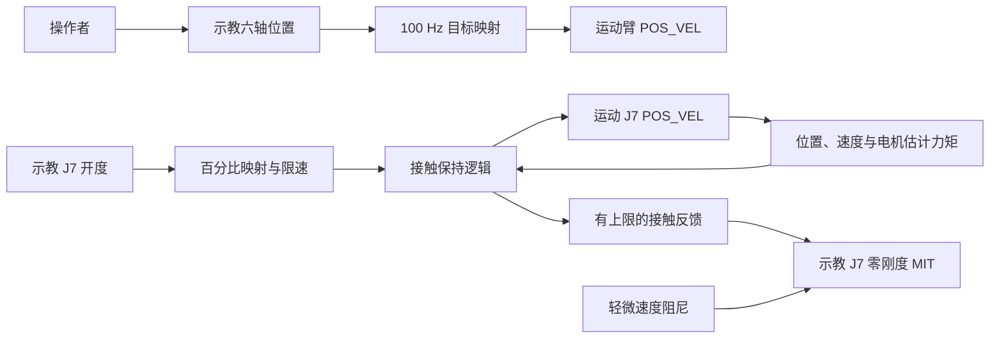

# 动力示教与夹爪反馈如何工作

动力示教把操作者移动示教臂的姿态传给运动臂，同时在示教侧补偿机械臂的重力。夹爪沿用位置跟随，并在运动端接触物体时把有限的阻力反馈给操作者。本页解释这种关系；操作步骤见[动力示教指南](../how-to/run-power-teaching.md)。

## 六轴与夹爪承担不同的工作

示教臂 J1～J6 使用 MIT 零刚度模式，由控制器计算重力、阻尼和已配置的摩擦补偿。运动臂使用 POS_VEL，由电机的位置／速度环追踪关节目标。目标是示教臂的绝对关节角度，所以启动前的姿态差会形成需要追赶的位移；1.2 秒软启动只能缓和接管，不会把映射变成保留姿态差的增量控制。



图中的 100 Hz 是目标更新配置；底层循环配置为 250 Hz。传感反馈、限速、电机响应和调度都参与实际跟随时间，单凭频率无法推出端到端延迟。

## 夹爪为什么按百分比映射

四个夹爪的电机端点不完全相同。直接复制电机角度会把一侧的闭合或张开端当成另一侧的端点，因此先把示教位置换算成开度比例，再落到运动夹爪自己的范围。

对于各自内收后的闭合端 `closed`、张开端 `open`：

```text
u = clamp((q_teacher - closed_teacher) / (open_teacher - closed_teacher), 0, 1)
q_target = closed_motion + u × (open_motion - closed_motion)
```

当前方向为负值张开，因此 `open < closed`；公式仍使闭合为 0%、张开为 100%。左右和交叉配对使用相同方法。每端内收约 0.02929 电机 rad，按现有模型比例为单指 0.7 mm，普通目标始终落在内收范围。

模型 J7 是移动关节，位移与电机角度的比例为 0.0239 m/rad。这里的毫米和 100 mm/s 都是模型单指坐标；实际指间距尚未独立测量，不能把它们直接当作尺量开口或夹口速度。可用端点来自[运行标定 YAML](../../tools/arm_gravity/teaching_gripper_limits.yaml)，原始采样保留本地。

实测端点用于定义百分比目标，不再作为反馈越界拦截条件。启动时运动夹爪先保持协议有效的实测位置，再限速趋向正常目标，这避免当前位置在内收余量区时立即跳到边界。

## 接触后为何捕获目标

自由空间中，运动夹爪追踪百分比目标。遇到物体后，如果仍不断把操作者的闭合动作传成更深的目标，位置误差会继续增大，运动侧就会持续追赶。

当前逻辑通过两类信号识别接触：有闭合误差且低速受阻，或在没有明确张开时出现持续正向负载。条件满足后捕获运动夹爪的位置目标，并停止累积进一步闭合；这也使较软物体在尚未完全停住时有机会触发反馈。

捕获后电机仍使用 **POS_VEL 位置控制**，不是切换到运动端恒力控制。实际夹持力随物体形变、摩擦和电机位置环变化；本实现没有标定后的指尖力传感器，也没有给出物体夹持力保证。

## 力矩反馈与单位

示教 J7 的 MIT Kp、Kd 都为零。空载阻力由软件按速度方向施加：运动时有很小的反向阻尼，停止时不增加位置保持。空载阻尼单独限于 0.015 N·m。

接触后，运动端估计力矩与操作者超过捕获点的闭合量共同形成反向反馈；该接触分量按 0.8 N·m/s 限制变化率，再与轻阻尼叠加，总电机力矩上限为 2.0 N·m。上限不是恒定命令：轻负载、接触时间短或检测到张开时，实际请求可以远低于它。

ROS 中 J7 是移动关节，`effort_j7` 使用广义力单位。按驱动映射：

```text
motor_tau = effort_j7 × position_scale / sign
```

当前 J7 的 `sign=+1`、`position_scale=0.0239 m/rad`。这个换算得到的是协议中的电机力矩，仍不等于物体上的实际夹持力。

## 张开、撤力与反馈中断

示教端出现超过死区的反向速度时，接触反馈立即撤掉，仅保留轻阻尼；映射位移回退 0.3 mm 后解除位置保持。释放后的映射从捕获位置连续打开，避免先消耗操作者多握紧的行程，再在完整端点接回原百分比映射。

这一快速撤力规则也有边界：接触期间微小反向回弹可能暂时清零反馈。提高总力矩上限不会改变该判据，因此不能据此声称反馈阻力始终连续。

双端 J7 的反馈和消息都有 80 ms 时效检查；异常后锁存故障，示教反馈撤力。C++ 控制器还独立执行力矩限幅及力矩／门控超时清零。正常退出时各臂六轴回零、夹爪保持实测开度，最后七轴失能并释放夹持力。

## 与其他入口的边界

独立重力补偿仍是六轴补偿、夹爪只读。MoveIt 使用自己的规划、夹爪范围和独立驱动构建；它的碰撞配置不自动作用于动力示教跟随。VR 也有独立接管与停止状态机。将这些入口分开，可以让各自的控制方式、参数和退出行为保持可核对；同一实体串口仍只能由一个会话占用。
