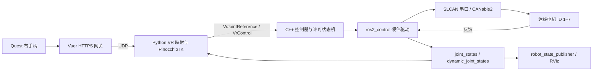

# A6Y 程序框架、指令与本机核查

本报告依据用户提供的 2026-10-28 交接包，以及 2026-11-24 13:58 起（北京时间）的本机只读检查。包内历史授权、标定和验收描述仅作为历史资料，本次没有将其当作新的运动授权。实物与接口的对应关系按用户要求稍后确认。

源码阅读目录：`/home/taoqiu/文档/ChatGPT/A6Y远程遥操作/A6-Y-G`。
已构建运行目录：`/home/taoqiu/a6y_handoff_20261124`。
新诊断、现场配置和原始读数：`/home/taoqiu/文档/ChatGPT/A6Y远程遥操作/diagnostics`。

交接包有 5 个 ROS 包，约 4.96 GB 的历史 validation 数据；本次解出源码、模型、文档等 221 个文件，历史大日志仍保留在 ZIP 中，另提取了 3 个离线回归夹具。英文运行目录中的交接文件已按 HANDOFF_MANIFEST.csv 校验，原源码未修改。中文路径下 ROS Humble 的 rosidl/CMake 消息生成失败，英文软链接仍会被解析回原路径，因此使用独立英文目录完成构建。

## 设备清单

A–D 是本次按当前 tty 编号分配的临时接口名，不代表左臂、右臂或主从角色。后续应以 USB 序列号固定身份，不能依赖 ttyACM 编号长期不变。

| 临时接口 | 当前串口 | USB 序列号 | USB 拓扑位置 | 响应情况 |
|---|---|---|---|---|
| A | /dev/ttyACM0 | 209D3982534B | 1-7.3 | ID 1、2 响应；3–7 无响应 |
| B | /dev/ttyACM1 | 304F33733036 | 1-7.4 | ID 1–7 全部响应 |
| C | /dev/ttyACM2 | 209B3971534B | 1-8.3 | ID 1–7 全部响应 |
| D | /dev/ttyACM3 | 304C33733036 | 1-8.2 | ID 1–7 全部响应 |

| 预期关节 | 请求 ID / 反馈 ID | 包内配置型号 | A | B | C | D |
|---|---|---|---|---|---|---|
| J1 | 0x01 / 0x11 | DM4340P | 有反馈 | 有反馈 | 有反馈 | 有反馈 |
| J2 | 0x02 / 0x12 | DM4340P | 有反馈 | 有反馈 | 有反馈 | 有反馈 |
| J3 | 0x03 / 0x13 | DM4340P | **无响应** | 有反馈 | 有反馈 | 有反馈 |
| J4 | 0x04 / 0x14 | DM4310 | **无响应** | 有反馈 | 有反馈 | 有反馈 |
| J5 | 0x05 / 0x15 | DM4310 | **无响应** | 有反馈 | 有反馈 | 有反馈 |
| J6 | 0x06 / 0x16 | DM4310 | **无响应** | 有反馈 | 有反馈 | 有反馈 |
| J7 / 夹爪 | 0x07 / 0x17 | DM3507 | **无响应** | 有反馈 | 有反馈 | 有反馈 |

共收到 23 个电机 ID 的反馈，均为状态码 0（按本项目协议为失能）。型号和 J1–J7 实物对应来自程序配置，不能由查询 ID 单独证明；也不能通过这样的查询排除同一总线上重复 ID 的所有情况。

A 的 3–7 在原始 5 轮、延长等待的 10 轮和独立寄存器查询中均未回应。结论是这些地址目前不可读，不是证明五台电机损坏。若实物采用 J1→J2→J3 的串接线路，可优先检查 J2 到 J3 之间及后段共同的电源、CAN 接插件；再核对 CAN H/L、终端及 ID。是否实际串接须现场确认。B/C/D 有反馈只证明通信与读数，不代表零点、方向、行程或运动性能已验收。

旧项目 `/home/taoqiu/A6-Y-G/arm_teleop_project/config/adapter_inventory.yaml` 将 A 的序列号记为 R1、C 记为 R2；这里只保留为历史参考。A 曾于 13:54 进入 DFU，13:56:34 已恢复正常串口；D 于 13:56:50 枚举完成，现在四个都是正常 CANable2。

## 实读参数与交接包的差异

| 项目 | 交接包 | 本次实读 | 影响 |
|---|---|---|---|
| B/C/D 的 J3 VMAX | 20 | 10 | 原配置会把这些 J3 的速度反馈放大约 2 倍 |
| C 的 J4–J6 VMAX | 50 | 30 | 原配置会把速度反馈放大约 1.667 倍 |
| D 的夹爪 PMAX | DM3507 解码固定 12.566 | 3.14 | 原扫描角度约放大 4 倍；原扫描 8.983 rad 不可直接采用 |
| 位置环 KP_APR | 历史 J1–J3=2500、J4=220 | C 七轴=120；B 七轴=54；D 前六轴=54、夹爪=80；A 可读两轴=54 | 历史调参结果不能当作今天这四组电机的当前参数 |

本次重新读取 PMAX/VMAX/TMAX 后解码，D 夹爪约为 **2.244787 rad（电机坐标）**。这仍不等于夹爪开度已标定。B 的 J2/J3 电机坐标分别约 −1.291485/−0.387770 rad；B 夹爪约 −1.929529 rad。若照搬包内零偏、方向和比例，会超出部分模型工作范围。因此不能直接对 B/D 套用原运动配置。

已生成 C 与 B 的独立只读 YAML：`diagnostics/motors_209B3971534B_readonly.yaml` 和 `diagnostics/motors_304F33733036_readonly.yaml`，修正实读 VMAX，并将全部关节设为 `read_only: true`。未修改电机寄存器或原 YAML。D 的 PMAX 不能靠现有 `protocol_vmax` 配置修复；现有 C++ 驱动仅支持 VMAX 覆盖，需要后续补充 PMAX 支持并核验夹爪映射。本次未绕过此限制。

精确寄存器、原始状态帧和正确量程解码见 `diagnostics/arms_verified_20261124.json`；接口记录见 `diagnostics/adapters_20261124.yaml`。

## 程序框架

项目名是 A6-Y-G，但采用 A5 URDF：六个转动关节加一个独立夹爪坐标，共 7 台电机；第二手指由 mimic 联动，没有第 8 台电机。



| 模块 | 核心文件或目录 | 功能 |
|---|---|---|
| a5_description | src/A5/urdf/A5.urdf、meshes/ | 几何、关节、质量惯量、TCP、手指 mimic |
| a6_y_ros2_control | src/A6_y_damiao_system.cpp、src/damiao_can.cpp | C++ SLCAN、反馈解码、7 轴映射、使能握手、超时和故障处理 |
| a6_y_ros2_control/tools | damiao_bus_scan.py、motor_status.py、read_motor_params.py 等 | 扫描、监测、参数读取；另有改 ID/写参数/存 Flash 工具 |
| a6_y_controllers | 3 个控制器 .cpp、joint_reference_gate.hpp | 重力补偿、末端阻抗、关节阻抗及派生的 VR 原生位控 |
| a6_y_teleop_msgs | VrControl、VrJointReference、VrState | 接管指令、参考位置及状态、会话和时间信息 |
| a6_y_vr_teleop | node.py / virtual_arm.py、real_node.py / real_bridge.py、a5_kinematics.py | 虚拟节点、实机桥接、手柄相对位姿、逆运动学 |
| vr_gateway | quest_gateway.py | Quest/Vuer 输入、HTTPS、UDP 转发、记录 |
| scripts / tools / docs | 启动脚本、验证与调参工具、文档 | 环境隔离、运行入口、测试及实验记录 |

普通控制命名空间固定为 `/arm6`。一个关节有 position、velocity、effort、motor_enable 四个命令接口，7 轴共 28 个。常规重力/阻抗控制目标 50 Hz；VR 完整原生位控目标 125 Hz，不等于已经实测达到的硬件控制频率。

重力模式通过 Pinocchio 计算 G(q)，叠加阻尼、可选摩擦补偿并限幅；关节阻抗捕获当前六轴角度作为恢复目标；末端阻抗捕获当前 TCP 位姿。三者不应同时争用同一组接口。原生位控使用电机 `pos_vel` 位置/速度闭环，不运行重力/阻抗力矩算法。

坐标换算为 `q_joint = sign * q_motor * position_scale + offset`。包内 J1–J6 的 sign 是 `[-1,+1,+1,-1,-1,-1]`，offset 全为 0。夹爪比例为 `0.0239 m/rad`、负方向打开；这些是原配置，不是本次四台实物新标定的结果。

## 目前如何运行

本机已经具备 Ubuntu 22.04、ROS 2 Humble、Pinocchio 4.0.0、colcon、C++ 编译器、python-can、pyserial 等核心依赖。建议使用下列已构建的英文目录；每个 ROS 终端先执行：

```bash
cd /home/taoqiu/a6y_handoff_20261124
source scripts/environment.bash
a6y_load_install
```

后续修改源码时的构建命令为：

```bash
cd /home/taoqiu/a6y_handoff_20261124
source scripts/environment.bash
export MAKEFLAGS='-j2 -l2'
colcon build --base-paths src --symlink-install --executor sequential \
  --cmake-args -DCMAKE_BUILD_TYPE=Release
a6y_load_install
```

根目录含 `COLCON_IGNORE`，必须带 `--base-paths src`。环境脚本会清理 Conda 和旧 overlay，避免混用 Python/ROS 包。

1. 无硬件启动与 RViz 显示（本次已验证后台 dry-run 链路，未打开 RViz GUI）：

```bash
export ROS_DOMAIN_ID=193 ROS_LOCALHOST_ONLY=1
ros2 launch a6_y_controllers a5_gravity_comp.launch.py \
  dry_run:=true auto_enable:=false use_rviz:=true
```

dry-run 不打开串口，只把命令回填为状态，不是动力学仿真。

2. 查看接口 C 的真实七轴反馈：

```bash
bash '/home/taoqiu/文档/ChatGPT/A6Y远程遥操作/diagnostics/run_interface_c_readonly.bash'
```

脚本严格绑定序列号 **209B3971534B**，即本次接口 C。脚本自动加载环境、采用 ROS 域 194、校验七轴只读配置，并启动 RViz。没有桌面显示时可加 `A6Y_REVIEW_RVIZ=false` 前缀。本次相同配置的无 GUI 真机验证通过，收到 80 条动态状态消息，7 轴均有新鲜反馈、无故障、未使能，验证进程已退出。

另一终端查看数据：

```bash
cd /home/taoqiu/a6y_handoff_20261124
source scripts/environment.bash
a6y_load_install
export ROS_DOMAIN_ID=194 ROS_LOCALHOST_ONLY=1
ros2 topic echo /arm6/joint_states
# 或：
ros2 run a6_y_ros2_control motor_status.py \
  --topic /arm6/dynamic_joint_states --watch --require-feedback \
  --fail-on-fault --max-feedback-age 0.5
```

3. 重新生成四个接口的电机清单，先退出占用串口的 launch；输出文件必须是新文件：

```bash
cd '/home/taoqiu/文档/ChatGPT/A6Y远程遥操作'
PYTHONNOUSERSITE=1 /usr/bin/python3 diagnostics/inspect_arms_readonly.py \
  --output diagnostics/arms_recheck_01.json
```

工具只允许 `0x7FF` 上的 `0x33` 寄存器读取和 `0xCC` 状态查询，并使用实读协议量程解码。不会发送使能、失能、位置目标、标零、改 ID、写参数或 Flash 保存。可加 `--serial 209D3982534B` 单独复查接口 A。

4. 先了解虚拟 VR 工作流：

```bash
cd /home/taoqiu/a6y_handoff_20261124
bash scripts/run_vr_rviz.bash
```

另开终端运行无头显演示：

```bash
cd /home/taoqiu/a6y_handoff_20261124
source scripts/environment.bash
export OPENBLAS_NUM_THREADS=1 OMP_NUM_THREADS=1
/usr/bin/python3 tools/vr_replay.py --demo --duration 16
```

虚拟入口用 ROS 域 84、UDP 15150，不连接 CAN。真机 VR 通常用 ROS 域 0、UDP 15153；mock 用域 86、UDP 15154。

5. 若后续接 Quest，需要单独创建网关环境与证书（本次未安装网关依赖、未启动 Quest）：

```bash
cd /home/taoqiu/a6y_handoff_20261124
/usr/bin/python3 -m venv .venv-vr
.venv-vr/bin/python -m pip install -r vr_gateway/requirements.lock
bash scripts/create_vr_certificate.bash 192.168.1.115
bash scripts/run_vr_gateway.bash
```

`192.168.1.115` 是本次主机 Wi-Fi 地址，改变后需使用新地址生成证书。虚拟网关默认 HTTPS 8012；实机文档示例用 `bash scripts/run_vr_gateway.bash --profile real --port 8014`。头显与主机需网络互通，通过对应 HTTPS 地址进入 XR。

## 功能与控制指令索引

以下是真机控制入口的含义，不表示本次已经使能或验收。现阶段以只读与 dry-run 为已验证路径。

| 功能 | 入口或指令 | 行为与当前条件 |
|---|---|---|
| 重力补偿 | a5_gravity_comp.launch.py，dry_run=false、auto_enable=true | 输出补偿力矩；启停会改变支撑力，需先确认具体实物及参数 |
| 固定末端阻抗 | a5_cartesian_impedance.launch.py | 手推可偏离，松手朝捕获的 TCP 目标恢复 |
| 固定关节阻抗 | a5_joint_impedance.launch.py | 手推可偏离，松手朝捕获的关节角恢复；本次有 2 项动力学测试未通过 |
| VR 阻抗 | bash scripts/run_vr_real.bash | 默认 readonly；mode=mock 无硬件；execute 受标定检查约束 |
| VR 原生位控 | bash scripts/run_vr_position.bash | 默认 readonly，使用电机位置闭环 |
| VR 完整原生位控 | bash scripts/run_vr_position_full.bash | 启动参数为 commission/follow/full；当前包存在启动前配置校验冲突，见下文 |
| 状态 | bash scripts/vr_position_control.bash status | 读取状态及原因 |
| 原位接管 | bash scripts/vr_position_control.bash prepare | **会使能并保持当前位置**，不是只读命令 |
| 允许跟随 | bash scripts/vr_position_control.bash arm | 要求有效新鲜输入、手柄握把已松开，然后按握把跟随 |
| 暂停 | bash scripts/vr_position_control.bash pause | 停止跟随并保持，不等于硬件急停 |
| 撤销输出 | bash scripts/vr_position_control.bash disarm | 撤去输出，机械臂可能失去保持力 |

VR 状态机包括 DISABLED、HOLD、ARMED_HOLD、TELEOP、STOPPING、PAUSED、FAULT。右手侧握把控制跟随/释放；full 模式扳机控制夹爪。普通 gravity/阻抗模式的夹爪默认零力。

主要 ROS 接口：`/arm6/joint_states`、`/arm6/dynamic_joint_states`、`/arm6/vr/status`、`/arm6/vr/reference_joint_states`、`/arm6/vr/target_pose`。原生位控的控制器接口在 `/arm6/a6_y_vr_position_controller/vr_control`、`vr_reference`、`vr_state`；阻抗后端对应 `/arm6/a6_y_joint_impedance_controller/`。关节数组须按 name 匹配。

## 本次运行核查结果与明确阻碍

| 检查 | 本次结果 |
|---|---|
| 5 个 ROS 包构建 | 全部成功 |
| 驱动 CTest | 6/6 通过，串口测试使用伪终端 |
| 控制器 CTest | 7/8 测试程序通过；关节阻抗程序内部 28/30 用例通过 |
| VR Python | 239 通过、23 失败 |
| 模型检查 | 通过 |
| S0 软件一致性 | 通过；实物标定仍未完成 |
| ROS 无硬件 dry-run | 通过 |
| 接口 C 的 ROS 真机只读 | 通过，七轴新鲜反馈，80 条消息 |

控制器失败用例为 `RepeatedLargePushesWithStrongerResistance`、`FrictionReleaseAtRecordedPose`；不能宣称当前关节阻抗配置全部验收通过。

VR 的主要问题可直接定位到：`a5_vr_position_full_controllers.yaml` 设 `vr_tracking_error: 0.25`，而 `position_profile.py` 的 full 配置校验仍要求 `0.05`。这不仅使测试失败，也会让 full launch 在配置检查阶段报 `position trial constraint changed: vr_tracking_error`。因此交接包的“完整启动”命令目前不能照搬即跑通，后续应先统一设计意图、校验与测试；本次未擅自把运动门限改大或改小。测试中的 [real] 是配置生成参数，不是本次进行了实机运动测试。

README 的“末端位姿阻抗”段落还有一处错误：注释写无硬件运行，命令却是 `dry_run:=false auto_enable:=true`。无硬件时必须显式使用 `dry_run:=true auto_enable:=false`。

full 位控关闭了 CAD 碰撞硬检查，未提供自动自碰/环境避障。原生位控也不能把 ROS 力矩上限当作电机内部电流限值。交接包中的标定确认与调参记录来自历史机器，不能直接覆盖今天四条总线的量程和零位差异。

这份压缩包是单臂入口：`/arm6` 名称、真机 UDP 15153 等固定。不能仅接入四个 CANable2 就直接同时启动四份 full VR；需要后续拆分命名空间、UDP 端口、每臂配置和输入路由。普通只读观察可以分开 ROS 域和串口，但实物配对仍须现场确认。另一个已有 `arm_teleop_project` 是不同的双臂主从方案，不属于这份 ZIP，本次未改动或启动它。

核查日志在 `/home/taoqiu/a6y_handoff_20261124/validation/local_20261124/`，本次检查完成后控制与诊断进程均退出。下一步先定位 A–D 实物并排查 A 的 3–7 地址，再针对各臂建立独立量程、方向、零位和工作范围配置。


## 实物定位更新：2026-11-24 14:11

用户仅保留一个 USB 接入并指认其为“示教端右臂”。此时系统仅枚举一个 CANable2，序列号为 `209D3982534B`，当前串口 `/dev/ttyACM0`、原临时接口 A。因此已将该序列号固定记录为 `teaching_right`。重新只读查询仍只有 ID 1、2 响应且失能，ID 3–7 无响应；其余三条总线本轮未连接，之前的反馈结果为历史快照，不表示当前在线。其他实物角色暂未绑定。最新角色映射见 `diagnostics/arm_roles.yaml`，每次重插以序列号为身份依据。


## 实物定位更新：2026-11-24 14:31

用户指认当前单独接入的是“示教端左臂”。唯一枚举的 CANable2 序列号为 `304F33733036`，原接口 B；重新插入后当前串口变为 `/dev/ttyACM0`，进一步说明须按序列号识别。此次有反馈的 ID 为 [1, 2, 3, 4, 5, 6, 7]，缺失 ID 为 []。精确读数见 `diagnostics/teaching_left_20261124_1431.json`。用户同时说明示教端右臂已定位到松线问题，要求稍后再检验；保留之前 1、2 响应及 3–7 无响应的历史结果，不将用户找到松线原因写成已复检通过。


## 实物定位更新：2026-11-24 14:37

用户指认当前单独接入的是“运动端左臂”。唯一枚举的 CANable2 序列号为 `304C33733036`，原接口 D，当前串口 `/dev/ttyACM0`，已绑定为 `motion_left`。本轮 ID 1–7 全部取得新鲜反馈，状态均为 0（失能），未发送电机使能、失能或参数写入。证据见 `diagnostics/motion_left_20261124_1437.json`。复读确认 ID 3 的 VMAX 为 10、ID 7 夹爪的 PMAX 约为 3.14，与原包部分配置/固定解码量程不一致，后续运行配置仍需适配。示教端右臂松线问题等待复检；运动端右臂尚待现场指认，不能仅按排除法标记已确认。


## 实物定位更新：2026-11-24 14:39（四臂身份确认完成）

用户指认当前单独接入的是“运动端右臂”。唯一枚举的 CANable2 序列号为 `209B3971534B`，原接口 C，当前串口 `/dev/ttyACM0`，已绑定为 `motion_right`。本轮 ID 1–7 全部取得新鲜反馈，状态均为 0（失能），未发送使能、失能或参数写入。证据见 `diagnostics/motion_right_20261124_1439.json`。复读确认 J3 的 VMAX 为 10，J4–J6 的 VMAX 为 30，与原包相应配置有差异。

| 角色 | USB 序列号 | 原接口 | 各自最近一次反馈 |
|---|---|---|---|
| 示教端右臂 | `209D3982534B` | A | ID 1、2 有反馈；ID 3–7 无反馈，用户已找到松线原因，等待复检 |
| 示教端左臂 | `304F33733036` | B | ID 1–7 有反馈，失能 |
| 运动端左臂 | `304C33733036` | D | ID 1–7 有反馈，失能；夹爪 PMAX 约 3.14，需适配驱动 |
| 运动端右臂 | `209B3971534B` | C | ID 1–7 有反馈，失能 |

四台身份已通过用户逐台单 USB 指认确认，按 `by-id` 稳定路径绑定，不按变化的 `ttyACM` 编号绑定。以上是分别连接时的检查结果，不表示当前四台同时在线。示教端右臂通信复检仍待完成，未执行任何真机运动。


## 四臂同时接入复检：2026-11-24 17:37–17:38

用户完成示教端右臂线缆连接并接入全部四臂。本次主机同时枚举四个已绑定的 CANable2，逐条总线执行只读寄存器与状态查询，共 28/28 电机取得新鲜反馈，所有电机状态为 0（失能）。示教端右臂此前无响应的 ID 3–7 已恢复通信，线缆问题的通信复检通过；旧异常快照保留，不代表当前状态。

| 角色 | USB 序列号 | 本次串口 | 电机反馈 |
|---|---|---|---|
| 示教端右臂 | `209D3982534B` | `/dev/ttyACM2` | 7/7，均失能 |
| 示教端左臂 | `304F33733036` | `/dev/ttyACM3` | 7/7，均失能 |
| 运动端右臂 | `209B3971534B` | `/dev/ttyACM1` | 7/7，均失能 |
| 运动端左臂 | `304C33733036` | `/dev/ttyACM0` | 7/7，均失能 |

串口编号会随重插变化，继续使用序列号对应的 `/dev/serial/by-id/` 路径。原始证据为 `diagnostics/all_arms_20261124_1737.json`，最新 USB 清单为 `diagnostics/usb_inventory_latest.json`，角色映射和电机清单均已更新。

本次新确认示教端右臂 J3 的 VMAX=10、J4–J6 的 VMAX=30；运动端右臂同样如此。两条左臂的 J4–J6 VMAX=50。运动端左臂夹爪 PMAX 约 3.14 的差异仍存在。通信恢复不等于原程序运动参数已适配或零位已标定。

本轮没有使能、失能、写参数或运动命令。诊断完成后已退出并释放全部串口；未启动常驻 ROS 控制节点。
