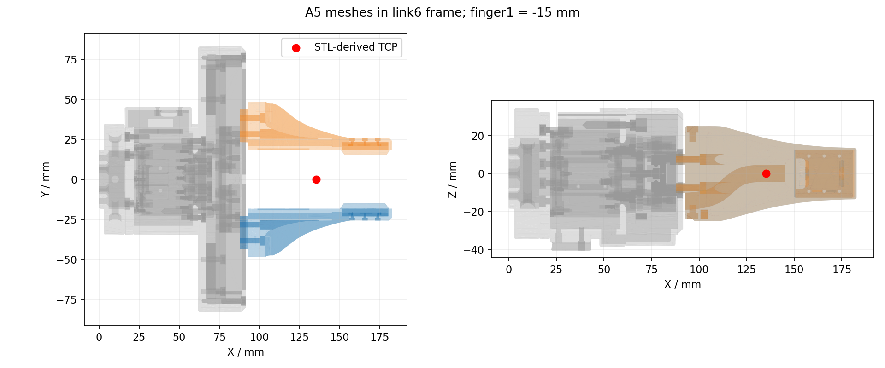

# S0 模型、TCP 与标定约定

执行日期：2026-10-06。软件模型与检查工具已落地；实物安装、零点和开度记录仍待测量。本次未连接串口、使能、运动或下发电机标零。

## 已完成的 TCP 定义

按本次要求，直接解析两个手指的 STL，取夹爪几何中间。具体定义是：将两个手指的所有 visual mesh 顶点，经 URDF 的 mesh scale、visual origin、joint origin 和关节位移变换到 `link6`，取合并后的轴对齐包围盒中心。

```text
center = (combined_min_xyz + combined_max_xyz) / 2

parent: link6
child:  tool_tcp
joint:  tool_tcp_joint (fixed)
xyz:    [0.135300001892, 0.00000415, 0.0] m
rpy:    [0.0, 0.0, 0.0] rad
```

TCP 的轴向继承 `link6`：当前模型中 +X 朝向手指前端，+Y 与第一手指关节正轴一致，+Z 由右手系确定。第一手指打开时 q 为负，沿 −Y 移动。这个 TCP 是整个两指几何包围盒的中点，包含手指安装段；并非只取前端接触垫中心，也不是用质量中心或顶点平均值计算。

源文件为 `src/A5/meshes/gripper_finger_link1.STL` 和 `gripper_finger_link2.STL`，分别有 12488、12476 个三角面。STL 本身没有单位声明，使用该 URDF 现有的米制 mesh 尺度。两指在 q=0 时合并范围约为：

| 轴 | 最小值 / mm | 最大值 / mm |
|---|---:|---:|
| X | 87.850003 | 182.750001 |
| Y | −33.314099 | 33.322399 |
| Z | −25.007175 | 25.007175 |

检查了第一手指 q=0、−0.015、−0.03 m 三个开度，计算中心完全一致。两个 STL、URDF 几何和原九个 link 的惯性参数保持不变；新增 TCP 是无质量固定 link。当前模型共 10 个 link、9 个 URDF joint、7 个独立自由度、9 份网格，命令接口仍为 28 个。



## 文件与职责

| 文件 | 用途 |
|---|---|
| [A5.urdf](../../src/A5/urdf/A5.urdf) | 唯一模型，新增 `link6 → tool_tcp` 固定变换 |
| [a5_model_conventions.yaml](../../src/A5/config/a5_model_conventions.yaml) | frame、单位、关节顺序、mimic、模型重力方向与夹爪开度约定 |
| [a5_motion_limits.yaml](../../src/a6_y_controllers/config/a5_motion_limits.yaml) | 运动限位契约，记录运行值、CAD 差异 |
| [a5_calibration.yaml](../../src/a6_y_controllers/config/a5_calibration.yaml) | 实物标定记录模板；待测量字段为 pending/null，不伪造结果 |
| [derive_a5_tcp.py](../../tools/derive_a5_tcp.py) | 重新解析 STL、核对 TCP、可选更新固定变换与绘图 |
| [verify_s0.py](../../tools/verify_s0.py) | 模型/配置/FK 一致性检查，以及测量记录是否完整且匹配当前配置 |
| [test_s0.py](../../tools/test_s0.py) | STL 解析、变换、过期 TCP 拒绝和标定记录错误路径回归 |

`a5_motion_limits.yaml` 的运行位置/速度值与 `a5_motors.yaml` 相同，effort 与现有重力控制器限幅相同；验证器要求它们一致。当前 gravity 仍从原配置加载。仅增加 YAML 不会改变当前硬件行为。

CAD 的 `velocity=0` 和 J6 `effort=0` 保留为原始导出值；新运行表显式提供对应值，不将零解释为无限制。CAD 与重力配置的 effort 差异也逐轴记录，仍需要真机审核。

## 重跑软件检查

先按 [README](../../README.md) 加载 ROS 环境，在项目根目录执行：

```bash
colcon build --base-paths src --symlink-install --executor sequential --cmake-args -DCMAKE_BUILD_TYPE=Release
/usr/bin/python3 tools/verify_s0.py
```

完整验证步骤见 [验证说明](VALIDATION.md)。运行以下命令前先按 README 加载环境。单独运行 S0：

```bash
source scripts/environment.bash
/usr/bin/python3 tools/derive_a5_tcp.py
/usr/bin/python3 tools/verify_s0.py
```

更换手指 STL 后，可显式重新生成 TCP，再重新构建、验证：

```bash
/usr/bin/python3 tools/derive_a5_tcp.py --write
colcon build --base-paths src --symlink-install --executor sequential --cmake-args -DCMAKE_BUILD_TYPE=Release
/usr/bin/python3 tools/verify_s0.py
```

可选重绘（需要 matplotlib，不是运行控制器的依赖）：

```bash
MPLCONFIGDIR=/tmp/a5-s0-matplotlib /usr/bin/python3 tools/derive_a5_tcp.py \
  --plot docs/图片资源/a5_tcp_geometry.png
```

查看模型：`ros2 launch a6_y_controllers a5_gravity_comp.launch.py dry_run:=true auto_enable:=false use_rviz:=true`，RViz 已增加 `Tool TCP` 坐标轴。dry-run 只验证消息与模型，不是动力学仿真。

## 仍需实物填写的记录

这些记录填写在 `a5_calibration.yaml`。各项实测误差容限须按测量精度和任务要求确定；只有 `status: verified` 和布尔勾选而没有测量数据，不会通过检查。

1. **基座安装**：记录固定安装方向及 `base_link` 各轴相对实物的方向，填写基座坐标系中的测得重力向量、测量误差容限。当前模型约定为 `[0,0,-9.81] m/s²`；若实物方向不符，需先统一模型与控制器重力配置，不能只把状态改成 verified。
2. **七轴映射**：逐轴核对电机 ID 和运动方向，至少记录两个不同姿态的原始电机角与已知模型位置。检查公式 `q_model=sign×scale×q_motor+offset`，必要时修改电机配置再重新验证。这里原始电机角始终是 rad；模型位置前六轴是 rad，夹爪是 m。`/arm6/joint_states` 已做过换算，不能作为原始电机角再代入一次。
3. **夹爪间距**：至少三个不同开度，记录电机角和实测两指间距，填写模型 q=0 对应的实测间距。验证器检查 `gap=closed_gap−2×q_finger1`，因此可以检查传动比例和闭合偏置。当前 0.0239 m/rad 的配置继续保留，尚未被本次实测证明。
4. **FK 实物核对**：至少三个不同姿态，记录七维模型坐标 q，以及 TCP 在 `base_link` 中的实测 xyz/rpy。位置单位 m，姿态单位 rad。TCP 采用本文的几何中点，测量时必须针对同一个点。

完成记录后执行：

```bash
/usr/bin/python3 tools/verify_s0.py --require-field-calibration
```

当前该命令应退出 **2**，因为实物记录未完成。软件结构错误会退出非零；一般检查不要求实物完成，软件一致性通过即可退出 0 并列出待测项。重力模式不会自动执行此检查；操作人员应在真机使能前完成实物核对。

## 报告

- `validation/tcp_geometry.json`：计算方法、完整坐标、网格 SHA256、三种开度的包围盒与中心。
- `validation/s0_check.json`：软件检查结果、32 姿态 FK 差值、实物待测项。
- `validation/model_check.json`、`validation/dry_run_check.json`：现有重力与完整启动回归，包含新增固定 TCP。
