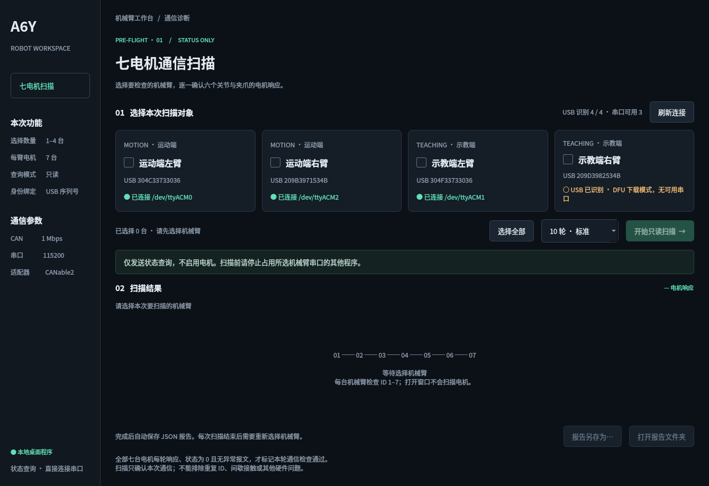

# 通信诊断与电机零位标定

按运动／示教、左／右角色识别 USB2CAN，扫描每臂七台电机，并在本地窗口中显式执行零位写入。默认打开的是**只读扫描窗口**，没有默认选中的机械臂；选择设备后仍需点击按钮才开始查询。



*已有扫描界面记录；图中的 USB 连接和 DFU 状态属于截图时刻，不代表当前设备状态。*

[只读扫描](#只读扫描) · [写入零位](#写入电机零位) · [命令行与网页](#命令行与可选网页) · [报告](#结果与报告) · [离线验证](#实现与离线验证)

## 功能与前提

| 功能 | 可以完成的工作 |
| --- | --- |
| USB 识别 | 显示四臂连接、可用串口和 DFU 状态；按序列号与 by-id 路径核验身份 |
| 七电机扫描 | 查询 ID 1～7，显示响应次数、状态、温度、电机位置和原始计数 |
| 零位标定 | 本地窗口单臂操作，检查失能与静止、逐台写入、独立回读并记录部分完成结果 |
| 报告 | 自动保存 JSON、另存报告、打开报告目录；停止后保存已获得的数据 |
| 多种入口 | Qt 桌面、只读 CLI、可选的本机只读网页 |

本模块不需要编译 ROS 控制器，也不需要先加载 ROS 环境。启动器使用 `/usr/bin/python3`，需要 PyQt5（桌面）、PySerial、python-can、PyYAML 和 `fuser`（`psmisc`）。系统依赖入口见[运行配置参考](../../docs/reference/runtime-and-configuration.md#环境要求)。真机需要每臂独立 CANable2／SLCAN、正确的电机 ID 与供电；CAN 为 1 Mbps，串口配置为 115200 baud。

以下命令统一从**仓库根目录**执行。保持 `A6-Y-G/` 与 `diagnostics/` 相邻，角色身份来自 [`diagnostics/arm_roles.yaml`](../../../diagnostics/arm_roles.yaml)。使用前停止其他正在连接机械臂的控制、标定和显示会话。

## 只读扫描

先做不连接硬件的配置检查：

```bash
bash A6-Y-G/scripts/run_arm_scan.bash --cli --arms all --dry-run
```

成功时列出四臂角色和 USB 序列号，并显示 `DRY RUN：没有打开串口`。打开本地桌面窗口：

```bash
bash A6-Y-G/scripts/run_arm_scan.bash
```

1. 保持“本次功能”为“只读扫描”，勾选本次需要的 1～4 条机械臂。
2. 点击“开始只读扫描”。默认对每台电机查询 10 轮，范围为 J1～J6 和夹爪 ID 1～7。
3. 查看响应次数、位置 °／rad、状态码、MOS／转子温度及原始反馈。悬停位置单元格可看采样时间、计数和量程。
4. 等待自动保存报告，或使用“报告另存为”“打开报告文件夹”。完成后勾选会清空，下一次需重新选择。

“刷新连接”和空闲时每两秒的连接更新只读取 Linux 设备信息，不打开串口。识别到 `0483:df11` 时显示“DFU 下载模式，无可用串口”。串口打开前通过 sysfs 核对最近 USB 设备的序列号，拒绝别名串臂及同序列号多设备，不使用上游 Hub 的序列号认臂。

扫描期间可点“停止扫描”、关窗或按 Ctrl+C；程序停止查询、保存部分报告并释放串口。只读扫描不发送使能或失能，因此“停止扫描”不等于停止其他程序已经启动的电机输出。

## 写入电机零位

此功能把**当前姿态保存为电机零点**，不自动运动回零，也不进行电气参数自整定。它会改变后续读取到的电机坐标；仅在确实需要重新标零时使用。

1. 退出该臂其他控制程序，在本地窗口将“本次功能”切换为 **“写入电机零位”**。
2. 选择一条机械臂。此模式为单选，切换功能会清空上次选择。
3. 将 J1～J6 **以及夹爪 ID 7** 放到要保存的零位，保持支撑、失能、静止。
4. 点击 **“已摆好零位，写入〈机械臂名称〉”**，等待检查、写入及回读。
5. 只有七台全部通过才显示“零位标定完成 · 7 / 7 台电机写入并回读通过”。随后用[只读 RViz 检查](../arm_visualization/README.md)与实物对照。

程序先读取整臂两轮反馈，检查 ID、状态码与姿态稳定性；任何一台失败都不开始写入。每台写入前再次检查，只发送一次原驱动的 `set_zero_position` 指令，等待 100 ms，再用两次独立状态查询确认接近零。稳定性阈值为 0.01 rad，回读容差为 0.005 rad；这是软件通过条件，不代表机械标定精度。

点击“停止后续标定”或关窗，会完成当前已写电机的有限回读后停止后续电机。**已经发送的写零位不能撤回**；超时或通信中断时不自动重发，可能出现部分完成。标定不发送使能、失能、运动、ID 或控制模式修改；状态仍使能或异常时拒绝写入。

报告文件为 `arm_zero_<日期>_<时间>.json`，分别列出 `written_ids`、`verified_ids`、`uncertain_ids` 和 `not_written_ids`，保存标定前后位置及时间。它不是旧零位的可恢复备份；本流程没有断电重启，回读通过也不等于已核验掉电保持。写零后需要重新核对模型映射和依赖该坐标的夹爪端点，不能直接沿用旧端点认为仍已标定。

## 命令行与可选网页

CLI 的 `--arms` 必填，没有默认机械臂：

```bash
# 一条臂，只读查询
bash A6-Y-G/scripts/run_arm_scan.bash --cli --arms motion_left

# 两条示教臂
bash A6-Y-G/scripts/run_arm_scan.bash --cli --arms teaching_left teaching_right

# 四臂，每电机十轮
bash A6-Y-G/scripts/run_arm_scan.bash --cli --arms all --passes 10

# 只检查选择和配置
bash A6-Y-G/scripts/run_arm_scan.bash --cli \
  --arms motion_left teaching_right --dry-run
```

| 参数 | 用途／默认值 |
| --- | --- |
| `--arms` | `motion_left`、`motion_right`、`teaching_left`、`teaching_right`，或单独的 `all` |
| `--passes` | 每电机查询轮数，默认 10 |
| `--timeout` | 单次响应等待，默认 0.06 s |
| `--roles` | 角色 YAML，默认 `diagnostics/arm_roles.yaml` |
| `--report-dir` | 报告目录，默认 `diagnostics/arm_scan_reports/` |
| `--dry-run` | 不打开串口，只检查目标选择与配置 |

角色绑定使用完整 `/dev/serial/by-id/…`，不回退到历史 `ttyACM` 编号。更换适配器时见[USB2CAN 迁移指南](../../docs/how-to/replace-usb-can-adapter.md)。

网页是保留的可选入口，只有显式传入 `--web` 才启动：

```bash
bash A6-Y-G/scripts/run_arm_scan.bash --web
# 不自动打开浏览器，或更换本机端口
bash A6-Y-G/scripts/run_arm_scan.bash --web --no-browser --port 8765
```

它只监听 `127.0.0.1`，默认地址为 `http://127.0.0.1:8765/`，提供只读扫描；请求检查本机 Host、Origin 和会话令牌。网页和 CLI 都没有写零位入口。退出网页服务用 Ctrl+C；关闭浏览器页面不等于终止服务。

## 结果与报告

| 结果 | 含义 |
| --- | --- |
| 每轮响应 | 每轮收到匹配 CAN ID、电机 ID 的标准反馈，且状态码均为 0 |
| 无响应／间歇响应 | 没有匹配反馈，或部分轮次缺失；检查供电、总线、接头和 ID |
| 状态需检查 | 至少一次状态非零；保留状态，不自动清错或改变使能 |
| 未扫描 | 设备缺失、占用、错误或任务停止；缺失数据不填假零 |

“本轮通信检查通过”要求所选七电机每轮响应、状态全部为 0，且没有未匹配报文、错误或取消。它不能排除重复 ID，也不代表接线、安装与负载全部验收。状态查询不读取电压、版本或寄存器参数。

位置来自本次状态帧的 16 位计数，使用 `q = raw / 65535 × 2 × PMAX − PMAX` 换算为电机轴 rad，再换成角度。PMAX 从 [`motor_position_limits.yaml`](motor_position_limits.yaml) 按 USB 序列号＋电机 ID 匹配，参考来源是已有的[四臂参数记录](../../../diagnostics/all_arms_20261124_1737.json)，没有复用历史位置。运动左夹爪 PMAX 约 3.14 rad，其余三台夹爪约 12.566 rad，J1～J6 为 12.5 rad；更换电机、ID 或 PMAX 后需重新核对。

扫描显示最近有效采样，结束后保留末次读数，不是连续监控或四臂同步快照。角度未应用模型方向和零偏；夹爪电机角度不是开口宽度。没有 PMAX 时只显示计数，没有反馈时显示 `—`。速度和力矩只保留原始计数。

默认报告为 `diagnostics/arm_scan_reports/arm_scan_<日期>_<时间>.json`，包含角色、USB、每轮统计、最新反馈、错误、时间和发送帧。每个电机的 `last` 含 `position_raw`、`position_rad`、`position_deg`、`position_pmax_rad`、`received_at`；`position_scale` 保存量程来源。设备失败也会尽可能留存失败报告。

CLI 退出码：`0` 全部通过，`1` 通信／状态／设备异常，`2` 配置或报告错误，`130` 用户中断。

## 实现与离线验证

[`scanner.py`](scanner.py) 和 [`session.py`](session.py) 提供查询及任务管理，[`desktop.py`](desktop.py) 提供 Qt 窗口，[`server.py`](server.py) 提供可选网页。扫描发送白名单仅允许 `CAN 0x7FF / <ID> 00 CC 00 00 00 00 00`；独立的 [`zero_calibration.py`](zero_calibration.py) 另允许 ID 1～7 的 `FF FF FF FF FF FF FF FE` 写零指令，不扩大扫描类权限。打开／关闭适配器仍有 SLCAN 初始化／关闭命令。

[`operation_lock.py`](operation_lock.py) 提供跨窗口、CLI、网页、标定与控制工具互斥，打开串口前还检查占用。测试使用 PTY 虚拟 CANable2，不接实体电机：

```bash
QT_QPA_PLATFORM=offscreen /usr/bin/python3 -s -m unittest discover \
  -s A6-Y-G/tools/arm_diagnostics -p 'test_*.py' -v
```

覆盖扫描响应／故障、身份和重复设备、发送白名单、串口占用、网页请求、桌面选择与停止，以及写零预检查、独立回读、写入不确定、部分完成、禁止重发和跨进程互斥。自动测试不判断实物姿态是否正确。协议背景保留[原驱动设置零点说明](https://github.com/cmjang/DM_Control_Python/blob/main/README_zh.md#33-设置零点)。
