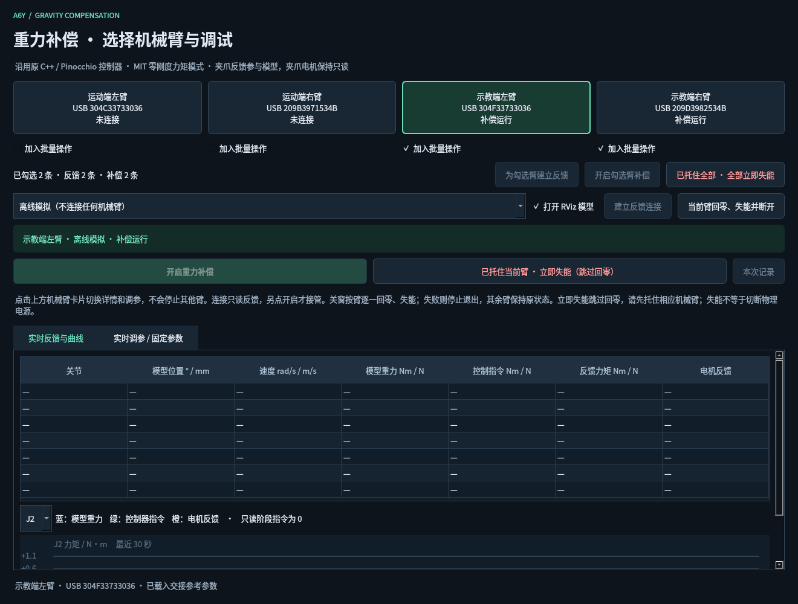

# 独立重力补偿与多臂调参

在当前位置为机械臂六轴提供 MIT 重力补偿，观察模型重力、实际指令与反馈，在线调整手感并按臂保存参数。支持四个角色的独立或批量操作。**默认离线模拟，建立反馈与开启补偿分开；本入口夹爪 J7 始终只读。**



*2026-11-25 离线界面记录，用于展示多臂选择、曲线和调参；不作为当前真机补偿效果证明。*

需要配对跟随与夹爪接触反馈时，使用[动力示教入口](TEACHING.md)。该入口保持当前夹爪百分比映射和 2 N·m 示教总力矩上限，不能把它与此处的独立重力补偿配置混用。

## 功能与前提

| 功能 | 用途 |
| --- | --- |
| 单臂／多臂反馈 | 四角色独立会话，RViz、七轴状态与六轴力矩曲线 |
| 重力补偿 | 六轴 MIT 零刚度，模型重力＋软件阻尼＋可选平滑摩擦项 |
| 在线调参 | 重力系数、阻尼、摩擦项在 0.3 秒内过渡，界面显示生效确认 |
| 分臂固定参数 | 按角色与 USB 保存，恢复参考或载入下垂试调草稿 |
| 回零退出 | MoveIt 规划、原 C++ 控制器执行受限关节阻抗回零，再核验失能 |
| 故障与日志 | 残留使能处理、回零取消／重试、参数版本、计划与故障快照 |

需要 Ubuntu 22.04、ROS 2 Humble、系统 PyQt5、Pinocchio ≥4.0 的 C++／Python、ros2_control、MoveIt 2 和 CycloneDDS 等[运行依赖](../../docs/reference/runtime-and-configuration.md#环境要求)。启动器按源码内容构建／更新 `/tmp/a6y-gravity-build-<uid>/`，避免加载其他工作区的同名控制器；首次启动或缓存清理后需要重新构建。

以下命令均从**仓库根目录**执行。实体操作前核对该臂 USB、七电机反馈、方向、零位、基座安装和负载。角色来自 [`diagnostics/arm_roles.yaml`](../../../diagnostics/arm_roles.yaml)，不依赖易变的 tty 编号。

## 启动与连接

```bash
# 不连接实体硬件：四臂模型、身份与参数检查
bash A6-Y-G/scripts/run_arm_gravity.bash --check

# 默认离线窗口
bash A6-Y-G/scripts/run_arm_gravity.bash

# 仅预选示教左臂，取消默认 RViz；仍需手动连接和开启补偿
bash A6-Y-G/scripts/run_arm_gravity.bash --role teaching_left --no-rviz
```

1. 选择一条机械臂。窗口默认“离线模拟（不连接任何机械臂）”，默认勾选 RViz，可先检查显示和启停。
2. 操作实体时选择“真机反馈与重力补偿”，点击 **“建立反馈连接”**。此时只读取反馈，不自动补偿或回零。
3. 托住机械臂，点击 **“开启重力补偿”**，等待状态确认。J1～J6 在当前位置启用，J7 仍只读。
4. 在“实时反馈与曲线”查看六轴模型重力、控制指令、反馈力矩和速度；用“本次记录”打开会话目录。

检测到电机在会话之前已经使能时，开启补偿会拒绝接管。先托住，再使用“已托住当前臂 · 立即失能（跳过回零）”清除残留输出，确认失能后再手动开启。恢复流程只发失能和查询，不自动使能；本地 `enabled=0` 不等于电机反馈状态已为 0。电脑重启或 USB 断连也不能作为失能证明。

## 在线调参与固定参数

在“实时调参 / 固定参数”中小步修改，再点击 **“实时应用（0.3 秒）”**。等待“已生效”后再评价手感；过渡期间右侧保留上一组已确认值。

| 参数 | 运行中调整 | 含义 |
| --- | --- | --- |
| `torque_scales` | 可以 | 逐轴模型重力系数 |
| `damping_gains` | 可以 | 软件反向速度阻尼 |
| `friction_compensations`、摩擦开关 | 可以 | 平滑摩擦补偿幅值与开关 |
| `effort_signs` | 断开后修改 | 补偿方向 |
| `torque_limits` | 断开后修改 | 该臂总力矩限幅 |

满意后点 **“满意，固定当前参数”**，写入 [`profiles/<role>.yaml`](profiles/)。运行中只允许保存已确认的整组参数，存在未应用编辑时不能保存；未连接时可保存草稿。文件绑定角色和 USB，下次选择该臂自动载入；缺少该角色 profile 时继承基准，不自动新建文件。保存并不证明真机效果已经验收。

“恢复交接参考值”恢复基准草稿；“载入下垂试调起点”把 J2／J3／J4 系数设为 1.2／1.1／1.2 并关闭摩擦助力。两者不自动应用或写文件，连接期间仅改变允许在线调整的项。这是试调起点，不是辨识结果；摩擦助力沿运动方向输出，重力下垂时也可能助推，需分开判断。

在线设置通过 `GravityTuning` 服务整组校验及实时缓冲生效，不能用 `ros2 param set` 替代。非法批次不修改已接受值；调参通信结果不确定时会关闭会话，停止按钮可中断等待。

## 多臂操作

1. 在需要的角色卡片勾选“加入批量操作”。
2. 点“为勾选臂建立反馈”，逐臂确认就绪，再点“开启勾选臂补偿”。
3. 点击角色卡片切换详情，不会停止其他臂；编辑草稿、确认参数、曲线、保存文件与日志按臂隔离。
4. 当前臂的回零／失能按钮只作用于当前臂；“已托住全部 · 全部立即失能”作用于所有运行会话。

不同 USB 的独立重力会话可以并行，批量提交不保证同一控制周期同时开启。同一 USB 或同一实际串口只能属于一个会话。扫描、标定、只读模型与独立 MoveIt 等全局操作仍与真机重力会话互斥。

## 正常退出与立即失能

点击 **“当前臂回零、失能并断开”**，或关闭窗口：

- 已开启补偿的臂先规划 J1～J6 回零，用原 C++ 控制器执行，核对到位后失能并再次查询实际状态；J7 全程只读。
- 未接管、且电机已经失能的只读会话直接关闭；发现残留使能则保留窗口，提示托住后立即失能。
- 多臂关窗逐臂回零、失能并关闭。任一臂失败会取消正常退出，显示该臂原因并保留其他会话。

规划、跟踪或到位失败时不宣称成功退出；反馈仍正常时返回补偿状态，可以处理后重试。反馈故障会尝试失能并说明核验是否成功。立即失能可中断回零并跳过规划，但会撤去力矩支撑；操作前托住对应机械臂。软件没有物理电源开关接口，失能不等于断电。

### 回零执行规则

[`gravity_home.py`](gravity_home.py) 用 MoveIt 的裸机碰撞策略规划，并复核实际发送的三次插值轨迹。规划速度／加速度限制为 0.10 rad/s、0.20 rad/s²；C++ 独立硬上限为 0.15 rad/s、0.3 rad/s²。首次回零按需启动规划器，重试复用；显示 1 秒预告后，以 2 秒过渡引入关节刚度。

回零继续由同一个 MIT 重力控制器输出，不在回零前重连或切换为 POS_VEL。附加阻抗力矩和总力矩分别受限；期间关闭摩擦助力，不接受在线调参。J4 使用较低回零刚度和速度相关制动，但不能保证任何摩擦、负载与延迟下都成功回零。

当前保护包括轨迹偏差超过 0.15 rad、速度超过 0.5 rad/s、周期超过 0.1 s、心跳超过 0.6 s、路径结束后 10 秒仍未到位。到位条件为六轴均在 ±0.005 rad、速度低于 0.03 rad/s 并持续 0.3 秒；最终失能要求收到电机状态 0，不以本地布尔值代替。

规划副本允许将模型边界外不超过 0.005 rad（夹爪 0.5 mm）的残差约束回边界，并记录事件；不改反馈、零位或映射。MoveIt 可能产生的不足 1 ms 近静止末端冗余点，只在终点不变等条件满足时合并，再复核插值与碰撞。两项处理均不是放宽实际轨迹保护。

当前模型不包含其他机械臂、桌面、线缆和人员，裸机策略也有明确禁用的连杆对，详见[MoveIt 碰撞配置](../arm_moveit/README.md)。回零前需留出路径空间；强制杀进程、USB 丢失或电脑重启不能保证完成回零和失能。

## 算法、配置与数据

控制器采用 `限幅(方向 × 系数 × g(q) − 阻尼 × dq + 平滑摩擦项)`。硬件 MIT Kp、Kd 为零，阻尼由软件计算；原生循环配置为 **125 Hz**。J7 位置参与完整 A5 模型的重力计算，但本入口夹爪补偿、阻尼与力矩输出为零，驱动仅查询 J7。

| 配置／源码 | 职责 |
| --- | --- |
| [`a5_gravity_controllers.yaml`](../../src/a6_y_controllers/config/a5_gravity_controllers.yaml) | 原重力算法基准；无分臂 profile 时继承 |
| [`profiles/`](profiles/) | 各臂已保存的系数、方向、阻尼、摩擦和限幅 |
| [`joint_mapping.yaml`](../arm_visualization/joint_mapping.yaml) | 模型方向、比例、零偏及 USB 关联 |
| [`motor_limits.json`](motor_limits.json) | 七电机 ID 与 PMAX／VMAX／TMAX；用于编码、反馈换算与有效性检查 |
| [`gravity_config.py`](gravity_config.py) | 参数校验、模型及每次会话生成配置 |
| [`A6_y_gravity_comp_controller.cpp`](../../src/a6_y_controllers/src/A6_y_gravity_comp_controller.cpp) | Pinocchio 重力、实时调参、力矩输出与退出回零执行 |
| [`gravity_session.py`](gravity_session.py) | 反馈、使能、故障和退出生命周期 |

逐轴 `torque_scales` 已配置时，标量 `torque_scale` 是后备值，不会再相乘。启用过程可以临时切换控制模式，但不保存 Flash、不写电机零位。PMAX／VMAX／TMAX 是协议量程，不是机械行程或日常运动限速；运动左夹爪和左右腕部可能采用不同量程，按角色实存配置读取。

图表分别显示模型重力、实际控制指令和电机协议反馈，三者不能互相替代。六轴位置单位 rad、力矩 N·m；夹爪为单指模型位移 m 和广义力 N，表格换成 mm；离线反馈来自驱动 dry-run，不是实物测量。

会话写入 `diagnostics/arm_gravity_reports/<role>_<id>/`，包含模型、生成配置、`parameters_latest.yaml`、CSV、`events.jsonl`、C++ 日志及退出结果。回零逐次保存 `home_plan_001.json` 等、原始规划响应和 `home_collision_policy.json`；`home_plan.json` 保留最新计划。事件关联参数版本、计划文件和保护分支，失败可追查具体关节、值、阈值与时间。ROS 输出位于 `diagnostics/arm_gravity_logs/`。

默认 ROS domain 197，可用 `A6Y_GRAVITY_DOMAIN_ID` 改写。启动器默认使用 [`gravity_dds.xml`](../../scripts/gravity_dds.xml) 并保留显式 `CYCLONEDDS_URI`；自定义 DDS 时需为多臂控制器和规划器保留足够参与者索引。

## 离线验证与已有边界

```bash
# 仅检查配置，不连接实体硬件
bash A6-Y-G/scripts/run_arm_gravity.bash --check

# 完整离线回归；真实 ROS/C++ 配合 dry-run 或 PTY 虚拟电机
bash A6-Y-G/scripts/test_arm_gravity.bash
```

脚本包括 Python／CTest、MIT 编解码与预装顺序、六轴启停与 J7 只读、在线调参、取消、残留使能、反馈故障、四臂并行、回零正常／失败／取消路径及离屏 UI。需要本机 ROS 通信、PTY 和对应依赖；建议与其他使用同一构建缓存或锁的回归串行运行。测试成功证明指定软件路径，不代表实体补偿、载荷、摩擦或回零性能全部验收。

原有调试资料仍保留，按记录日期与条件解读：

- [退出修订验证](../../../diagnostics/gravity_exit_revision_20261125/validation.json)：包含独立阻抗扩展回归的历史失败记录；不把它们归为本页独立重力全部通过。
- [回零日志与修订](../../../diagnostics/gravity_home_revision_20261125/validation.json)：规划成功和执行中止是不同阶段，不能仅凭低频曲线认定 USB 或静摩擦是唯一原因。
- [多臂与压力模型验证](../../../diagnostics/gravity_multi_revision_20261125/validation.json)：部分附加静摩擦／延迟场景仍触发速度保护或到位超时；这些模型参数没有经实体辨识，保护路径通过不等于回零成功。

这些历史资料不代表当前 USB 状态，也不能替代本次版本的测试输出与现场确认。配对示教具有独立的 250 Hz 控制、POS_VEL 退出及夹爪反馈流程，继续阅读 [TEACHING.md](TEACHING.md)。
