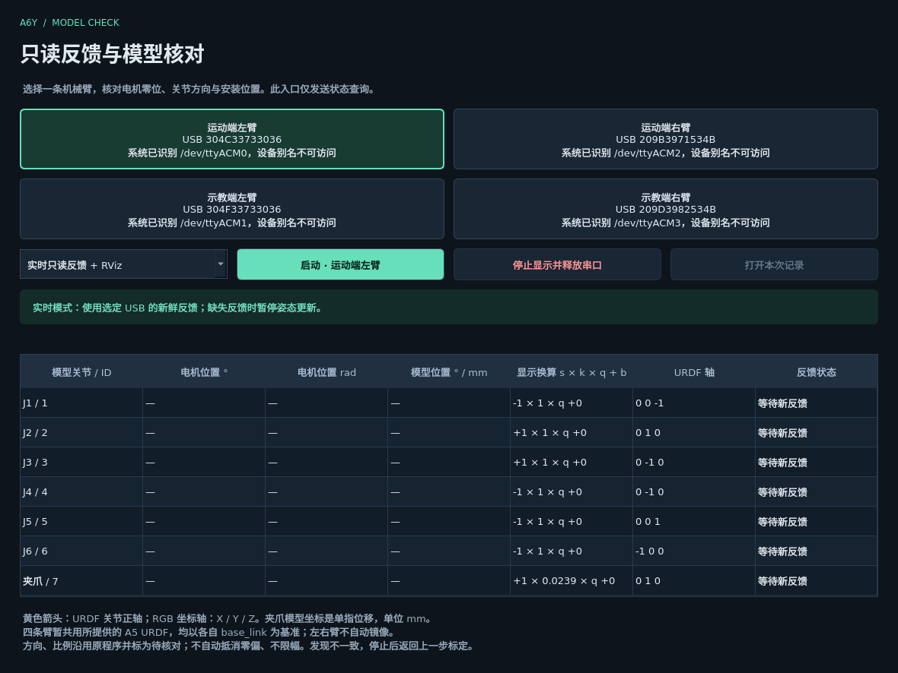

# 只读反馈与 RViz 模型核对

把每次新读到的电机位置换算为模型关节坐标，在表格与 RViz 中核对零姿态、方向、比例和夹爪 mimic。此入口只发送状态查询，不加载控制器，也不提供运动或标零按钮。



*已有界面记录，展示电机／模型两套位置、映射与关节轴；截图里的设备状态不代表当前连接。*

## 功能与前提

| 功能 | 用途 |
| --- | --- |
| 角色选择 | 从四臂中选择一条，按 USB 序列号与 by-id 核验连接 |
| 实时只读显示 | 七轴反馈、原始计数、电机 rad／°、模型位置和状态提示 |
| RViz 对照 | 当前源码 A5 模型、关节正轴、坐标系与夹爪 mimic |
| 无硬件预览 | q=0 模型，不填充虚构的实测电机读数 |
| 失联提示 | 不完整或过期反馈时冻结姿态并标红，恢复后继续 |
| CLI／记录 | 终端选臂、无 RViz 发布、定时退出和会话检查报告 |

需要 ROS 2 Humble 的 `rclpy`、`sensor_msgs`、`visualization_msgs`、`robot_state_publisher`、`rviz2`，以及系统 PyQt5、PySerial、python-can、PyYAML、`fuser`。**不需要构建本项目，也不依赖 Pinocchio。** 环境入口见[依赖参考](../../docs/reference/runtime-and-configuration.md#环境要求)。

以下命令从**仓库根目录**执行。实体显示前停止扫描、标零及其他控制会话；模块与这些操作共用全局任务锁和串口锁。

## 先检查配置或预览模型

```bash
# 检查四臂模型与映射，不连接串口、不启动 ROS 或 RViz
bash A6-Y-G/scripts/run_arm_rviz.bash --dry-run

# 有图形桌面时预览模型零姿态，不连接硬件
bash A6-Y-G/scripts/run_arm_rviz.bash --cli --arm motion_left --preview
```

`--dry-run` 输出角色、USB、URDF 哈希和映射；`--preview` 则实际启动显示链路。预览明确标记“无实测”，电机读数为空，不能作为实机标定通过的依据。

## 打开实时只读显示

```bash
bash A6-Y-G/scripts/run_arm_rviz.bash
```

1. 选择运动左／右或示教左／右中的一条臂。窗口默认不选择任何臂。
2. 保持默认“实时只读反馈 + RViz”，点击“启动”。仅此时连接所选串口。
3. 将实物的基座、J1～J6、夹爪和关节安装位置与模型对照。黄色箭头表示 URDF 关节正轴，RGB 分别表示 X／Y／Z。
4. 在实物有支撑且可手动活动的条件下，逐关节小幅摆动，核对关节对应、转动方向和角度比例。
5. 需要返回[零位标定](../arm_diagnostics/README.md#写入电机零位)时，先点“停止显示并释放串口”，等待清理完毕。

打开窗口、选臂与刷新 USB 状态不打开串口；`--arm` 只预选图形窗口中的目标，不自动开始读取。停止后需重新选择机械臂，才能开始下一次显示。

## 命令行入口

```bash
# 交互菜单选臂，再打开 RViz
bash A6-Y-G/scripts/run_arm_rviz.bash --cli

# 显式选择示教左臂，读取真机
bash A6-Y-G/scripts/run_arm_rviz.bash --cli --arm teaching_left

# 无图形桌面时读取并发布状态／TF，十秒后停止
bash A6-Y-G/scripts/run_arm_rviz.bash --cli \
  --arm motion_right --no-rviz --duration 10
```

| 参数 | 行为 |
| --- | --- |
| `--arm` | 四臂角色之一：`motion_left`、`motion_right`、`teaching_left`、`teaching_right` |
| `--cli` | 命令行会话；交互终端省略 `--arm` 时显示数字菜单 |
| `--preview` | 无硬件 q=0 模型预览 |
| `--dry-run` | 只检查配置；可用 `--arm` 缩小检查范围 |
| `--no-rviz` | 仅 CLI：发布真实反馈／TF，不打开 RViz |
| `--duration` | 仅 CLI：运行给定的正数秒数后停止 |

非交互 CLI 必须明确 `--arm`。`--no-rviz` 本身不代表离线；需要无硬件模式时同时使用 `--preview`。

## 读数与模型约定

显示链路为状态查询 → 电机角度 → 模型坐标 → `joint_states` → `robot_state_publisher` → RViz。

| 数据／配置 | 来源与含义 |
| --- | --- |
| 机械臂身份 | [`diagnostics/arm_roles.yaml`](../../../diagnostics/arm_roles.yaml)，按 USB 识别，不猜测 tty 编号 |
| 电机位置 | 本次状态帧计数，使用按 USB＋ID 缓存的 PMAX 换算 |
| 模型位置 | [`joint_mapping.yaml`](joint_mapping.yaml)：`q_urdf = sign × position_scale × q_motor_rad + offset` |
| 模型与手指 | [`A5.urdf`](../../src/A5/urdf/A5.urdf)，第二手指由 mimic 联动 |
| 映射差异 | 每个角色的 `overrides`，同时校验该角色的 USB 身份 |

六轴当前默认方向为 `[-1, +1, +1, -1, -1, -1]`，零偏为 0；夹爪比例为 0.0239 m/rad。代码把映射标记为 `mapping_verified=false`，不会因为成功显示就自动认证实体标定。新设备仍需逐轴对照；窗口不写入映射、URDF 或电机零位。

四臂共用现有 A5 URDF，各自以 `base_link` 为基准；该显示不表达四臂在桌面中的相对安装位置，也不自动镜像左右臂。J1～J6 内部为 rad、表格显示角度，J7 内部为 m、显示单指模型位移 mm，不是实测指间开口。

程序不减去启动位置、不自动消零、不滤波、不回绕、不截断超限反馈。URDF 越界只标记并保留实测值，判断留出一个位置量化步长。悬停表格可查关节原点、轴、范围、采样时间、原始计数和 PMAX；量程从[诊断缓存](../arm_diagnostics/motor_position_limits.yaml)读取，不混用不同夹爪的 PMAX。

## 失联、停止与资源释放

实时目标为每秒 20 轮、单电机最多等待 40 ms；查询按序进行，不保证七轴同步采样。只有一轮七个位置均完整且年龄不超过 400 ms 才发布整臂 `joint_states`。

缺失或过期时清空相应读数，暂停模型姿态更新，RViz 显示 `FEEDBACK LOST / POSE FROZEN`。屏幕仍可能保留旧姿态，它不是当前真机位置；通信恢复后自动继续显示。已使能或故障状态会提示，但有效位置仍保留，不清错、不改变使能。

点“停止显示并释放串口”、关窗或 CLI Ctrl+C 后，停止查询并清理该会话启动的 ROS／RViz 子进程；关闭该会话的 RViz 也会结束显示。不会批量结束其他 ROS 程序，也不会发送电机失能指令。

默认 `ROS_DOMAIN_ID=194`，可用 `A6Y_REVIEW_DOMAIN_ID` 改写，并限制 ROS 通信在本机。每次会话的 `/a6y_check/<角色>/s<随机值>` 命名空间隔离 `joint_states`、模型描述、TF 和 markers。网格由当前源码路径加载，不依赖旧 install；启动时核验模型节点与关节反馈链路。

## 报告与离线验证

每次会话写入 `diagnostics/arm_rviz_reports/<角色>_<唯一目录>/session.json`，包含角色身份、URDF 哈希、映射、最后读数、发送计数和最后 70 条查询；同目录保存参数、RViz 配置和子进程日志。启动输出在 `diagnostics/arm_rviz_logs/`。这些是检查记录，不是连续轨迹或标定证书。

```bash
QT_QPA_PLATFORM=offscreen /usr/bin/python3 -s -m unittest discover \
  -s A6-Y-G/tools/arm_visualization -p 'test_*.py' -v

# 合成姿态验证：不连接串口，不打开 RViz；需要本机 ROS DDS
source A6-Y-G/scripts/environment.bash
export ROS_LOCALHOST_ONLY=1 ROS_DOMAIN_ID=195 ROS_LOG_DIR=/tmp/a6y-rviz-verification-logs
/usr/bin/python3 A6-Y-G/tools/arm_visualization/verify_ros_display.py
```

测试覆盖四臂 PMAX、方向／比例、身份不符与非法配置、禁止自动消零和限幅、缺失／过期反馈、发送白名单、PTY 通信、互斥、断连清理及离屏窗口。ROS 验证实际订阅状态、机器人描述和九个 TF，核对 mimic 与失联不补零；不能替代实物安装核对。发布机制参考 [robot_state_publisher Humble 说明](https://github.com/ros/robot_state_publisher/tree/humble)。
