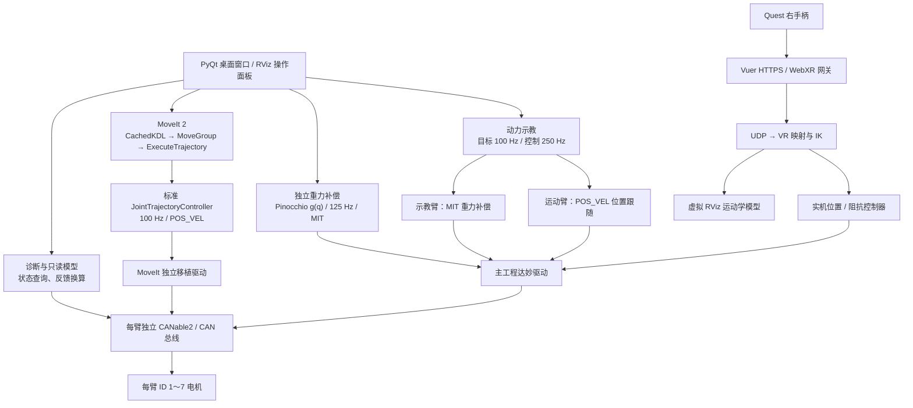
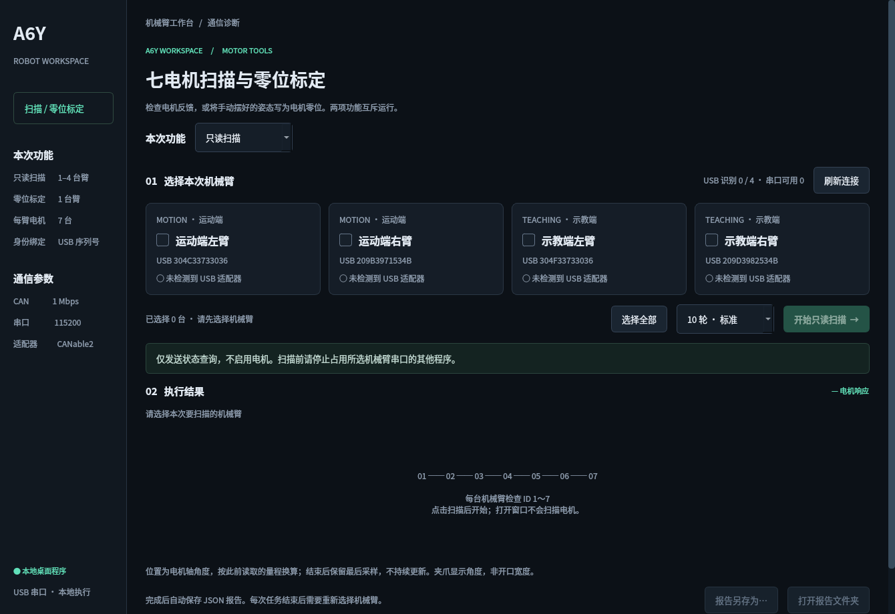
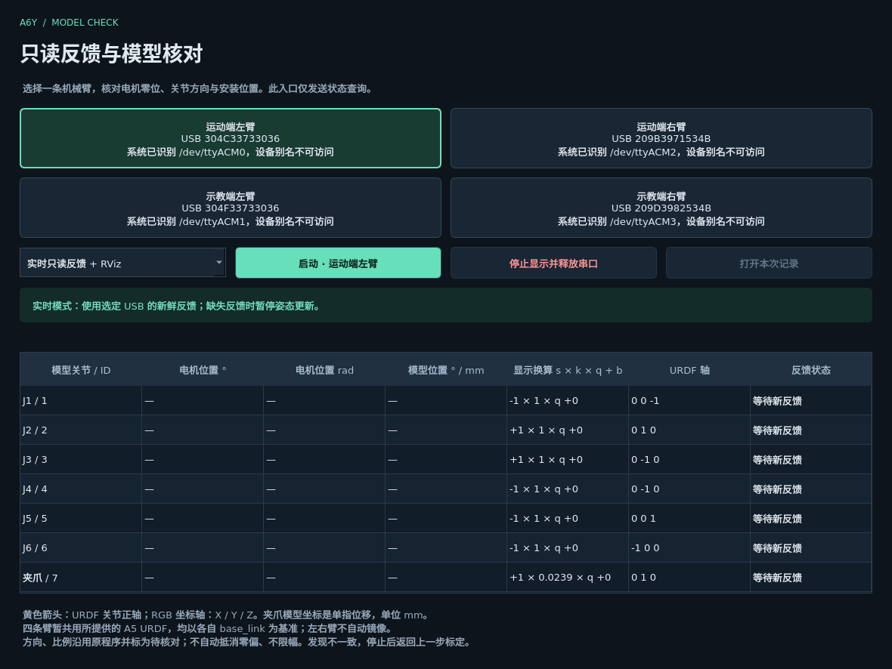
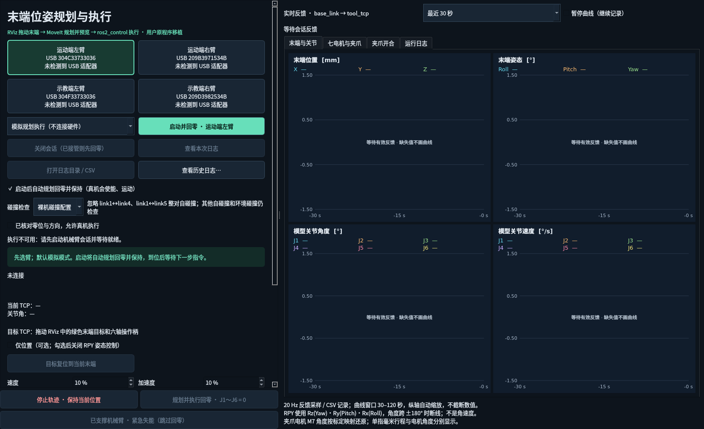
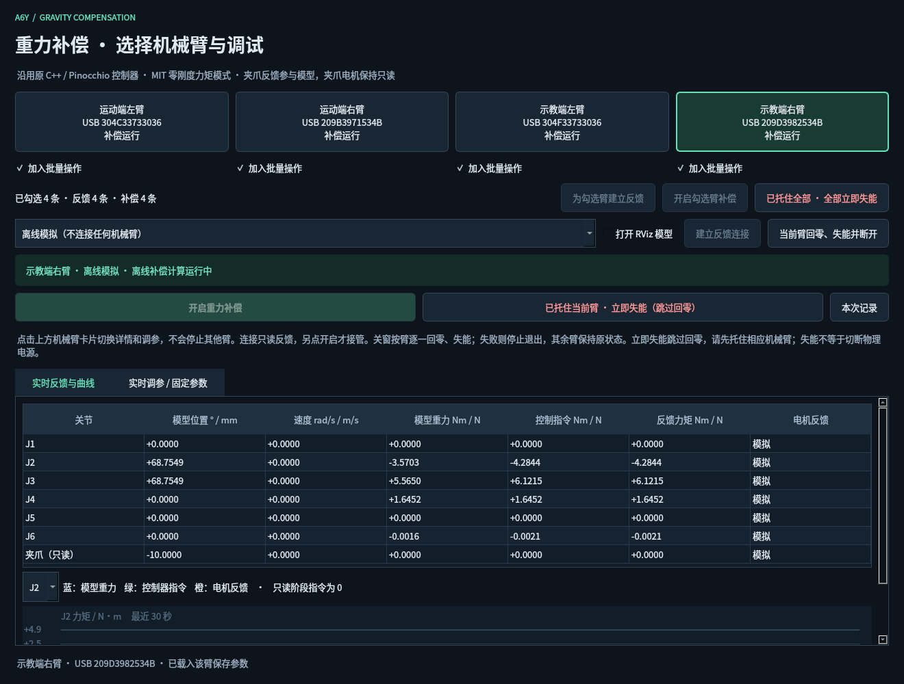
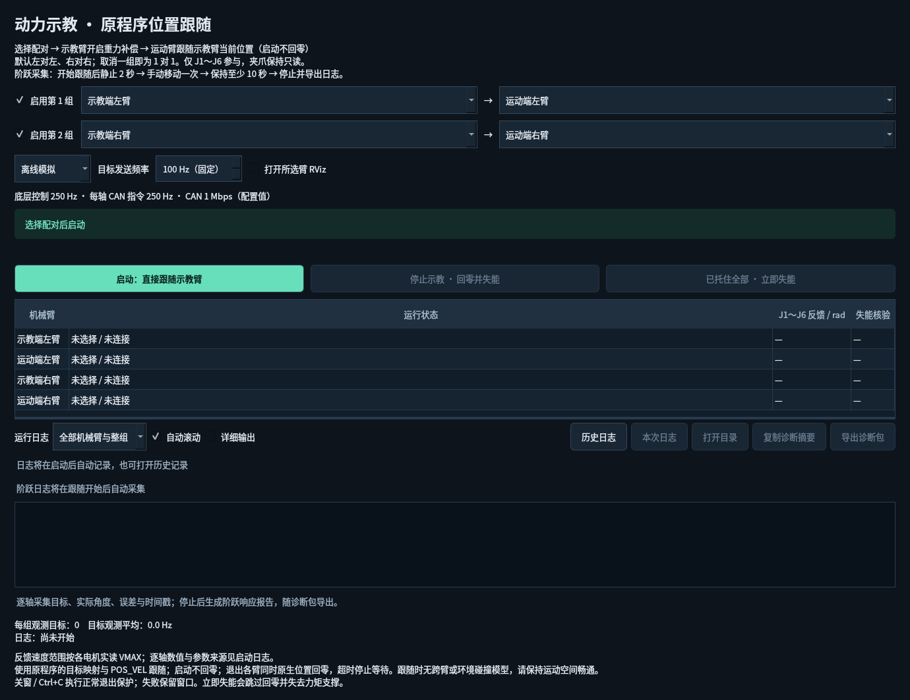
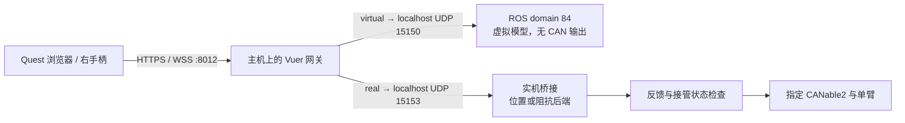
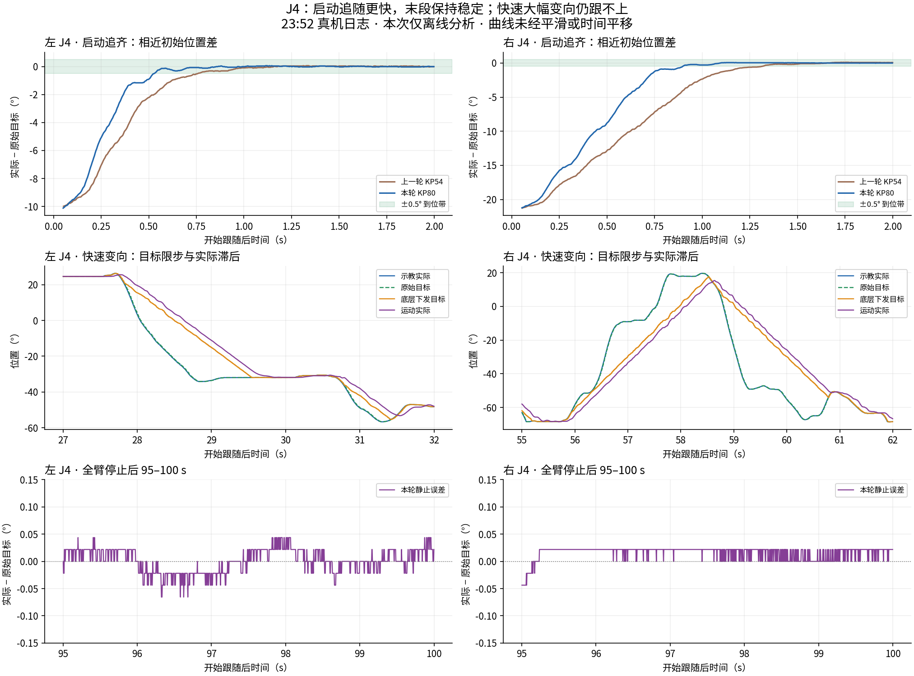

# A6Yarm · 四臂控制、动力示教与 VR 遥操作

**从电机诊断、模型核对到末端规划、重力补偿和主从示教的 A6Y 机械臂程序合集。**

基于 ROS 2 Humble、ros2_control、MoveIt 2、Pinocchio 和 PyQt5，面向使用、调试与继续开发这套机械臂系统的人员。仓库包含源码、CAD 模型、设备配置、桌面工具、启动脚本、离线测试及实验分析程序。


*图 1：已有 MoveIt 模拟会话的 RViz 截图，展示机械臂模型与 XYZ / RPY 操作柄。图中夹爪百分比为旧版模型行程定义，当前电子端点见下文 MoveIt 说明。*

[项目简介](#introduction) · [代码框架](#architecture) · [软硬件要求](#requirements) · [安装与配置](#setup) · [功能与启动](#usage) · [调试说明](#debugging) · [测试与文档](#development)

<a id="introduction"></a>

## 项目简介

当前工作模型是 **A5 CAD 模型**，保留 `A6-Y-G` 工程目录和已有 ROS 包名。每臂有 **6 个旋转关节 + 1 个夹爪电机**，共 7 个独立驱动；另一个手指通过 URDF `mimic` 联动，不是第 8 台电机。四臂角色为运动端左／右臂、示教端左／右臂。

| 能力 | 可完成的工作 |
| --- | --- |
| 通信与标定 | 按 USB 身份认臂、查询 7 台电机、查看反馈、显式写入电机零位 |
| 模型核对 | 显示电机角度、模型角度和夹爪位移，在 RViz 中检查方向与姿态 |
| MoveIt 控制 | XYZ / RPY 目标预览、轨迹规划与执行、夹爪控制、实时曲线与日志 |
| 重力补偿 | 单臂或多臂 MIT 重力补偿、在线调参、按臂保存参数 |
| 动力示教 | 1 对 1 / 2 对 2 主从跟随、交叉配对、频率与阶跃响应记录 |
| VR 遥操作 | Quest 右手柄驱动虚拟模型，或使用独立的位置／阻抗实机入口 |
| 底层开发 | 关节与笛卡尔阻抗控制器、电机参数工具、单关节测试和离线回归 |

本文按 **2026-11-26 的源码与配置**核对。模拟界面、驱动 `dry_run` 和 PTY 虚拟串口测试用于验证不同层面的软件行为，均不等同于真机动力学验收。已有设备记录和参数也不代表新机械臂完成了零位、方向、负载及工作空间标定。

<a id="architecture"></a>

## 代码框架

### 控制与数据流



图中表示可选运行链路；同一实体串口不能被多个模块同时占用。MoveIt 和主工程含有**同名但不同实现的 `a6_y_ros2_control` 包**，启动器分别构建、分别加载。不能把两套源码放进同一次 `colcon build`。

### 目录与职责

```text
A6Yarm/
├── README.md                         # 安装、使用和调试总入口
├── A6-Y-G/
│   ├── src/
│   │   ├── A5/                      # a5_description：URDF、STL、关节与末端模型
│   │   ├── a6_y_ros2_control/        # 主工程 C++ 驱动、Python 电机工具
│   │   ├── a6_y_controllers/         # 重力、关节阻抗、笛卡尔阻抗、VR 位控
│   │   ├── a6_y_teleop/              # leader-follower 映射与 ROS 节点
│   │   ├── a6_y_teleop_msgs/         # 示教相关消息与服务
│   │   └── a6_y_vr_teleop/           # VR 输入、IK、实机桥接和验证
│   ├── tools/
│   │   ├── arm_diagnostics/         # 四臂扫描、USB 身份核验、标零
│   │   ├── arm_visualization/       # 只读反馈、关节映射、RViz
│   │   ├── arm_moveit/              # MoveIt 桌面程序、生命周期与日志
│   │   │   ├── ros2_stack/src/      # 独立移植的 MoveIt 配置与驱动
│   │   │   └── rviz_panel/          # A6Y RViz C++ 操作面板
│   │   └── arm_gravity/             # 重力补偿、动力示教、在线调参与分析
│   ├── scripts/                     # 统一启动、环境隔离、构建与测试入口
│   ├── vr_gateway/                  # Quest 网关与固定 Python 依赖
│   └── docs/                        # 按主题分类的技术文档与图片
└── diagnostics/
    ├── arm_roles.yaml               # 四臂 USB 角色绑定，运行时需要
    ├── all_arms_20261124_1737.json    # 已读取的四臂电机参数基准
    └── …                            # 参数快照、分析程序、曲线和验证摘要
```

**请保留 `A6-Y-G/` 与 `diagnostics/` 相邻的目录关系。** 启动器按自身路径找配置，可以克隆到其他目录。历史文档中的 `/home/...` 是开发时路径；新环境使用本文命令。历史分析脚本的原始数据依赖另见 [diagnostics 说明](diagnostics/README.md)。

<a id="requirements"></a>

## 软硬件环境要求

### 硬件与连接

| 项目 | 要求与用途 |
| --- | --- |
| 主机 | Linux 电脑；本机核对环境为 x86_64。仓库没有经测试的最低 CPU / 内存指标 |
| 机械臂 | 当前 A5 结构、6 轴机械臂与 1 个夹爪驱动；单臂功能需 1 臂，1 对 1 示教需 2 臂，2 对 2 需 4 臂 |
| USB-CAN | 每臂 1 个 CANable2，使用程序支持的 SLCAN 固件，各臂独立总线 |
| 通信 | CAN **1 Mbps**；串口参数 **115200 baud**；不同臂可重复使用 ID 1～7 |
| 供电与安装 | 按实际电机／机械臂规格供电并固定底座；仓库未给出经过核验的整机电压、功率或额定负载 |
| 图形环境 | PyQt5 窗口与 RViz 需要图形桌面；无桌面环境可先执行 CLI 配置检查 |
| VR 可选项 | 支持 WebXR 的 Quest 及右手柄，与主机处于可互通的局域网；网关默认 HTTPS 8012 端口 |
| 无硬件使用 | 配置检查、离线测试、MoveIt 模拟和 VR 虚拟模型不需要实体机械臂 |

当前 [`a5_motors.yaml`](A6-Y-G/src/a6_y_controllers/config/a5_motors.yaml) 的电机分配如下。它是**配置约定**，更换硬件后应对照实物确认。

| 关节 | 电机型号 | 指令 ID | 反馈 ID |
| --- | --- | --- | --- |
| J1～J3 | DM4340P | `0x01`～`0x03` | `0x11`～`0x13` |
| J4～J6 | DM4310 | `0x04`～`0x06` | `0x14`～`0x16` |
| 夹爪 | DM3507 | `0x07` | `0x17` |

### 软件基线

| 软件 | 本项目要求／当前核对值 |
| --- | --- |
| 操作系统 | Ubuntu 22.04；本机为 22.04.5 LTS |
| ROS | ROS 2 Humble，安装路径 `/opt/ros/humble` |
| Python | 系统 Python 3.10；ROS 工具使用 `/usr/bin/python3` |
| 构建工具 | CMake、C++ 编译器、colcon、rosdep；RViz 面板使用 Qt5 Widgets |
| 控制与规划 | ros2_control、ros2_controllers、MoveIt 2、RViz2、xacro |
| Pinocchio | **≥ 4.0** 的 C++ 库与匹配 Python 绑定；本机核对为 4.0.0，控制器使用原生 mimic 支持 |
| 桌面与数据 | PyQt5、PySerial、python-can、PyYAML、NumPy、SciPy、Matplotlib、Pandas |
| DDS | MoveIt、重力补偿和示教入口默认使用 CycloneDDS |
| VR 网关 | 独立 `.venv-vr`，按 [`requirements.lock`](A6-Y-G/vr_gateway/requirements.lock) 安装 |

<a id="setup"></a>

## 安装与配置

### 1. 获取代码与安装依赖

仓库为私有仓库，克隆时使用具有访问权限的 GitHub 账号。若要构建主工作区，建议直接克隆到**纯英文路径**，避开 Humble `rosidl` 的中文路径问题。

```bash
mkdir -p ~/a6y-work
cd ~/a6y-work
git clone https://github.com/yangzz7/A6Yarm.git
cd A6Yarm/A6-Y-G
```

先安装 ROS 2 Humble，并确认 `/opt/ros/humble/setup.bash` 存在，再安装依赖：

```bash
sudo apt-get update
sudo apt-get install -y \
  build-essential cmake pkg-config git psmisc qtbase5-dev \
  python3-colcon-common-extensions python3-rosdep python3-pytest \
  python3-can python3-serial python3-yaml python3-numpy python3-scipy \
  python3-pyqt5 python3-matplotlib python3-pandas python3-venv fonts-noto-cjk \
  ros-humble-ros2-control ros-humble-ros2-controllers ros-humble-moveit \
  ros-humble-rviz2 ros-humble-xacro ros-humble-robot-state-publisher \
  ros-humble-rmw-cyclonedds-cpp ros-humble-pinocchio

# 仅尚未初始化 rosdep 的机器执行一次：sudo rosdep init
rosdep update
source scripts/environment.bash
rosdep install --from-paths src tools/arm_moveit/ros2_stack/src \
  tools/arm_moveit/rviz_panel --ignore-src --rosdistro humble \
  --skip-keys ament_python -y

/usr/bin/python3 -c 'import pinocchio; print(pinocchio.__version__)'
```

现有 Python 包声明中的 `ament_python` 无法被本机 `rosdep` 解析，因此跳过这个键，Python 包构建由已安装的 colcon 支持。其余依赖仍由 rosdep 处理，包括上游 MoveIt 包声明的 `warehouse_ros_mongo`。软件源中的 Pinocchio 版本可能不同；若低于 4.0，需先准备满足要求的 C++ 库与对应 Python 绑定。

`environment.bash` 会清理旧 ROS overlay、Conda 及用户 Python 路径，并切回系统工具链，请在专用终端中加载。不要把 VR 网关的 pip 依赖安装到 ROS 系统 Python 中。

### 2. 串口权限与四臂身份

```bash
ls -l /dev/serial/by-id/
groups

# 仅当前用户尚无串口访问权限时执行；完成后注销并重新登录
sudo usermod -aG dialout "$USER"
```

| 角色 | 机械臂 | 当前绑定的 USB 序列号 |
| --- | --- | --- |
| `motion_left` | 运动端左臂 | `304C33733036` |
| `motion_right` | 运动端右臂 | `209B3971534B` |
| `teaching_left` | 示教端左臂 | `304F33733036` |
| `teaching_right` | 示教端右臂 | `209D3982534B` |

更换设备时，逐个插入适配器识别身份，更新 [`arm_roles.yaml`](diagnostics/arm_roles.yaml) 中的 `usb_serial` 和 `by_id`。不要按会随插拔变化的 `ttyACM0/1/...` 猜测角色。原 USB 序列号也写入了关节映射、量程记录和分臂参数文件，换臂时需要一起核对。

### 3. 关节、量程与控制参数

| 配置 | 配置内容与注意事项 |
| --- | --- |
| [`joint_mapping.yaml`](A6-Y-G/tools/arm_visualization/joint_mapping.yaml) | 角色、关节方向、比例与零偏；当前文件明确标记为尚未完成四臂逐一验证 |
| [`motor_position_limits.yaml`](A6-Y-G/tools/arm_diagnostics/motor_position_limits.yaml) | 扫描反馈解码使用的逐 USB、逐电机 PMAX |
| [`motor_limits.json`](A6-Y-G/tools/arm_gravity/motor_limits.json) | 重力／示教使用的实读 PMAX、VMAX、TMAX 等量程记录 |
| [`profiles/`](A6-Y-G/tools/arm_gravity/profiles/) | 按角色与 USB 保存的重力补偿参数；无专属文件的角色使用基础配置 |
| [`a5_gravity_controllers.yaml`](A6-Y-G/src/a6_y_controllers/config/a5_gravity_controllers.yaml) | 主工程重力补偿基础参数；桌面入口会生成会话配置 |
| [`gripper_limits.yaml`](A6-Y-G/tools/arm_moveit/gripper_limits.yaml) | MoveIt 夹爪电子闭合／张开端点及分臂覆盖 |
| [`collision_policy.yaml`](A6-Y-G/tools/arm_moveit/collision_policy.yaml) | MoveIt 完整／裸机碰撞检查与分臂例外 |
| [`a5_vr_position_full_motors.yaml`](A6-Y-G/src/a6_y_controllers/config/a5_vr_position_full_motors.yaml) | 完整 VR 位置控制的独立电机配置，不自动继承四臂桌面入口的全部配置 |

反馈换算为 `q_model = sign × position_scale × q_motor + offset`。六轴模型量为 rad；夹爪为单指位移 m，当前比例为 `0.0239 m/rad`。左右臂不会自动镜像。**协议 PMAX／VMAX 是编解码范围，不是经过确认的机械行程或安全运动速度。**

### 4. 按功能选择构建方式

| 功能 | 构建方式 |
| --- | --- |
| 扫描／标零、只读 RViz | 无需编译本项目控制器；只读 RViz 需要 ROS 基础包 |
| MoveIt 桌面 | 启动器自动构建独立源码到 `/tmp/a6y-moveit-build-<uid>/`，面板在 `A6-Y-G/build/arm_moveit_ui/` |
| 重力补偿／动力示教 | 启动器自动构建到 `/tmp/a6y-gravity-build-<uid>/` |
| 主工程 ROS launch、阻抗、VR | 按下方命令显式构建 `src/` |

```bash
# 在 A6Yarm/A6-Y-G/ 下执行；用于主工作区
source scripts/environment.bash
export MAKEFLAGS='-j2 -l2'
colcon build --base-paths src --symlink-install --executor sequential \
  --cmake-args -DCMAKE_BUILD_TYPE=Release
a6y_load_install
```

工程根目录有 `COLCON_IGNORE`，因此保留 `--base-paths src`。内存紧张时可用 `MAKEFLAGS='-j1 -l1'`。桌面工具的 `/tmp` 构建缓存被清理后，下次启动会重建；启动器在源码变化时也会更新缓存。

ROS 诊断终端需与入口使用相同的 domain 和 DDS 设置。默认值如下，启动脚本均将 ROS 通信限制在本机；Quest 经 HTTPS 网关进入，不直接加入 ROS 网络。

| 入口 | 默认 `ROS_DOMAIN_ID` | 可覆盖的环境变量 |
| --- | --- | --- |
| 只读 RViz | 194 | `A6Y_REVIEW_DOMAIN_ID` |
| MoveIt 桌面 | 196 | `A6Y_MOVEIT_DOMAIN_ID` |
| 重力补偿／动力示教 | 197 | `A6Y_GRAVITY_DOMAIN_ID` |
| VR 虚拟模型 | 84 | `A6Y_VR_DOMAIN_ID` |
| VR 实机／其 mock | 实机 0；mock 固定 86 | 实机使用 `A6Y_REAL_ROS_DOMAIN_ID` |


<a id="usage"></a>

## 程序功能与启动指令

**本节命令均在 `A6Yarm/A6-Y-G/` 执行，各模块分别启动。** 首次上手按“无硬件检查 → 只读反馈 → 模型核对 → 所需控制功能”的顺序进行。

### 启动速查

| 模块 | 命令 | 默认状态 |
| --- | --- | --- |
| 扫描／标零窗口 | `bash scripts/run_arm_scan.bash` | 只读扫描选项；点击开始前不扫描 |
| 只读模型窗口 | `bash scripts/run_arm_rviz.bash` | 选择机械臂后启动只读显示 |
| MoveIt | `bash scripts/run_arm_moveit.bash` | 模拟模式；启动自动回零已勾选 |
| 重力补偿 | `bash scripts/run_arm_gravity.bash` | 模拟模式；连接与开启补偿分开操作 |
| 动力示教 | `bash scripts/run_arm_teaching.bash` | 模拟模式、左对左＋右对右；启动直接跟随 |
| VR 虚拟模型 | `bash scripts/run_vr_rviz.bash` | 纯运动学模型，无串口输出 |
| Quest 网关 | `bash scripts/run_vr_gateway.bash --profile virtual` | 虚拟输入协议，UDP 15150 |
| VR 常规位控入口 | `bash scripts/run_vr_position.bash` | `readonly`，不会允许 prepare / arm |
| VR 完整位控入口 | `bash scripts/run_vr_position_full.bash` | **commission / follow / full**；启动 DISABLED，手动接管 |
| VR 阻抗入口 | `bash scripts/run_vr_real.bash` | `readonly`；实机 execute 需要通过标定检查 |

### 1. 七电机扫描与零位标定

```bash
# 不打开串口，只核对角色和配置
bash scripts/run_arm_scan.bash --cli --arms motion_left teaching_right --dry-run

# 图形窗口
bash scripts/run_arm_scan.bash

# 真机只读查询：指定一臂，查询 10 轮
bash scripts/run_arm_scan.bash --cli --arms motion_left --passes 10
```

第一条命令在当前配置中的输出：

```text
运动端左臂 [motion_left]  USB=304C33733036
示教端右臂 [teaching_right]  USB=209D3982534B
DRY RUN：没有打开串口；本次目标为每臂 ID 1～7。
```



*图 2：2026-11-26 当前源码的未连接界面；未启动扫描或连接实体串口。*

只读扫描仅发送状态查询，不使能电机。标零需要在窗口中切换为**写入电机零位**，一次选择一臂，在支撑、静止、失能状态下操作。它把当前物理姿态写成电机零点，**不会把机械臂运动到零位**；应按逐电机结果确认，不能把部分成功当作整臂完成。详细流程见 [扫描与标定说明](A6-Y-G/tools/arm_diagnostics/README.md)。

### 2. 只读反馈与 RViz 模型核对

```bash
# 不连接串口，不启动 ROS / RViz，检查模型与映射
bash scripts/run_arm_rviz.bash --cli --arm motion_left --dry-run

# GUI：选择臂后启动只读反馈与 RViz
bash scripts/run_arm_rviz.bash

# 无硬件预览：显示模型零姿态
bash scripts/run_arm_rviz.bash --cli --arm motion_left --preview
```



*图 3：已有只读模型窗口截图，展示电机量、模型量及换算关系；表中空值表示尚无有效反馈。*

逐轴核对机械臂实际姿态、正方向和模型变化，再确认夹爪比例。该入口没有运动控制器，不做自动零偏修正，也不把越界反馈裁剪成“正常值”。配置中的 `mapping_verified: false` 提醒当前映射仍需实物核对。

### 3. MoveIt 末端规划与夹爪控制

```bash
# 常规入口，默认模拟模式
bash scripts/run_arm_moveit.bash

# 先读反馈：取消默认启动自动回零，并预选机械臂
bash scripts/run_arm_moveit.bash --arm motion_left --read-only-start

# 使用完整模型碰撞检查
bash scripts/run_arm_moveit.bash --read-only-start --collision-profile full

# 仅核对配置与包来源，不运行机械臂会话；首次可能构建依赖
bash scripts/run_arm_moveit.bash --check-config
```



*图 4：2026-11-26 当前源码的未连接界面。右侧反馈缺失时保持空白，不生成模拟测量曲线。*

1. 选择机械臂与模拟／真机模式。真机点击“启动并回零”会授予执行许可、接管 **7 台电机**并规划 J1～J6 回零；先核对实物时使用只读启动。
2. 在 RViz 的 **Interact** 模式拖动箭头改变 XYZ，拖动圆环改变 RPY；拖动仅更新目标预览。勾选“仅位置”时不固定末端姿态。
3. 设置速度、加速度比例，点击 **规划 Plan** 检查轨迹，再点击 **执行 Execute**。默认两项比例均为 10%。只读启动后需手动勾选执行许可。
4. 夹爪独立设置目标，再规划、执行。当前 0%／100% 对应电子闭合／张开端，单指位置为 **−0.7 / −34.3 mm**；两端各内收 0.7 mm，尚不代表四臂实物端点均已测定。
5. 右侧监视末端、六轴、七电机、夹爪目标与反馈。目标采样 20 Hz、窗口约 10 Hz 刷新；回零后末端相对曲线以本次实测零姿态为参考，CSV 仍保留绝对 TCP。

当前默认裸机碰撞配置整对忽略 `link1↔link4`、`link1↔link5`，运动端右臂额外忽略 `link2↔link4`。这些连杆对不再受自碰撞检查；未建模的桌面、线缆与其他机械臂也不自动成为障碍物。绿色预览只表示通过当前配置的检查。详见 [MoveIt 使用说明](A6-Y-G/tools/arm_moveit/README.md)。

### 4. 单臂／多臂重力补偿

```bash
bash scripts/run_arm_gravity.bash

# 预选一臂并取消 RViz；不会自动连接或使能
bash scripts/run_arm_gravity.bash --role teaching_left --no-rviz

# 模型、身份和参数离线检查；首次可能构建依赖
bash scripts/run_arm_gravity.bash --check
```



*图 5：2026-11-25 四臂离线模拟记录，展示各臂状态、模型重力、控制指令和模拟反馈；不是四臂真机补偿效果证明。*

先“建立反馈连接”，再托住机械臂并“开启重力补偿”。六轴以 **125 Hz、MIT 零刚度模式**执行重力、阻尼与平滑摩擦项，夹爪只读。算法为 `限幅(方向 × 系数 × g(q) − 阻尼 × dq + 摩擦项)`；MIT 电机端 Kp、Kd 为 0，阻尼在控制器中计算。

重力系数、阻尼和摩擦项可通过“实时应用”在 0.3 秒内平滑过渡；等待显示“已生效”后固定参数。方向与总力矩上限在断开后修改。参数按角色和 USB 保存，保存并不表示已通过真机验证。多臂可分别运行与切换详情；批量开启不保证各臂在同一控制周期开始。见 [重力补偿与调参](A6-Y-G/tools/arm_gravity/README.md)。

### 5. 1 对 1／2 对 2 动力示教

```bash
bash scripts/run_arm_teaching.bash

# 离线核对模型、配对及控制参数
bash scripts/run_arm_teaching.bash --check
```



*图 6：2026-11-26 当前源码的未连接界面，明确显示“启动不回零”、100 Hz 目标发送和 250 Hz 底层控制。*

默认示教左臂→运动左臂、示教右臂→运动右臂；取消一组即为 1 对 1，也可交叉配对。示教臂使用 MIT 重力补偿，运动臂使用 POS_VEL 跟随，**夹爪不参与**。

**启动直接跟随示教臂当前绝对关节位置，不先回零，也不保留两端初始姿态差。** 启动前对齐姿态并确认运动空间。当前目标发布为 100 Hz，底层控制与每轴指令配置为 250 Hz，CAN 为 1 Mbps；这些是软件配置频率，不代表电机内部闭环频率或端到端时延。

跟随目标使用电机协议量程换算的边界，不应视为完整机械行程／碰撞保护；跟随阶段没有跨臂或环境碰撞模型。退出流程与独立重力补偿不同，见下表和 [动力示教说明](A6-Y-G/tools/arm_gravity/TEACHING.md)。

### 停止、回零与失能的区别

| 入口 | 正常停止／退出 | 立即失能 |
| --- | --- | --- |
| MoveIt | 停止轨迹时保持当前位置；已接管会话正常关闭时规划六轴回零、核验后失能；未接管只读会话直接关闭 | 跳过回零并释放力矩 |
| 独立重力补偿 | 已补偿的臂通过 MoveIt 规划及受限关节阻抗回零，再失能；关窗按臂依次处理 | 可中断回零；对选定臂／全部臂按对应按钮操作 |
| 动力示教 | 先停止跟随，随后各臂并发使用原生位置控制回零，再逐臂核验失能；等待有超时 | 中断流程、跳过回零，对整组失能 |
| VR 实机 | 使用该后端的 pause / disarm 状态机，不沿用上述桌面回零流程 | 按 VR 文档处理，不能假定暂停等于断电 |

正常回零或核验失败时，桌面工具会报告原因并取消正常退出。**立即失能后机械臂失去力矩支撑，需要托住；软件失能不等于切断电源。** 强制结束进程、USB 丢失或电脑重启不能保证完成回零和失能。

### 6. Quest VR：先虚拟，再核对实机模式

先完成主工作区构建。在未加载 ROS 的新终端、`A6-Y-G/` 下创建独立网关环境：

```bash
/usr/bin/python3 -m venv .venv-vr
.venv-vr/bin/python -m pip install -r vr_gateway/requirements.lock

# 将示例值改为这台主机的局域网 IPv4 地址
A6Y_HOST_IP="192.168.1.100"
bash scripts/create_vr_certificate.bash "$A6Y_HOST_IP"
```

证书脚本接收一个 IP 参数，已有证书／私钥时会拒绝覆盖。生成的私钥由本机保管，不进入 Git。

```bash
# 终端 A：虚拟 RViz 模型
bash scripts/run_vr_rviz.bash
```

```bash
# 终端 B：Quest 网关
bash scripts/run_vr_gateway.bash --profile virtual
```

在 Quest 浏览器访问 `https://主机局域网IP:8012` 并按 [VR 虚拟模型说明](A6-Y-G/docs/VR遥操作/虚拟机械臂/VR_RVIZ_USAGE.md) 完成证书和 WebXR 设置。网页采集右手柄输入，完整模型显示在电脑 RViz；它不是电脑画面串流。首次连接或重连先松开握把，再按住进入跟随；松开进入 HOLD。



实机使用独立输入协议与 UDP 端口，网关改为 `bash scripts/run_vr_gateway.bash --profile real`。实机入口的 `can_channel` 默认仍是 `/dev/ttyACM0`；应显式传入已核对的稳定路径，并先核对对应 VR 电机、零位和量程配置，不能仅靠桌面四臂角色绑定认臂。

下面用当前 `motion_left` 配置读取稳定路径，**只启动读取反馈的模式**；更换目标臂需改角色并完成相应配置核对：

```bash
A6Y_CAN="$(/usr/bin/python3 -c 'import yaml; print(yaml.safe_load(open("../diagnostics/arm_roles.yaml"))["roles"]["motion_left"]["by_id"])')"
bash scripts/run_vr_position.bash mode:=readonly can_channel:="$A6Y_CAN"
```

完成单臂校准与实机调试条件后，完整位控使用以下独立流程。`run_vr_position_full.bash` 默认是 **`mode:=commission stage:=follow motion_range:=full operator_trial:=true`**，并非 readonly；启动状态仍为 DISABLED。

```bash
# 使用上一步核对的 A6Y_CAN；先关闭同一臂的其他会话
bash scripts/run_vr_position_full.bash can_channel:="$A6Y_CAN"
```

```bash
# 另一个终端；先检查状态，只有满足接管条件时再逐步执行
bash scripts/vr_position_control.bash status
bash scripts/vr_position_control.bash prepare
bash scripts/vr_position_control.bash arm

# 暂停／失能接口；含义以返回状态为准
bash scripts/vr_position_control.bash pause
bash scripts/vr_position_control.bash disarm
```

完整位控关闭未标定 CAD 网格的碰撞硬检查，仍有其配置的范围、超时和状态检查，**不提供自动自碰或环境避障**。位置后端当前不支持 `mode:=execute`；阻抗入口 `run_vr_real.bash` 默认只读，严格 execute 会检查标定清单，不能假定现有记录已满足。完整步骤、状态与边界见 [VR 实机说明](A6-Y-G/docs/VR遥操作/实机控制/VR_REAL_ROBOT_USAGE.md)。

### 7. 主工程控制器与单关节开发入口

这些命令使用主工作区 `install/`，适合控制器开发。先加载环境，以下三个 launch **择一运行**，示例均为无实体串口的 `dry_run`：

```bash
source scripts/environment.bash
a6y_load_install

ros2 launch a6_y_controllers a5_gravity_comp.launch.py \
  dry_run:=true auto_enable:=false use_rviz:=true

ros2 launch a6_y_controllers a5_joint_impedance.launch.py \
  dry_run:=true auto_enable:=false use_rviz:=true

ros2 launch a6_y_controllers a5_cartesian_impedance.launch.py \
  dry_run:=true auto_enable:=false use_rviz:=true
```

`scripts/run_j1_position_test.bash`～`run_j3_position_test.bash` 和 `run_j1_highspeed_test.bash`～`run_j4_highspeed_test.bash` 是专用测试入口。先通过 `bash scripts/run_j1_position_test.bash --help` 查看参数，再按 [电机调试文档索引](A6-Y-G/docs/README.md) 配置；这些脚本会执行测试动作，不应作为普通连接检查使用。

<a id="debugging"></a>

## 调试说明

### 推荐排查顺序

1. **身份与连接**：查看 `/dev/serial/by-id/`，确认 USB 序列号对应角色；关闭占用同一串口的旧会话，检查串口权限、CAN 接线与适配器固件。
2. **七电机反馈**：用扫描 CLI 检查 ID 1～7 是否都有新鲜响应、状态和故障信息。缺失电机先定位通信，不通过使能或反复运动验证连线。
3. **协议量程**：读取各电机 PMAX、VMAX、TMAX，与本臂量程记录对照；不同 USB 下相同型号也可能配置不同。
4. **模型与标定**：在只读 RViz 中逐轴核对方向、零位和夹爪比例；异常时检查 `joint_mapping.yaml` 和实际电机配置。软件回零、写电机零位、修改模型零偏是三种不同操作。
5. **单臂再配对**：先验证所需模式的一条臂，再做重力调参或示教配对；每轮改变少量参数并保存会话记录。
6. **目标、命令与反馈分开看**：轨迹规划成功不表示已执行；目标已发布不表示电机到位。结合许可状态、下发目标、反馈年龄与失能核验分析。

### 参数读取与只读反馈工具

先执行不连接串口的预览，核对解析出的关节、型号、ID 与参数：

```bash
/usr/bin/python3 src/a6_y_ros2_control/tools/read_motor_params.py \
  --config src/a6_y_controllers/config/a5_motors.yaml \
  --all --params PMAX,VMAX,TMAX --dry-run
```

确定 `A6Y_CAN` 为要检查的真实稳定路径、配置与该臂匹配且串口未被占用后，去掉 `--dry-run` 并传入 `--channel "$A6Y_CAN"` 可读取寄存器。原始反馈工具会向新 JSONL 文件记录，已有文件不覆盖：

```bash
/usr/bin/python3 src/a6_y_ros2_control/tools/damiao_feedback_watch.py \
  --channel "$A6Y_CAN" \
  --config src/a6_y_controllers/config/a5_motors.yaml \
  --duration 20 --log /tmp/a6y-feedback-new.jsonl
```

这些是底层工具，不替你选择四臂角色。改 ID、写模式、写 Flash 和写零位属于另外的操作，先阅读对应工具说明，勿用来处理尚未定位的通信故障。

### 动力示教：采集与分析一次阶跃

开始跟随后静止 **2 秒**，手动改变一次示教端姿态，保持至少 **10 秒**，再停止并导出日志。会话保存原始目标、实际下发目标、两端反馈、频率与数据质量信息。

```bash
# 改成实际会话目录；分析已有记录，不连接机械臂
A6Y_SESSION="../diagnostics/arm_teaching_reports/teaching_实际会话编号"
/usr/bin/python3 tools/arm_gravity/analyze_teaching_step.py "$A6Y_SESSION"
```

重点查看 `references.csv`、`frequency.csv`、`step_arms.csv`、`step_targets.csv`、`step_tracking.csv`、`step_summary.json` / `.txt` 和 `step_quality.json`。比较稳定时间、超调和误差时，同时检查有效反馈、丢样和目标限步；串口 `send_complete_time` 只表示主机串口写入完成，不是电机 CAN 确认或实际动作时刻。



*图 7：对已有真机日志的离线分析，展示启动追随、快速变向及静止误差。该次结果仍存在快速大幅变向滞后，不作为整个系统的性能保证。分析程序和报告见 [该次分析目录](diagnostics/teaching_following_analysis_20261126_f1699253fb/)。*

### 日志位置与常见问题

下表路径相对于仓库根目录。新运行的批量会话日志被 Git 忽略，需要在本机保存或从界面导出。

| 路径／文件 | 用途 |
| --- | --- |
| `diagnostics/arm_scan_reports/` | 扫描与标零报告 |
| `diagnostics/arm_rviz_reports/`、`arm_rviz_logs/` | 只读模型记录及 ROS 输出 |
| `diagnostics/arm_moveit_native_reports/<role>_<id>/` | `application.log`、`events.jsonl`、`telemetry.csv`、规划轨迹及 ROS 子进程日志 |
| `diagnostics/arm_gravity_reports/<role>_<id>/` | 参数、CSV、事件、回零规划与退出结果 |
| `diagnostics/arm_teaching_reports/teaching_<id>/` | 整组示教流程、各臂日志、频率与阶跃报告 |
| `A6-Y-G/validation/vr_commission/` | 未显式指定记录文件时，VR commission 阶段生成的 JSONL |

| 现象 | 优先检查 |
| --- | --- |
| ROS 包不存在／加载了旧驱动 | 开新终端，使用相应 `run_*.bash`；主工程先 `a6y_load_install`，不要叠加两套同名驱动 |
| rosdep 提示无法解析 `ament_python` | 使用安装命令中的 `--skip-keys ament_python`；确认 colcon 已安装 |
| Pinocchio 版本／导入错误 | 先 source 环境，检查系统 Python 与 CMake 找到的版本，要求 ≥ 4.0；venv 中的版本不能替代 C++ 库 |
| 编译出现中文路径／接口生成错误 | 主工作区克隆到纯英文实际路径；桌面入口使用自动生成的英文构建缓存 |
| USB 可见但串口不可用 | `dialout` 权限、稳定路径、固件是否进入 DFU、是否被其他进程占用；不要随意杀掉正在控制机械臂的进程 |
| 规划通过但执行按钮灰色 | 执行许可、当前操作是否结束、规划是否过期；改目标或速度后需重新规划 |
| 轨迹返回 −2／回零失败 | 查看具体碰撞连杆、起点、跟踪误差和保护事件；IK 目标有效不等于整条轨迹有效 |
| 重力补偿拒绝接管／电脑重启后仍使能 | 看电机实际反馈状态；托住后按流程失能并核验，再手动接管，不能只看本进程的 enabled 标志 |
| 四臂启动等待控制器超时 | 串口占用与 ROS 日志；自定义 CycloneDDS 配置需保留足够参与者索引，默认见 `scripts/gravity_dds.xml` |
| Quest 连上但模型不动 | HTTPS / WebXR、右手柄事件与 pose_age、握把先释放再按下、virtual / real profile 是否匹配 |
| 历史分析脚本找不到 CSV | 该脚本可能依赖未入库的原会话文件；按 diagnostics 说明恢复数据，或使用通用阶跃分析器 |

<a id="development"></a>

## 测试、文档与开发说明

### 离线检查

以下检查不需要真实机械臂。诊断测试包含本机回环服务和 PTY，需要运行环境允许这些接口；各组按顺序运行，避免共享锁互相影响。

```bash
QT_QPA_PLATFORM=offscreen /usr/bin/python3 -s -m unittest discover \
  -s tools/arm_diagnostics -p 'test_*.py' -v

/usr/bin/python3 -s -m unittest discover \
  -s tools/arm_visualization -p 'test_*.py' -v

source scripts/environment.bash
/usr/bin/python3 -s -m unittest discover \
  -s tools/arm_moveit -p 'test_native.py' -v
```

扩展回归会构建模块并启动隔离 ROS / PTY 环境：

```bash
bash scripts/test_arm_gravity.bash
bash scripts/test_arm_teaching.bash
```

2026-11-26 入库时，干净源码副本上的诊断 52 项、只读模型 14 项、MoveIt 配置与来源 8 项，共 **74 项离线测试通过**；另完成 Python / Shell 语法及 JSON / XML 解析检查。这是指定范围的记录，未据此宣称全部 ROS 集成、阻抗控制或真机性能通过。历史验证记录仍包含部分阻抗回归失败、重力回零压力模型触发保护等边界，见各模块说明。

本次 README 整理还实际运行了扫描／模型／寄存器工具的 `dry-run`、MoveIt `--check-config`、重力补偿与动力示教 `--check`，均通过；本地 Markdown 解析、链接、图片与 Shell 示例语法检查通过。此次只做离线验证，没有连接实体串口或执行真机运动。

### 详细文档

| 文档 | 内容 |
| --- | --- |
| [工程详细说明](A6-Y-G/README.md) | 主工程、控制器、底层 launch 与历史调试 |
| [分类文档索引](A6-Y-G/docs/README.md) | VR、阻抗、电机调试、标定与验证 |
| [扫描与零位标定](A6-Y-G/tools/arm_diagnostics/README.md) | USB 身份、七电机扫描、写零位 |
| [只读模型检查](A6-Y-G/tools/arm_visualization/README.md) | 反馈换算、URDF / RViz 与零姿态 |
| [MoveIt 控制](A6-Y-G/tools/arm_moveit/README.md) | 规划、夹爪、碰撞策略、曲线与退出 |
| [四臂重力补偿](A6-Y-G/tools/arm_gravity/README.md) | 在线调参、参数固定、多臂与回零 |
| [动力示教](A6-Y-G/tools/arm_gravity/TEACHING.md) | 配对、频率、停止与阶跃日志 |
| [VR 虚拟机械臂](A6-Y-G/docs/VR遥操作/虚拟机械臂/VR_RVIZ_USAGE.md) | Quest、网关、RViz、录制与回放 |
| [VR 实机](A6-Y-G/docs/VR遥操作/实机控制/VR_REAL_ROBOT_USAGE.md) | 后端、模式、接管与停止状态 |
| [实验程序与数据](diagnostics/README.md) | 数据保留范围、历史脚本依赖 |
| [新增截图说明](A6-Y-G/docs/images/README.md) | 截图日期、状态与获取方式 |

### 修改与来源

修改控制逻辑时同时说明适用角色、运行模式、单位、参数来源及验证范围；修改启动参数时同步更新对应 README。故障记录应保留源码版本、角色／USB、启动命令、会话配置、事件与原始反馈，避免只提供界面截图。

仓库包含已有 A6-Y-G 工程及用户提供的 `A6_Y-main(1).zip` 移植源码。上游文件校验记录见 [`upstream_manifest.json`](A6-Y-G/tools/arm_moveit/ros2_stack/upstream_manifest.json)，适配差异见 [`upstream_changes.patch`](A6-Y-G/tools/arm_moveit/ros2_stack/upstream_changes.patch)。各 ROS 包保留其作者、来源和许可证声明；仓库目前没有统一的根目录 LICENSE，使用或分发时需检查具体组件。

Git 中保留程序、模型、配置、精选分析结果与验证摘要；编译安装目录、Python 虚拟环境、批量原始日志、修改前备份和 TLS 私钥不入库。文档按 [readme-writer-skill](https://clawhub.ai/api/v1/skills/readme-writer-skill/file?path=SKILL.md) 的工具项目结构整理，功能与行为以本仓库实现为依据。
