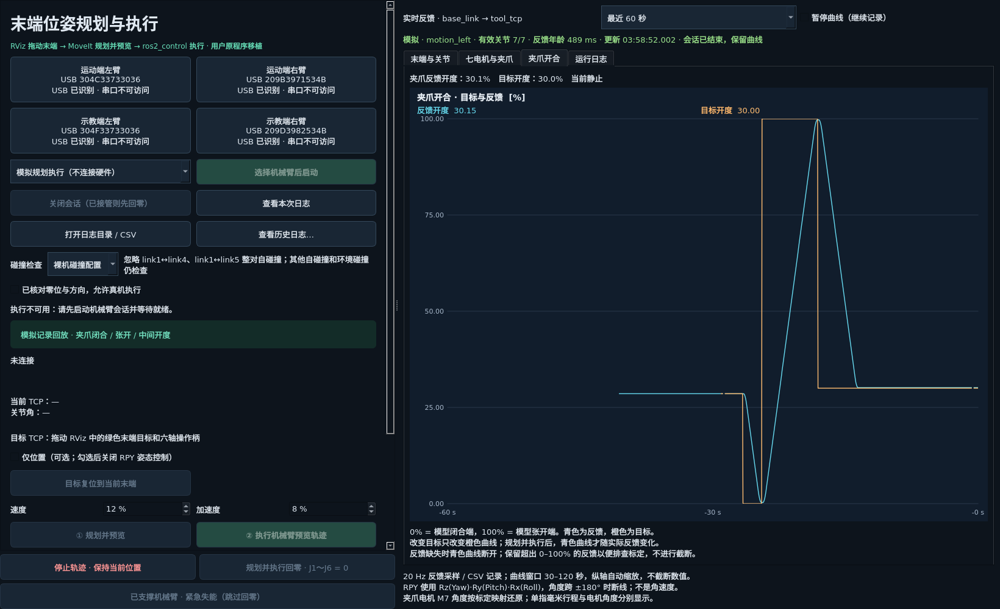

# A6Yarm：四臂控制、动力示教与 VR 遥操作

基于 **ROS 2 Humble、ros2_control、MoveIt 2、Pinocchio 和 PyQt5** 的 A6Y 机械臂程序合集，包含当前开发使用的源码、模型、配置、启动脚本、测试和实验分析程序。

当前工作模型为 **A5 CAD 模型**：六个旋转关节加一个夹爪电机，共七个独立控制自由度；第二个手指通过 URDF mimic 联动。四臂分别为运动端左／右臂、示教端左／右臂。仓库保留 `A6-Y-G` 项目名称及已有 ROS 包名，方便沿用现有程序。

> 当前版本整理于 **2026-11-26**。真机操作前，先核对本机 USB 身份、关节方向、零位和电机量程。界面的模拟模式、驱动 dry-run 和 PTY 虚拟电机验证均不代表真机动力学验证。

## 功能与入口

以下命令均在仓库的 **`A6-Y-G/` 目录**执行。

| 模块 | 启动命令 | 当前行为 / 说明 |
| --- | --- | --- |
| 四臂扫描与零位标定 | `bash scripts/run_arm_scan.bash` | 按角色选择机械臂；只读扫描七台电机，或显式选择写零位 |
| 只读模型与 RViz | `bash scripts/run_arm_rviz.bash` | 核对反馈、关节方向和模型姿态，不加载运动控制器 |
| MoveIt 末端控制 | `bash scripts/run_arm_moveit.bash` | 默认模拟模式；支持 XYZ/RPY、规划执行、夹爪、曲线和日志；启动自动回零可取消 |
| 重力补偿 | `bash scripts/run_arm_gravity.bash` | 四臂选择、MIT 重力补偿、在线调参、分臂参数保存；夹爪只读 |
| 动力示教 | `bash scripts/run_arm_teaching.bash` | 1 对 1 / 2 对 2，默认左对左、右对右，也支持交叉配对 |
| VR 虚拟机械臂 | `bash scripts/run_vr_rviz.bash` | Quest 手柄 → Vuer 网关 → IK → RViz；不连接电机 |
| Quest 输入网关 | `bash scripts/run_vr_gateway.bash` | 独立 Python 环境，提供 HTTPS / WSS 输入服务 |
| VR 实机位置控制 | `bash scripts/run_vr_position_full.bash` | 原生 POS_VEL；默认只读，通过 prepare / arm 接管 |
| VR 实机阻抗控制 | `bash scripts/run_vr_real.bash` | 关节阻抗动态参考，默认只读；执行需满足标定与停止验收条件 |



### 当前控制链路

- **MoveIt**：MoveGroup / CachedKDL → ExecuteTrajectory → FollowJointTrajectory → 标准 JointTrajectoryController → C++ 达妙驱动，控制频率 **100 Hz**。启动窗口默认模拟；选择真机并点击“启动并回零”会授予执行许可、使能并规划回零。先检查反馈时使用 `--read-only-start`。
- **动力示教**：示教臂使用 MIT 重力补偿；运动臂使用 POS_VEL，直接跟随示教端当前位置。目标发布 **100 Hz**，底层控制及每轴指令 **250 Hz**，各 CAN 总线 **1 Mbps**。启动不回零，不保留两端初始角度偏差；夹爪只读。正常退出时各臂同时原生位置回零，逐臂核验失能。
- **独立重力补偿**：当前入口底层 **125 Hz**，支持多臂反馈、补偿、调参和日志。已接管的会话正常退出时执行其独立的规划回零流程。
- **VR**：虚拟、位置控制和阻抗控制是不同入口；完整 VR 位控配置关闭未标定 CAD 网格碰撞硬检查，不提供自动自碰或环境避障。详见各模式文档。

## 目录结构

```text
A6Yarm/
├── README.md                       # 仓库总入口
├── A6-Y-G/
│   ├── README.md                   # 底层工程、控制器和历史调试说明
│   ├── src/
│   │   ├── A5/                    # a5_description：URDF、STL、模型约定
│   │   ├── a6_y_ros2_control/      # 达妙 CAN / SLCAN 驱动和电机工具
│   │   ├── a6_y_controllers/       # 重力补偿、关节 / 笛卡尔阻抗控制器
│   │   ├── a6_y_teleop/            # leader-follower 示教映射
│   │   ├── a6_y_teleop_msgs/       # 消息与服务定义
│   │   └── a6_y_vr_teleop/         # VR 映射、IK、实机桥接与测试
│   ├── scripts/                   # 启动、隔离构建和离线验证入口
│   ├── tools/
│   │   ├── arm_diagnostics/       # 扫描、USB 身份核验、标零
│   │   ├── arm_visualization/     # 只读反馈、关节映射、RViz
│   │   ├── arm_moveit/            # MoveIt 上位机、RViz 面板及独立 ROS 源码
│   │   └── arm_gravity/           # 重力补偿 / 动力示教上位机、日志分析
│   ├── vr_gateway/                # Quest 网关及固定依赖
│   └── docs/                      # VR、阻抗、电机调试、标定与验证文档
└── diagnostics/
    ├── arm_roles.yaml             # 四臂 USB 角色绑定，运行时需要
    ├── all_arms_20261124_1737.json  # 已读取的电机参数基准
    └── …                          # 实验脚本、参数快照、分析结果与验证摘要
```

**保留 `A6-Y-G/` 和 `diagnostics/` 的相邻位置。** 启动器根据自身路径查找配置，不要求克隆到原开发者的目录。历史文档中的 `/home/...` 是当时的运行路径；新环境请使用本 README 的相对路径命令。历史数据分析脚本可能依赖原会话文件和原路径，见 [diagnostics 说明](diagnostics/README.md)。

## 环境安装

开发环境为 **Ubuntu 22.04、ROS 2 Humble、Python 3.10**。先安装 ROS 2 Humble，并确认 `/opt/ros/humble/setup.bash` 存在。

```bash
git clone https://github.com/yangzz7/A6Yarm.git
cd A6Yarm/A6-Y-G

sudo apt-get update
sudo apt-get install -y \
  build-essential cmake pkg-config git psmisc \
  python3-colcon-common-extensions python3-rosdep python3-pytest \
  python3-can python3-serial python3-yaml python3-numpy python3-scipy \
  python3-pyqt5 python3-matplotlib python3-pandas python3-venv \
  fonts-noto-cjk \
  ros-humble-ros2-control ros-humble-ros2-controllers \
  ros-humble-moveit ros-humble-rviz2 ros-humble-xacro \
  ros-humble-robot-state-publisher ros-humble-rmw-cyclonedds-cpp \
  ros-humble-pinocchio

# 仅尚未初始化 rosdep 的机器执行一次：sudo rosdep init
rosdep update
source scripts/environment.bash
rosdep install --from-paths src tools/arm_moveit/ros2_stack/src \
  tools/arm_moveit/rviz_panel --ignore-src --rosdistro humble -y
/usr/bin/python3 -c 'import pinocchio; print(pinocchio.__version__)'
```

**重力控制器要求 Pinocchio ≥ 4.0**，使用原生 mimic 支持。若软件源版本较旧，应先准备满足要求的 C++ 库和对应 Python 绑定；CMake 会拒绝旧版本。不要把网关的 pip 依赖直接装进 ROS 系统 Python。`environment.bash` 会清理旧 overlay、Conda 和用户 Python 路径，应在专用终端中加载。

串口通常需要当前用户属于 `dialout` 组；权限不足时执行 `sudo usermod -aG dialout "$USER"`，注销并重新登录。桌面界面需要本机图形会话；无显示器时可用下方 CLI 检查。

### 四臂与标定配置

| 角色 | 机械臂 | 当前 USB 序列号 |
| --- | --- | --- |
| `motion_left` | 运动端左臂 | `304C33733036` |
| `motion_right` | 运动端右臂 | `209B3971534B` |
| `teaching_left` | 示教端左臂 | `304F33733036` |
| `teaching_right` | 示教端右臂 | `209D3982534B` |

这些值是当前设备的记录，其他设备不能直接套用。主要配置位置：

| 配置 | 用途 |
| --- | --- |
| [`diagnostics/arm_roles.yaml`](diagnostics/arm_roles.yaml) | 角色、USB 序列号、稳定的 `/dev/serial/by-id/` 路径 |
| [`joint_mapping.yaml`](A6-Y-G/tools/arm_visualization/joint_mapping.yaml) | 各臂关节方向、比例和零偏 |
| [`motor_position_limits.yaml`](A6-Y-G/tools/arm_diagnostics/motor_position_limits.yaml) | 按 USB + 电机 ID 保存的 PMAX |
| [`motor_limits.json`](A6-Y-G/tools/arm_gravity/motor_limits.json) | 重力补偿 / 示教使用的实读协议量程 |
| [`profiles/`](A6-Y-G/tools/arm_gravity/profiles/) | 已保存的分臂重力补偿参数；无专属文件时采用基础配置 |
| [`gripper_limits.yaml`](A6-Y-G/tools/arm_moveit/gripper_limits.yaml) | MoveIt 夹爪电子端点，当前两端各内收 0.7 mm |
| [`collision_policy.yaml`](A6-Y-G/tools/arm_moveit/collision_policy.yaml) | 完整 / 裸机碰撞配置及分臂例外 |

USB 序列号用于认臂，不能用会随插拔变化的 `ttyACM0/1/...` 推断角色。同一串口不能同时运行扫描、RViz 读取和运动控制。七个电机 ID 为 1～7，其中 7 为夹爪；量程、机械方向和实际标定必须与硬件对应。

## 快速开始

### 1. 先检查配置和只读反馈

```bash
# 不连接硬件，只验证选择和配置
bash scripts/run_arm_scan.bash --cli --arms motion_left teaching_right --dry-run

# 连接指定臂，只发送状态查询
bash scripts/run_arm_scan.bash --cli --arms motion_left --passes 10

# 打开只读模型选择窗口
bash scripts/run_arm_rviz.bash
```

扫描和只读 RViz 无需构建本项目控制器。标零须在扫描窗口中显式选择“写入电机零位”，它将当前姿态保存为电机零点，不能当作自动回零按钮。

### 2. MoveIt、重力补偿与动力示教

```bash
# 建议先使用只读启动核对实物，界面默认仍为模拟模式
bash scripts/run_arm_moveit.bash --read-only-start

# 使用完整碰撞配置
bash scripts/run_arm_moveit.bash --read-only-start --collision-profile full

# 重力补偿 / 动力示教界面（分别启动）
bash scripts/run_arm_gravity.bash
bash scripts/run_arm_teaching.bash
```

这三个启动器会在首次启动或源码变化后构建所需模块：

- MoveIt 移植包：`/tmp/a6y-moveit-build-<uid>/`。
- 重力补偿 / 动力示教包：`/tmp/a6y-gravity-build-<uid>/`。
- RViz 自定义面板：`A6-Y-G/build/arm_moveit_ui/`。

MoveIt 原版驱动与重力驱动存在同名 ROS 包，必须使用各自入口隔离加载，**不要把两套源码合并到同一次 colcon 构建中**。启动器默认使用 CycloneDDS 和本机 ROS 通信；MoveIt 默认 domain 196，重力 / 示教默认 domain 197。

动力示教从当前位置直接跟随，启动前应核对两端姿态与可用空间。MoveIt 当前默认“裸机碰撞配置”，忽略文档中列出的部分连杆对；完整模型检查可用 `--collision-profile full`。各模块的回零、停止和失能行为不同，详见下方模块文档。

### 3. 构建底层工程与 VR 模块

需要原生 ROS launch、阻抗控制或 VR 功能时，在 `A6-Y-G/` 构建主工作区。建议克隆到纯英文路径，避免 rosidl 对中文路径的兼容问题。

```bash
source scripts/environment.bash
export MAKEFLAGS='-j2 -l2'
colcon build --base-paths src --symlink-install --executor sequential \
  --cmake-args -DCMAKE_BUILD_TYPE=Release
a6y_load_install

# 无硬件重力控制器 / RViz 检查
ros2 launch a6_y_controllers a5_gravity_comp.launch.py \
  dry_run:=true auto_enable:=false use_rviz:=true
```

根目录有 `COLCON_IGNORE`，因此构建必须显式传入 `--base-paths src`。内存不足时使用 `MAKEFLAGS='-j1 -l1'`。

VR 网关使用单独环境，在未加载 ROS 的新终端、`A6-Y-G/` 下执行：

```bash
/usr/bin/python3 -m venv .venv-vr
.venv-vr/bin/python -m pip install -r vr_gateway/requirements.lock
bash scripts/create_vr_certificate.bash <主机局域网IP>
```

然后分别在两个终端运行 `bash scripts/run_vr_rviz.bash` 与 `bash scripts/run_vr_gateway.bash`，Quest 访问 `https://<主机局域网IP>:8012`。证书在本机生成，私钥不提交。实机模式另见 [VR 实机使用说明](A6-Y-G/docs/VR遥操作/实机控制/VR_REAL_ROBOT_USAGE.md)。

## 测试与运行记录

先完成依赖安装；以下单元检查不需要真实机械臂：

```bash
# 扫描、USB 身份、标零协议及桌面窗口（PTY / mock）
QT_QPA_PLATFORM=offscreen /usr/bin/python3 -s -m unittest discover \
  -s tools/arm_diagnostics -p 'test_*.py' -v

# 只读模型与映射
/usr/bin/python3 -s -m unittest discover \
  -s tools/arm_visualization -p 'test_*.py' -v

# MoveIt 移植配置、四臂映射与上游来源核验
source scripts/environment.bash
/usr/bin/python3 -s -m unittest discover \
  -s tools/arm_moveit -p 'test_native.py' -v

# 扩展离线回归：会构建模块并启动隔离 ROS / PTY 测试
bash scripts/test_arm_gravity.bash
bash scripts/test_arm_teaching.bash
```

本次入库检查（2026-11-26）在仅包含待提交文件的干净源码副本上完成：诊断 / 标零 52 项、只读模型 14 项、MoveIt 配置与来源 8 项，共 **74 项离线测试通过**；另通过 235 个 Python 文件的语法检查、26 个 Shell 文件的语法检查，以及 JSON/XML 解析和首页链接检查。诊断测试需要允许本机回环端口；各测试组按顺序运行以避免共享串口锁的测试互相干扰。本次未执行真机运动，也未重跑全部 ROS 集成和 C++ 控制器测试。

测试文件和 `verify_*.py` 随源码保留。历史验证文档记录了各轮通过结果及尚未解决的边界，例如独立关节阻抗的部分历史回归失败、重力回零在压力模型中的速度保护触发，不能据此宣称全部模块或所有硬件场景均已验收。

新运行日志保存到仓库旁的 `diagnostics/arm_*_reports/` 和 `diagnostics/arm_*_logs/`，被 Git 忽略。仓库保留当前程序、设备配置、实验分析脚本、参数快照、截图与验证摘要；不上传编译安装目录、虚拟环境、批量会话原始数据、修改前备份及 TLS 私钥。本地已有文件不会因此删除。旧文档中的部分原始报告链接需要本地实验数据才能打开。

## 文档导航

| 文档 | 内容 |
| --- | --- |
| [工程详细说明](A6-Y-G/README.md) | 主工作区、控制器、底层 launch、电机调试历史 |
| [文档分类索引](A6-Y-G/docs/README.md) | VR、阻抗、电机调试、标定与验证 |
| [扫描与零位标定](A6-Y-G/tools/arm_diagnostics/README.md) | USB 身份、七电机扫描、写零位和结果解释 |
| [只读模型检查](A6-Y-G/tools/arm_visualization/README.md) | 反馈换算、URDF / RViz 与零姿态 |
| [MoveIt 控制](A6-Y-G/tools/arm_moveit/README.md) | 启动回零、夹爪曲线、碰撞策略、执行与退出 |
| [四臂重力补偿](A6-Y-G/tools/arm_gravity/README.md) | 调参、参数固定、多臂与回零 |
| [动力示教](A6-Y-G/tools/arm_gravity/TEACHING.md) | 配对、控制频率、停止与阶跃日志分析 |
| [VR 虚拟机械臂](A6-Y-G/docs/VR遥操作/虚拟机械臂/VR_RVIZ_USAGE.md) | Quest、网关、虚拟 RViz、录制与回放 |
| [VR 实机](A6-Y-G/docs/VR遥操作/实机控制/VR_REAL_ROBOT_USAGE.md) | readonly / mock / execute、prepare / arm |
| [实验程序与数据](diagnostics/README.md) | 保留范围、历史脚本依赖与日志目录 |

## 常见问题

- **找不到 ROS 包或加载了旧驱动**：使用新终端和对应 `scripts/run_*.bash` 入口；不要叠加不同工作区的 install。
- **Pinocchio 构建报版本错误**：检查系统 Python 与 CMake 找到的版本，重力控制器最低要求 4.0；虚拟环境里的包不一定对 `/usr/bin/python3` 可见。
- **没有窗口**：在 Ubuntu 桌面会话中启动，确认 `DISPLAY` / `WAYLAND_DISPLAY`；纯 SSH 可先使用扫描 CLI。
- **USB 已连接但无法打开串口**：检查 `dialout`、`/dev/serial/by-id/`、USB 序列号与端口占用；进入 DFU 模式的适配器没有可用串口。
- **规划通过但无法执行 / 回零失败**：查看执行许可、反馈新鲜度、碰撞配置与会话日志；程序不会自动跳过失败的保护检查。
- **历史分析脚本缺少 CSV / JSON**：恢复它所依赖的原始实验会话；通用阶跃分析使用 `tools/arm_gravity/analyze_teaching_step.py <会话目录>`。

## 移植来源

本仓库包含已有 A6-Y-G 工程与用户提供的 `A6_Y-main(1).zip` 中的移植源码。MoveIt 原始文件校验记录见 [`upstream_manifest.json`](A6-Y-G/tools/arm_moveit/ros2_stack/upstream_manifest.json)，适配差异见 [`upstream_changes.patch`](A6-Y-G/tools/arm_moveit/ros2_stack/upstream_changes.patch)。各 ROS 包保留原有许可证声明、作者说明和来源记录。
