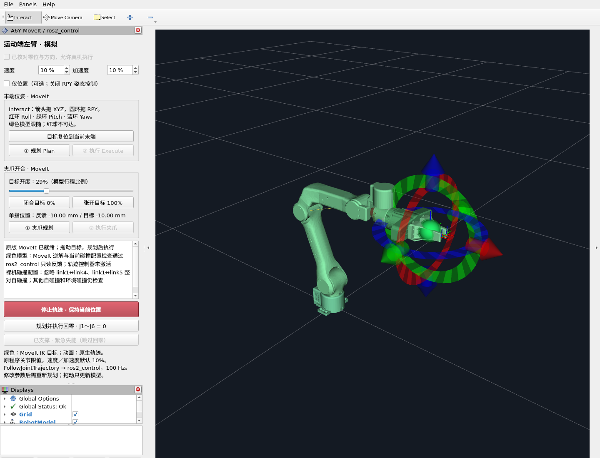
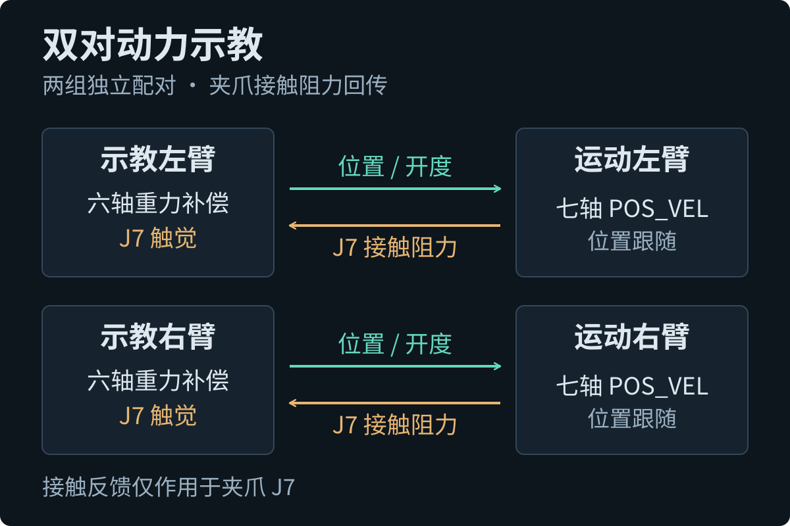
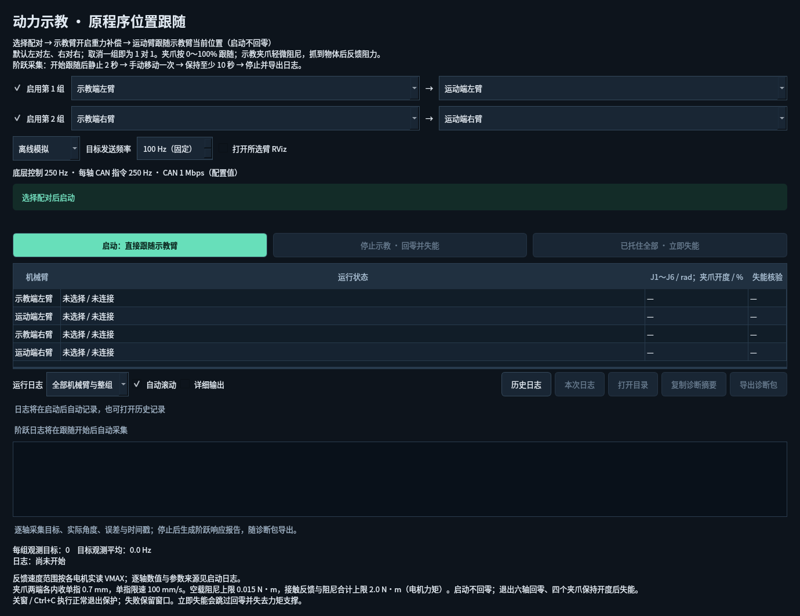

# SENSIA · A6Y Robotics

**从七电机诊断、运动规划，到四臂动力示教与 Quest 遥操作。**

基于 ROS 2 Humble 的机械臂控制工程，提供诊断、模型核对、MoveIt、重力补偿、主从示教、VR 和底层控制开发入口。各入口使用同一套机械模型，并按用途选择独立的启动、配置和验证流程。

[快速启动](#quick-start) · [七类功能](#features) · [文档导航](#docs) · [验证范围](#validation)



*仓库保留的 MoveIt / RViz 模拟截图，展示目标控制与 A5 模型。截图中的旧版文字和行程值不作为当前参数来源；各模块说明给出当前入口与配置。*

## 项目简介

当前工作模型是 **A5 CAD 模型**，保留 `A6-Y-G` 工程目录和已有 ROS 包名。每臂有 **6 个旋转关节 + 1 个夹爪电机**，共 7 个独立驱动；另一个手指通过 URDF `mimic` 联动，不是第 8 台电机。四臂角色为运动端左／右臂、示教端左／右臂。

| 能力 | 可完成的工作 | 功能文档 |
| --- | --- | --- |
| 通信与标定 | 按 USB 身份认臂、查询 7 台电机、查看反馈、显式写入电机零位 | [扫描、身份与标零](A6-Y-G/tools/arm_diagnostics/README.md) |
| 模型核对 | 显示电机角度、模型角度和夹爪位移，在 RViz 中检查方向与姿态 | [反馈与模型](A6-Y-G/tools/arm_visualization/README.md) |
| MoveIt 控制 | XYZ / RPY 目标预览、轨迹规划与执行、夹爪控制、实时曲线与日志 | [规划与执行](A6-Y-G/tools/arm_moveit/README.md) |
| 重力补偿 | 单臂或多臂 MIT 重力补偿、在线调参、按臂保存参数 | [重力与调参](A6-Y-G/tools/arm_gravity/README.md) |
| 动力示教 | 1 对 1 / 2 对 2 主从跟随、交叉配对、夹爪跟随与接触反馈、频率与阶跃响应记录 | [配对与运行](A6-Y-G/docs/how-to/run-power-teaching.md) |
| VR 遥操作 | Quest 右手柄驱动虚拟模型，或使用独立的位置／阻抗实机入口 | [VR 全部入口](A6-Y-G/docs/VR遥操作/README.md) |
| 底层开发 | 关节与笛卡尔阻抗控制器、电机参数工具、单关节测试和离线回归 | [控制器](A6-Y-G/src/a6_y_controllers/README.md) · [开发与测试](A6-Y-G/docs/how-to/develop-and-test.md) |

完整的功能、源码、配置与测试对应关系见[功能覆盖索引](A6-Y-G/docs/reference/feature-coverage.md)。

<a id="quick-start"></a>

## 快速启动：先完成离线检查

软件基线为 **Ubuntu 22.04 · ROS 2 Humble · 系统 Python 3.10**，桌面工具使用 PyQt5；动力学、重力补偿和示教需要 **Pinocchio ≥ 4.0**。按[首次离线运行教程](A6-Y-G/docs/tutorials/first-offline-run.md)准备依赖。下面的命令从仓库根目录执行，不连接实体串口：

```bash
git clone https://github.com/SENSIA814/Sensia_Robotics_Arm_A6Y.git
cd Sensia_Robotics_Arm_A6Y

# 核对四臂身份配置，不打开串口
bash A6-Y-G/scripts/run_arm_scan.bash --cli --arms all --dry-run

# 检查电机到模型的坐标换算
bash A6-Y-G/scripts/run_arm_rviz.bash --cli --arm motion_left --dry-run

# 核对示教模型、端点和运行参数；首次会构建所需包
bash A6-Y-G/scripts/run_arm_teaching.bash --check
```

桌面入口默认打开选择界面；选择设备、连接设备、使能控制是不同步骤。各模块的实际默认模式见下文。仓库中的 USB 身份和夹爪端点对应当前这套设备，同一机械臂仅更换 USB-CAN 时，按[身份与配置迁移指南](A6-Y-G/docs/how-to/replace-usb-can-adapter.md)更新绑定；更换机械臂需重新核对模型和标定。

<a id="features"></a>

## 七类功能与启动入口

以下桌面命令均从**仓库根目录**执行。一个串口同一时间只交给一个控制入口；切换工具前先完成原入口的停止和释放流程。

### 1. 通信与标定

按 USB 序列号绑定四种角色，扫描 J1～J7，查看位置、状态、温度和原始反馈报文；报告保留速度、力矩原始计数。提供桌面、CLI 和可选 Web 界面。扫描默认只读；标零是单独的显式写入操作，执行前会核对角色与电机状态，结果写入本地记录。

```bash
bash A6-Y-G/scripts/run_arm_scan.bash
```

使用方式、状态含义和标零流程见[诊断 README](A6-Y-G/tools/arm_diagnostics/README.md)；换板认臂见[USB-CAN 迁移](A6-Y-G/docs/how-to/replace-usb-can-adapter.md)。

### 2. 模型核对

只读采集电机反馈，同时显示电机角度、模型关节角、夹爪单指位移，并发布 RViz 所需的关节状态。可用于检查模型方向、零偏及实际姿态；反馈过期时保留最后有效姿态并标记状态，不继续显示为新鲜反馈。

```bash
bash A6-Y-G/scripts/run_arm_rviz.bash
```

电机与模型坐标、刷新方式、夹爪 `mimic` 及只读边界见[模型 README](A6-Y-G/tools/arm_visualization/README.md)。

### 3. MoveIt 控制

提供 XYZ / RPY 末端目标、关节目标与夹爪控制；目标预览、轨迹规划和执行分开操作。支持模拟或选定实机，带 RViz、实时曲线和运行日志。启动界面默认使用模拟模式，实机连接与接管需按模块流程完成。

```bash
bash A6-Y-G/scripts/run_arm_moveit.bash
```

MoveIt 使用独立构建栈，其中的 `a6_y_ros2_control` 与主工程同名但实现不同。使用专用启动器，构建、规划、执行与退出方式见[MoveIt README](A6-Y-G/tools/arm_moveit/README.md)。

### 4. 重力补偿

支持单臂或多臂 J1～J6 MIT 重力补偿，在线调节重力比例、阻尼、摩擦等参数，并按四臂角色分别保存。窗口提供反馈、参数、日志和停止操作。**独立重力入口的 J7 只读**，不会接入示教夹爪阻力；独立控制频率默认 125 Hz。

```bash
bash A6-Y-G/scripts/run_arm_gravity.bash
```

模型准备、单臂／多臂启动、参数生效与保存、回零及失能流程见[重力补偿 README](A6-Y-G/tools/arm_gravity/README.md)。

<a id="teaching"></a>

### 5. 动力示教与夹爪反馈

支持 1 对 1、2 对 2 以及交叉配对。默认示教左 → 运动左、示教右 → 运动右。示教六轴提供 MIT 重力补偿，运动七电机以 `POS_VEL` 跟随；六轴跟随绝对关节角，夹爪按各自可用行程的 **0～100%** 映射，每端保留按模型单指换算的 **0.7 mm** 余量。

```bash
# 打开界面，默认选择离线模拟
bash A6-Y-G/scripts/run_arm_teaching.bash
```



空载示教夹爪采用零刚度和轻微速度阻尼；运动夹爪接触后捕获保持位置，继续捏合示教夹爪产生反馈阻力，张开则释放。当前示教 J7 **总力矩上限为 2 N·m**，包含阻尼与接触反馈，并非持续输出值，也不是指尖夹持力。

启动不回零：接管当前姿态后平滑进入跟随。正常退出时六轴回零、夹爪保持当时开度，随后全部失能；立即失能跳过回零并释放力矩支撑与夹持力。提供控制频率、目标与反馈曲线、阶跃响应、接触状态和诊断导出。



*2026-11-27 从当前示教界面源码离屏截取，处于离线空闲状态，未连接硬件、未填充演示反馈。*

操作见[示教指南](A6-Y-G/docs/how-to/run-power-teaching.md)，跟随与阻力记录见[日志指南](A6-Y-G/docs/how-to/inspect-teaching-logs.md)，机制与参数见[原理说明](A6-Y-G/docs/explanation/power-teaching-and-gripper-feedback.md)和[运行配置](A6-Y-G/docs/reference/runtime-and-configuration.md)。

### 6. VR 遥操作

Quest 右手柄经 HTTPS / WebXR 网关输入位姿和按键。支持虚拟模型、原生位置实机、关节阻抗实机三条路线；可录制回放输入，使用 mock 验证状态切换。按 [VR README](A6-Y-G/docs/VR遥操作/README.md)完成主工程构建后，先打开虚拟模型，再启动网关：

```bash
bash A6-Y-G/scripts/run_vr_rviz.bash
```

实机入口 `run_vr_position.bash` 和 `run_vr_real.bash` 默认 **readonly**；完整位置试运行入口 `run_vr_position_full.bash` 从 **DISABLED** 开始，需要本地 PREPARE、ARM。实机按稳定串口路径选一条臂，未接入四臂角色选择；完整位置试运行支持旋转和夹爪，其参数独立于动力示教。

网关依赖与证书、三个终端的实机接管、按键、失联、录制回放和配置区别见[VR README](A6-Y-G/docs/VR遥操作/README.md)。

### 7. 底层开发与验证

主工程提供串口 CAN 驱动、电机寄存器／ID 工具、重力及关节／笛卡尔阻抗控制器、VR 控制器、位置与力矩单关节实验脚本，以及 Python、CTest、PTY 虚拟电机和离线集成验证。

开发先按[开发与测试指南](A6-Y-G/docs/how-to/develop-and-test.md)选择主工程或 MoveIt 构建；控制器、接口和当前默认参数见[控制器 README](A6-Y-G/src/a6_y_controllers/README.md)。实验脚本可能接管整条臂以保持其他关节，不能仅根据“单关节”名称判断使能范围。电机写参数、标零与 Flash 保存均属于显式硬件操作。

<a id="docs"></a>

## 按任务查文档

| 需求 | 文档 |
| --- | --- |
| 安装环境，完成第一个离线流程 | **教程** · [首次离线运行](A6-Y-G/docs/tutorials/first-offline-run.md) |
| 查全部功能、源码、启动和配置位置 | **参数参考** · [功能覆盖索引](A6-Y-G/docs/reference/feature-coverage.md) |
| 使用七类功能的具体入口 | **模块指南** · [完整文档索引](A6-Y-G/docs/README.md) |
| 连接四臂，启动或停止示教 | **操作指南** · [运行动力示教](A6-Y-G/docs/how-to/run-power-teaching.md) |
| 检查跟随滞后、接触触发和日志 | **操作指南** · [检查示教日志](A6-Y-G/docs/how-to/inspect-teaching-logs.md) |
| 更换 USB-CAN，迁移角色绑定 | **操作指南** · [更换适配器](A6-Y-G/docs/how-to/replace-usb-can-adapter.md) |
| 构建、修改控制器、运行模块测试 | **操作指南** · [开发与测试](A6-Y-G/docs/how-to/develop-and-test.md) · [示教回归](A6-Y-G/docs/how-to/run-offline-tests.md) |
| 理解百分比映射、接触保持和阻力回传 | **原理说明** · [动力示教与夹爪反馈](A6-Y-G/docs/explanation/power-teaching-and-gripper-feedback.md) |

<a id="validation"></a>

## 验证范围

动力示教发布检查已通过 **201 项 Python 单元测试、12 项 CTest 检查和 7 组离线集成验证**，覆盖跟随、夹爪接触、故障与退出等场景；复现入口见[示教离线测试](A6-Y-G/docs/how-to/run-offline-tests.md)。这些数量对应示教及相关诊断检查，不代表所有独立入口均完成实机验收。其他模块的离线命令与测试范围见各模块 README 和[开发指南](A6-Y-G/docs/how-to/develop-and-test.md)。

现场操作者已确认当前示教设备完成试用。文档发布与源码核对不驱动实体机械臂。使用时需区分这些边界：

- **示教 100 Hz 目标发送、250 Hz 底层控制是配置频率**，不能直接换算成端到端机械时延；独立入口各有自己的控制频率。
- 夹爪接触由电机力矩与运动状态估计，未标定为指尖力。当前采用位置保持，不提供恒力夹持或六轴力反馈。
- 张开优先撤销夹爪阻力，开向微动可能使手感间歇变化；软物体、摩擦及不同机构需要分别验证。
- VR 完整位置入口属于现场试运行配置，未启用 CAD 几何检查；具体权限、限制和验收状态以 VR 文档及配置为准。
- 历史调参、截图与实验记录描述当时版本；当前默认值以对应源码和配置为准。原始运行日志和本地参数恢复记录不随文档发布上传。

## 项目结构

```text
Sensia_Robotics_Arm_A6Y/
├── A6-Y-G/
│   ├── src/          # A5 模型、驱动、控制器、示教与 VR 节点
│   ├── tools/        # 诊断、只读模型、MoveIt、重力与示教桌面工具
│   ├── scripts/      # 环境隔离、构建、启动与测试入口
│   ├── docs/         # 教程、操作指南、参数参考与原理说明
│   └── vr_gateway/   # Quest WebXR 网关
├── diagnostics/      # 角色绑定与已有参考资料；运行日志在本地生成
└── assets/readme/    # 可编辑的 README 技术图
```

保留 `A6-Y-G/` 与 `diagnostics/` 相邻。包边界及启动器列表见[工程说明](A6-Y-G/README.md)。

## 来源与许可

工程保留 A6-Y-G 源码与 A5 模型，并包含提供给本项目的 MoveIt 移植代码；对应[上游文件清单](A6-Y-G/tools/arm_moveit/ros2_stack/upstream_manifest.json)和[适配差异](A6-Y-G/tools/arm_moveit/ros2_stack/upstream_changes.patch)可供查阅。

各 ROS 包保留作者与许可证声明。仓库目前没有统一的根目录 `LICENSE`；使用和分发前请查阅具体组件的许可。
